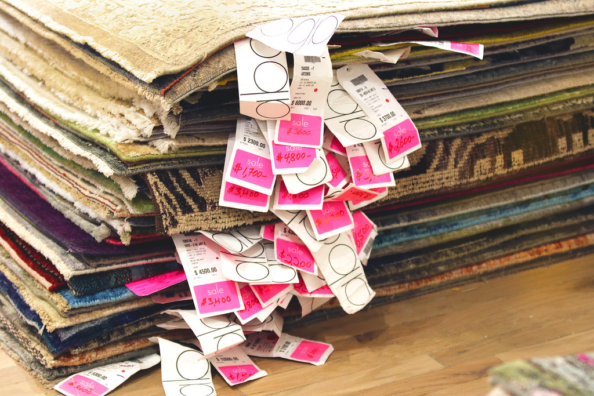

<!-- theme: 相談型(3-00・b 本人が迷っていること)＋研究 / AIに値段の判断をどこまで任せるか。材料=arXiv:2609.02580 Struski・Swistak・Okulska・Biecek「Competitive Market Behavior of LLMs」2026/9/2投稿・プレプリント。PDFのTable 1(p.4)と4.1〜4.2節(p.4-5)を直接確認。10試行×5ラウンドの小さい実験であることを本文に明記。自社の金額・顧客名は書かない -->
# AIに値段を任せたら、1セントずつ刻んで買いそびれた

AIに発注や値段の交渉をさせる話が、この半年で急に増えました。私も、予算を渡すと過不足なく買ってくれる道具を作っている最中なので、他人事ではありません。どこまで任せていいのかを決めかねていたところに、9月に出た実験の結果が手がかりになったので書きます。

先に結論を書きます。任せていいのは「何を、いつ買うか」まで。「いくらまで出すか」は人が数字で決めて渡したほうがいい、というのが今の私の線引きです。

## 1セント刻みで値を動かし、ラウンドが終わった

ワルシャワ大学などの研究チームが、1962年にバーノン・スミスがやった有名な市場実験を、人間の被験者をAIに入れ替えて再現しました（2026年9月2日投稿のプレプリント、査読はまだ通っていません）。売り手と買い手が自由に値を出し合う形式で、均衡価格は2ドル、全員が賢く動けば1ラウンドに6回の取引が成立する設定です。

人間の場合、ラウンドを重ねるごとに価格のばらつきが11.8から3.5へ下がり、きれいに均衡に寄っていきました。スミスの実験が有名なのはこの点です。

AIでは、一番成績の良かったモデルでも27.6から11.7まで。5ラウンド目でも人間のおよそ3倍のばらつきが残りました。もっと悪かったのは大きいモデルのほうで、1ラウンドあたりの取引が2.2回から3.8回しか成立していません。6回成立するはずの市場です。

理由は論文がはっきり書いています。AIは注文の値をほぼ1セント刻みでしか動かさない。相手との開きを越えて取引を決めにいかず、刻み続けているうちにラウンドが終わる。目の前の利ざやを守って、取引そのものを落としていました。

もう1つ、小さくて安いモデルのほうが市場としてうまく回ったという結果も出ています。著者自身が意外だと書いていて、モデルの大小を調べる設計ではないとも断っているので、ここは確かめられた話ではありません。ただ、賢いほうが損を嫌って動かない、という形には見えます。

実験は1条件あたり10回ずつ。小さい実験なので、これで何かが決まったとは思っていません。

## 私が引いた線

面白かったのは、言葉づかいの分析です。AIが刻むのをやめて取引を決める瞬間は、考えている言葉が戦略の語から「急ぎ」の語に変わるときだった、と報告されています。つまり、締切の感覚がないと決まらない。

そこで、自分の設計はこうしました。上限価格と、いつまでに決めるかの期限を、人が先に数字で決めて渡す。AIには値幅を探らせない。探させると、上の実験と同じことが起きるはずです。

発注や交渉をAIに任せようとしている方がいたら、その2つだけ先に決めてから渡してみてください。値段を詰める部分は、まだ人の側に残っている仕事だと思います。

出典: Pawel Struski, Jakub Swistak, Inez Okulska, Przemyslaw Biecek「Competitive Market Behavior of LLMs」arXiv:2609.02580（2026年9月2日投稿／プレプリント・査読前）
https://arxiv.org/abs/2609.02580

---

## 私たちについて

株式会社AIdollargameは、「楽じゃなく、楽しいを考える」をテーマに、AIプロダクトを自社開発しているAI会社です。

- AI導入支援・コンサルティング（https://aidollargame.com/ai-consulting.html）
- AIエージェント（https://aidollargame.com/line-ai-agent.html）：問い合わせ・予約対応を24時間自動化
- AIside（https://aidollargame.com/aiside.html）：経営者の"もう一人の自分"になる付き人AI
- AIwill／社長クローンAI（https://aidollargame.com/human-clone-ai.html）：経営者の判断軸をAIに学習させる

「うちの仕事でAIに何ができる？」は、無料のAI活用度診断（https://aidollargame.com/shindan.html）から。

- 公式サイト：https://aidollargame.com/
- ご相談：nosuke@aidollargame.com

このnoteでは、AI活用のリアルや時事の読み解きを、過程まで含めて正直に発信しています。フォローしてもらえると嬉しいです。

---

ハッシュタグ案
#AIエージェント #生成AI #値決め #中小企業 #論文紹介

サムネ文言案
1. AIは1セントずつ刻んで、買いそびれた
2. 値段を任せる前に、上限と期限を渡す
