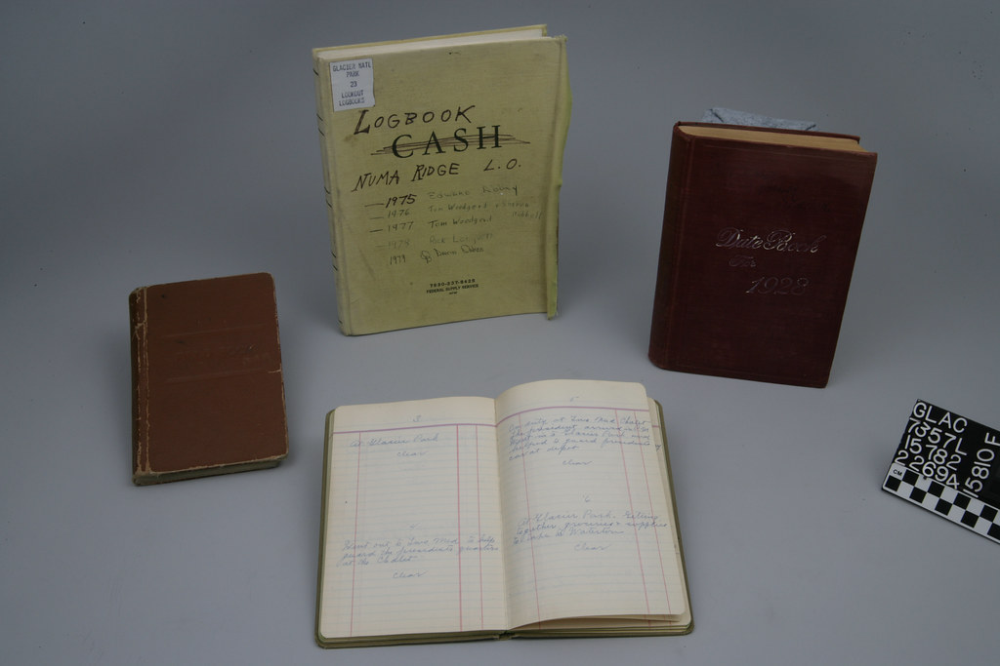

<!-- theme: 相談型（3-00・本人が今まさに決めかねていること） / 余り1 -->

# 「3回当たったら法則」とAIに覚えさせたら、4回目で外した

毎朝、うちのAIが前日の動きをまとめたメールを送ってくる。今日の予定、入金の期日、返事待ちの案件。自分で仕込んだ仕組みなので、中身は毎日読んでいます。

10月8日、そのメールに新しいルールが1行、書き足されていました。「対面の打ち合わせの成果は、翌日に送受信したメールに現れる」。10月2日と10月6日の打ち合わせで実際にそうなっていたので、法則として覚えたようです。

10月10日のメールに、訂正が出ていました。10月8日の打ち合わせについて、2日たってもメールにもカレンダーにも何も出ていない。3回続いたから法則だと思ったが、4回目で外れた、と自分で書いていました。

## 覚えさせるのは法則ではなく、空白の書き方

AIに「3回続いたことは法則にしていい」と覚えさせない。覚えさせるのは、わからないところをわからないまま出す書き方のほうです。

理由は1つです。AIは空白を埋めるのが自分の仕事だと思っている。法則を1つ持たせると、次からは目の前の記録よりその法則を先に使って空白を埋めます。「記録がない」が「たぶんこうなっているはず」に置き換わる。置き換わったあとの文は、確かめた話とまったく同じ書き方で出てくるので、読む側には区別がつきません。

今回気づけたのは、AIが自分で「読みは3つ考えられますが、どれも推測です」と書いていたからです。先方から動く話だった、その場で終わった、まだ書いていない。3つ並んでいて全部に推測と付いていたので、私の側で「これは本人に聞けば済む」と判断できました。もしここが「先方待ちの案件です」の1行になっていたら、そのまま信じて1週間放っておいたと思います。

## 今日やれること

AIに文書を書かせているなら、指示に1行足してください。「確かめた事実と、そこからの推測は別の行に分けて書く。推測の行には推測と書く」。これだけです。

これで精度は上がりません。間違いの数も変わらない。変わるのは、間違いが見える場所に出るかどうかだけです。AIを仕事に入れるときに最初に要るのは、賢くすることではなくて、推測で埋めた行がどこなのか自分に分かるようにしておくことだと思っています。

4回目で外した法則は、消して「聞く案件」に戻しました。聞けば1分で終わる話に、法則はいりませんでした。AIに任せて空いた時間を、AIの推測の後始末に使うのでは本末転倒なので。

---

## 私たちについて

株式会社AIdollargameは、「楽じゃなく、楽しいを考える」をテーマに、AIプロダクトを自社開発しているAI会社です。

AI導入支援・コンサルティング
https://aidollargame.com/ai-consulting.html?utm_source=note&utm_medium=referral&utm_campaign=2026-10-10

AIチャットエージェント：問い合わせ・予約対応を24時間自動化
https://aidollargame.com/line-ai-agent.html?utm_source=note&utm_medium=referral&utm_campaign=2026-10-10

AIside：経営者の「もう一人の自分」になる付き人AI
https://aidollargame.com/aiside.html?utm_source=note&utm_medium=referral&utm_campaign=2026-10-10

AIwill／社長クローンAI：経営者の判断軸をAIに学習させる
https://aidollargame.com/human-clone-ai.html?utm_source=note&utm_medium=referral&utm_campaign=2026-10-10

「うちの仕事でAIに何ができる？」は、無料のAI活用度診断から。
https://aidollargame.com/shindan.html?utm_source=note&utm_medium=referral&utm_campaign=2026-10-10

公式サイト
https://aidollargame.com/?utm_source=note&utm_medium=referral&utm_campaign=2026-10-10

ご相談：nosuke@aidollargame.com

このnoteでは、AI活用のリアルや時事の読み解きを、過程まで含めて正直に発信しています。フォローしてもらえると嬉しいです。

---

ハッシュタグ案

#AI活用 #AIエージェント #中小企業の経営 #生成AI #AIdollargame

サムネ文言案

1. 3回当たった法則が、4回目で外れた
2. AIの推測に「推測」と書かせる
