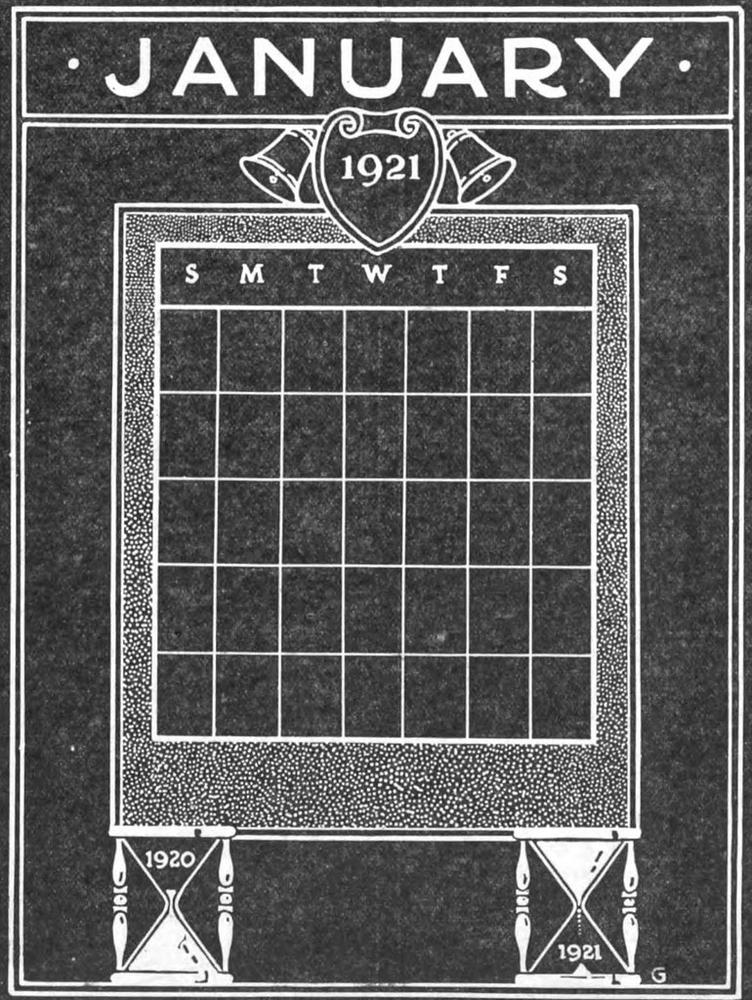

<!-- theme: 相談型（3-00・本人が今まさに決めかねていること） / 余り2 -->

# 20日のうち9日、納めたAIは一度も使われなかった

お客様に毎月お出しする報告書の形を、今まさに決めかねています。次の打ち合わせで持っていきますと自分で言ってしまったので、中身を考えているところです。

手始めに、うちが納めてある検索の道具のログを20日分、数えました。9月20日から10月9日まで。現場の担当者が検索した回数です。

全部で84件でした。20日で割ると1日4.2件。ここまでは、報告書にそのまま書けそうな数字に見えます。

日ごとに並べたら、形が違っていました。検索が1件も無かった日が9日あります。20日のうち、ほぼ半分です。いちばん多い日は20件で、次が13件、その次も13件。この3日だけで46件、84件の55%を占めていました。

## 平均にすると、使われ方の形が消える

報告書の主役を回数にしません。書くのは、使われた日に何が前に進んだかのほうです。

理由は1つです。この道具は毎日少しずつ使う物ではなく、案件が1件立った日に集中して使う物だからです。20件入った日のログを開くと、短い時間のうちに同じ地域の候補を1つずつ名前で引いていました。条件を変えながら、数時間。これは「よく使われた」ではなく「1件を最後まで追った」記録です。

0件の9日も、その日に追う案件が無かっただけで、道具が止まっていたわけではありません。ログ自体は毎日生きていて、障害を示す記録はどの日にもありませんでした。

ここを平均4.2件にまとめると、どちらの日も説明できなくなります。お客様に「思ったより使っていないね」と受け取られるか、こちらが「毎日使われています」と言い張るか、どちらかになる。両方とも、起きたことと違います。

## 今日やれること

AIでも何でも、入れた道具の成果を誰かに報告する立場なら、報告書の1行目を回数にしないでください。代わりに、使われた日に前へ進んだ仕事を1件だけ書く。

物足りなく見えると思います。私も、横に回数を足したくなりました。ただ回数は、使う側の仕事の形を映しません。毎日発生する仕事なら毎日の件数に意味があるし、案件ごとに立つ仕事なら1件にかけた時間に意味がある。先に決めるのはそちらで、数字はあとです。

自分の報告書も、この形で書いてみます。0件の9日を隠さずに出して、何と言われるかを見てから次を決めます。使われない日があることより、使われない日を説明できないことのほうが、たぶん困ります。

---

## 私たちについて

株式会社AIdollargameは、「楽じゃなく、楽しいを考える」をテーマに、AIプロダクトを自社開発しているAI会社です。

AI導入支援・コンサルティング
https://aidollargame.com/ai-consulting.html?utm_source=note&utm_medium=referral&utm_campaign=2026-10-11

AIチャットエージェント：問い合わせ・予約対応を24時間自動化
https://aidollargame.com/line-ai-agent.html?utm_source=note&utm_medium=referral&utm_campaign=2026-10-11

AIside：経営者の「もう一人の自分」になる付き人AI
https://aidollargame.com/aiside.html?utm_source=note&utm_medium=referral&utm_campaign=2026-10-11

AIwill／社長クローンAI：経営者の判断軸をAIに学習させる
https://aidollargame.com/human-clone-ai.html?utm_source=note&utm_medium=referral&utm_campaign=2026-10-11

「うちの仕事でAIに何ができる？」は、無料のAI活用度診断から。
https://aidollargame.com/shindan.html?utm_source=note&utm_medium=referral&utm_campaign=2026-10-11

公式サイト
https://aidollargame.com/?utm_source=note&utm_medium=referral&utm_campaign=2026-10-11

ご相談：nosuke@aidollargame.com

このnoteでは、AI活用のリアルや時事の読み解きを、過程まで含めて正直に発信しています。フォローしてもらえると嬉しいです。

---

ハッシュタグ案

#AI導入 #中小企業 #KPI #業務改善 #ログ分析

サムネ文言案

案1: 20日のうち9日、使われなかった
案2: 平均4.2件が隠したもの
