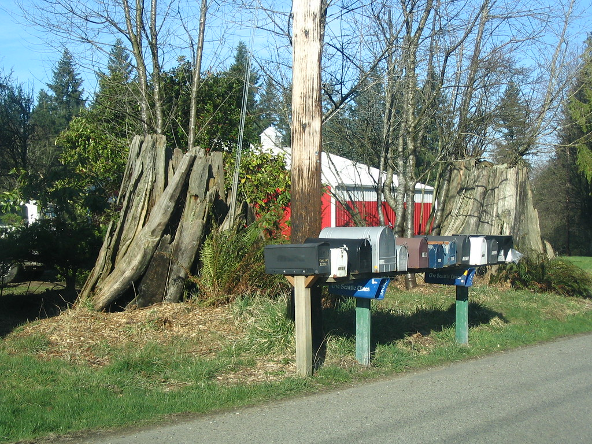

<!-- theme: 相談型（3-00・b 本人が今まさに決めていること）／79番の診断の道具で「直す範囲」を決めた話。材料=monomi-whitehat 2/完成の条件.md(10/14決定・10/15追記)。裏取り=RFC 7489 6.3節のp=タグの定義、Google Workspace管理者ヘルプ「推奨されるDMARCの展開」(none→quarantine→rejectを段階で・rejectは受信側で拒否され届かない)を本文で確認 / 余り0 -->

# メールのなりすまし対策を、いきなり一番強くしない。届かなくなるのは自社の請求書

会社のメールのなりすまし対策を、診断で「弱い」と言われた方に向けて書きます。私たちは今、会社のドメインの弱点を外から調べて、直し方まで出す道具を作っています。その中で、直し方をどこまで機械に任せるかを決めました。

結論を先に書きます。なりすまし対策の設定は、一番強い段に一気に上げません。1回に1段ずつしか上げません。

## 一番強い段は、自分のメールも消す

なりすまし対策の設定（DMARC）には、強さが3段あります。何もしない（none）、怪しいメールを迷惑メール箱へ回す（quarantine）、受け取りを断る（reject）。

診断で弱いと言われると、一番強い段にしたくなります。ただ、一番強い段で断られるのは、偽のメールだけではありません。自社から出しているのに、設定が漏れていて認証に通らないメールも断られます。

Googleの管理者向けの案内も、一番強い段では、認証に通らないメールは受け取る側のサーバーで拒否されて届かない、と書いています。迷惑メール箱にも残りません。

困るのは、会社のメールは人が書くものだけではないことです。請求書の自動送信、予約の確認、問い合わせへの自動返信。別々のサービスが会社の名前で送っていて、その全部を把握している人はあまりいません。外から調べる道具にも、ここは見えません。だから私たちの道具は、段を飛ばして上げる直し方を出さない作りにしました。

## 今日やれること

会社のドメイン名でメールを出しているサービスを、紙に書き出してください。社員のメールのほかに、請求書・予約・通販の注文確認・メルマガ・問い合わせフォームの自動返信。

書けたものが、なりすまし対策を上げる前に設定を確かめる相手です。書き漏らしたサービスのメールが、一番強い段で最初に消えます。

安全にするための設定で、取引先に請求書が届かなくなったら本末転倒です。直す前に、直すと何が止まるかを先に知っておく。その順番だけは、私たちの道具でも変えないことにしました。

出典
- RFC 7489（DMARCの仕様、2015年）6.3節 p=タグの定義
https://www.rfc-editor.org/rfc/rfc7489.html
- Google Workspace 管理者ヘルプ「推奨されるDMARCの展開」（公式の案内）
https://support.google.com/a/answer/10032473

---

## 私たちについて

株式会社AIdollargameは、「楽じゃなく、楽しいを考える」をテーマに、AIプロダクトを自社開発しているAI会社です。

AI導入支援・コンサルティング
https://aidollargame.com/ai-consulting.html?utm_source=note&utm_medium=referral&utm_campaign=2026-10-15

AIチャットエージェント：問い合わせ・予約対応を24時間自動化
https://aidollargame.com/line-ai-agent.html?utm_source=note&utm_medium=referral&utm_campaign=2026-10-15

AIside：経営者の「もう一人の自分」になる付き人AI
https://aidollargame.com/aiside.html?utm_source=note&utm_medium=referral&utm_campaign=2026-10-15

AIwill／社長クローンAI：経営者の判断軸をAIに学習させる
https://aidollargame.com/human-clone-ai.html?utm_source=note&utm_medium=referral&utm_campaign=2026-10-15

「うちの仕事でAIに何ができる？」は、無料のAI活用度診断から。
https://aidollargame.com/shindan.html?utm_source=note&utm_medium=referral&utm_campaign=2026-10-15

公式サイト
https://aidollargame.com/?utm_source=note&utm_medium=referral&utm_campaign=2026-10-15

ご相談：nosuke@aidollargame.com

このnoteでは、AI活用のリアルや時事の読み解きを、過程まで含めて正直に発信しています。フォローしてもらえると嬉しいです。

---

ハッシュタグ案

#情報セキュリティ #中小企業 #DMARC #なりすましメール #メール設定

サムネ文言案

案1: 一番強い設定で、最初に消えるのは自社の請求書
案2: なりすまし対策は1段ずつ上げる
