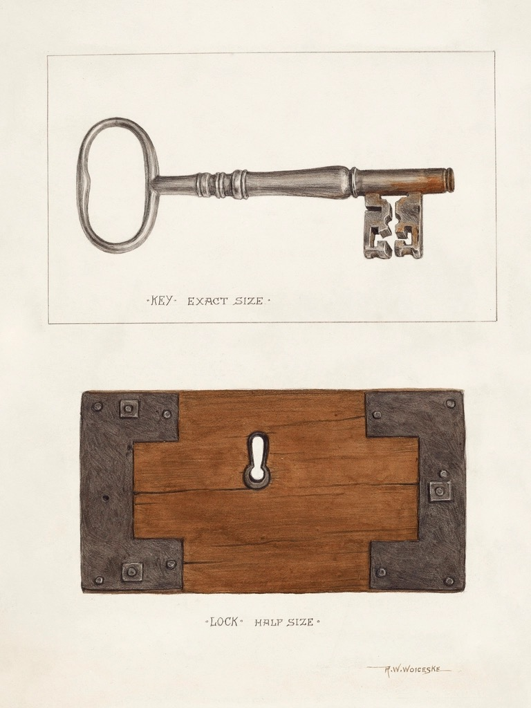

<!-- theme: ニュース型 / IPA サイバーセキュリティ相談窓口 2026年第3四半期（OAuth同意の悪用事例） / 余り0 -->

# パスワードを知られなくても、社員のメールは送られる。IPAの企業向け相談309件に載った「アクセスを許可」の事例

社員にMicrosoftやGoogleのアカウントを持たせている会社の方に向けて書きます。
IPA（情報処理推進機構）が10月23日、企業から受けたセキュリティ相談の3か月分の統計と、相談事例を1件公表しました。
その事例は、パスワードを盗まれたという話ではありませんでした。社員がどこかで押した「許可」ボタンが疑われています。
AIの道具をメールやカレンダーにつなぐ会社が増えているので、私たち自身も押す機会が多い画面です。読み終わるころに、自社で今日確かめる場所が2か所分かるように書きました。

---

## 企業からの相談は1年で約1.9倍。事例は「社員1人のアカウントから大量送信」

IPAは2025年4月から、企業や組織からの相談を「サイバーセキュリティ相談窓口」で受けています。今回の報告は2026年7月1日から9月30日までの分です。

数字を先に並べます。

- 企業からの相談は309件。前の3か月（302件）から約2.3%増
- 1年前の同じ3か月は162件。そこから約1.9倍
- 内訳は、被害が起きた後の相談（インシデント対応）56件、平時の対策41件、サポート詐欺70件、その他142件
- 「その他」のうち29件は、社長などの名前をかたる詐欺メールの相談

サポート詐欺は、1年前の20件から70件へ3.5倍になっています。パソコンに偽の警告を出して電話をかけさせる手口です。

1つ断っておきます。IPAの本文には「インシデント対応相談65件」とありますが、同じページのグラフと内訳を足すと56件で、65件は前の3か月のグラフの値と同じです。ここではグラフと内訳の56件を採りました。内訳は、不正アクセス17件、マルウェア感染6件、ランサムウェア感染5件、ビジネスメール詐欺3件、サイト改ざん3件、なりすましメール送信2件、その他20件です。

そして相談事例です。要約するとこうなります。

- ある会社で、社員1名のMicrosoftアカウントから大量のメールが送られていた
- 調べると、そのアカウントは「アプリA」という外部のアプリに、OAuthという仕組みで許可を与えていた
- この許可を使って、第三者にメールを送られた可能性が高い
- どこから入られたのか、情報が漏れたのかを調べたいが、どこを見ればいいか分からない

## 「許可」ボタンで何が渡るのか

OAuth（オーオース）は、普段の仕事でかなり使われている仕組みです。
例えば、日程調整のアプリや議事録のAIを使い始めるとき、「このアプリにメールの読み取りを許可しますか」という画面が出ます。そこで「承諾」を押すと、アプリはあなたのパスワードを知らないまま、許可された範囲のメールやファイルを扱えるようになります。

便利な仕組みですが、IPAが今回取り上げたのはその逆の使われ方です。
偽のアプリを用意した犯人が、利用者に許可を出させる。表示される同意画面自体は、Microsoftの本物の画面です。押した時点で、メールやファイルを読む権限、メールを送る権限が犯人のアプリに渡ります。IPAはこれを「OAuth同意攻撃」と呼んでいます。

ここで知っておきたいのが、Microsoftの初期設定です。
Microsoftの説明書きには、既定ではすべての利用者が、管理者の同意を必要としない範囲の許可を自分で出せると書かれています。例として挙がっているのが「アプリに自分のメールボックスへのアクセスを許可すること」です。つまり何も設定していない会社では、社員1人の判断で、その社員のメールをアプリに渡せます。

パスワードを変えても、出した許可は残ります。ここが通常のパスワード漏れと違うところで、IPAの事例の会社が「どこを見ればいいか」から相談しているのも、この点が理由だと私は受け取りました。

## IPAが示した調べ方と、設定の見直し方

IPAの回答は、調べる場所を具体的に挙げています。Microsoft 365を使っている会社向けの内容です。

調べるもの:

- そのアプリが、会社として正式に採用したものかどうか。違うなら、なぜその社員の許可があったのか
- Microsoft Entra ID（アカウントの管理画面）の監査ログとサインインログで、アプリのID・発行元、与えた権限、許可した日時、サインイン元のIPアドレス
- 許可を出した時点と、怪しい動きが始まった時点の前後関係
- メールの記録（監査ログ・メッセージの追跡・転送設定・受信トレイのルール）で、送信に使われただけか、受信メールまで大量に取られたか

最後の点が、情報漏えいとして扱うかどうかの分かれ目になります。送られただけなら取引先へのお詫びと注意喚起で済む場面もありますが、受信メールを取られていれば、取引先の情報が外に出た前提で動くことになります。

設定の見直しとして、IPAは次を挙げています。

- 社員が任意のアプリに許可を出せる状態なら、確認済みの発行元のアプリだけに絞る
- 社員が出せる権限の種類を限定する
- 管理者が確認してから許可する運用にする

社員一人ひとりには、同意画面で3つを見るよう求めています。アプリ名、アプリの発行者、求められている権限の中身です。Microsoftが発行者を確認済みのアプリには、発行者名の横に青い確認済みの印が付きます。「未確認」と出たら管理者に確かめ、判断できなければ許可しない、というのがIPAの案内です。

Microsoft以外でも同じ危険はあるとIPAは書いており、Google Workspaceについては、Googleアカウントで連携しているアプリを確認・削除する手順の案内を参照先に挙げています。

## まだ分からないこと

この報告から分からないことも書いておきます。

- 事例の会社で、社員がどんな経路で偽のアプリに許可を出したのかは書かれていません。「侵入経路を調査中」の段階の相談です
- 309件のうち、OAuthの許可が絡んだ相談が何件あったかは集計されていません。今回の1件が珍しい例なのか、増えている例なのかは、この資料からは言えません
- 社員の許可を絞った場合、普段使っている便利なアプリが止まる可能性があります。どこまで絞るかは、会社ごとに使っている道具を見て決めるしかありません

私たちはAIの道具をメールやカレンダーにつなぐ仕事をしているので、この画面を社員に押してもらう立場でもあります。だからこそ、押した後の権限を会社の誰かが一覧で見られる状態にしておくことが、つなぐ前の約束だと考えています。

## 今日やれること

- Microsoft 365の管理者は、Entra管理センターの「エンタープライズ アプリケーション」→「同意とアクセス許可」→「ユーザーの同意設定」を開き、今どの設定になっているかを見る
- 同じ画面の一覧で、社員が許可を出しているアプリを確認する。会社として採用していない名前があれば、誰がいつ許可したかを見る
- Google Workspaceの会社は、まず自分のGoogleアカウントで連携しているアプリの一覧を開き、使っていないものを外す。社員にも同じ手順を一度案内する
- 社員向けには「許可の画面では、発行者と権限を見る。分からなければ押さずに聞く」の1行だけ伝える

設定を変える前に一覧を見るだけでも、会社のメールにどの道具がつながっているかが分かります。AIの道具を増やすのは、その一覧を見られるようになってからで遅くありません。

まとめ:

- IPAの企業向け相談は3か月で309件、1年前の約1.9倍。サポート詐欺は3.5倍
- 公表された事例は、社員が外部アプリに出した「許可」が悪用されたとみられるもの。パスワードを変えても許可は残る
- Microsoftの初期設定では、社員が自分のメールをアプリに渡す許可を自分で出せる
- まずは同意設定と、許可済みアプリの一覧を開いて見る

出典:

- IPA「サイバーセキュリティ相談窓口の相談状況［2026年第3四半期（7月～9月）］」（2026年10月23日／公表資料）
https://www.ipa.go.jp/security/support/reports/2026q3outline.html
- IPA「情報セキュリティ安心相談窓口の相談状況［2026年第3四半期（7月～9月）］」（2026年10月23日／公表資料・個人からの相談）
https://www.ipa.go.jp/security/anshin/reports/2026q3outline.html
- Microsoft Learn「ユーザーがアプリケーションに同意する方法を構成する」（公式ドキュメント）
https://learn.microsoft.com/ja-jp/entra/identity/enterprise-apps/configure-user-consent
- Google アカウント ヘルプ「Googleアカウントと他のデベロッパーのアプリとのリンクを管理する」（公式ヘルプ）
https://support.google.com/accounts/answer/13533235?hl=ja

---

## 私たちについて

株式会社AIdollargameは、「楽じゃなく、楽しいを考える」をテーマに、AIプロダクトを自社開発しているAI会社です。

- AI導入支援・コンサルティング（https://aidollargame.com/ai-consulting.html?utm_source=note&utm_campaign=2026-10-27）
- AIエージェント（https://aidollargame.com/line-ai-agent.html?utm_source=note&utm_campaign=2026-10-27）：問い合わせ・予約対応を24時間自動化
- AIside（https://aidollargame.com/aiside.html?utm_source=note&utm_campaign=2026-10-27）：経営者の"もう一人の自分"になる付き人AI
- AIwill／社長クローンAI（https://aidollargame.com/human-clone-ai.html?utm_source=note&utm_campaign=2026-10-27）：経営者の判断軸をAIに学習させる

「うちの仕事でAIに何ができる？」は、無料のAI活用度診断から。

https://aidollargame.com/shindan.html?utm_source=note&utm_campaign=2026-10-27

公式サイト

https://aidollargame.com/?utm_source=note&utm_campaign=2026-10-27

ご相談：info@aidollargame.com

このnoteでは、AI活用のリアルや時事の読み解きを、過程まで含めて正直に発信しています。フォローしてもらえると嬉しいです。

---

ハッシュタグ案
#情報セキュリティ #IPA #Microsoft365 #中小企業 #AI導入

サムネ文言案
1. パスワードを変えても、出した「許可」は残る
2. IPAの企業向け相談309件、1年で約1.9倍
