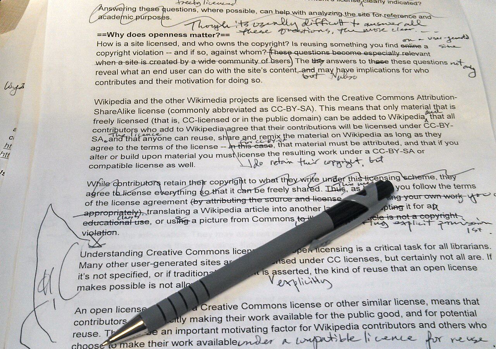

<!-- theme: 研究・実験結果レーン / NBER Working Paper 35720 (Autor, Rodchenko, Martin, Iscenko, Strand, Pearl, Ferere「Does AI Assistance Enhance or Erode Expertise?」2026年9月・10月改訂)のPDF48ページを原文で確認。米国の特許事務所11社・弁護士133人(完走91人)の3か月の無作為化比較試験。人数が少ないことは本文に明記。10/29朝のカスハラ記事、昼のD&B記事を経て差し替え / 余り2 -->

# AIで若手の書類はベテランより良くなった。AIを外して確かめると、力が伸びていたのはベテランだけだった

若手にAIを使わせている会社の経営者や、教える立場の方に向けて書きます。
AIを使うと仕事の出来は上がる。では、3か月AIを使い続けた人は、AIが無い場面でも前より仕事ができるようになっているのか。
これを実験で確かめた論文が、9月に出て10月に改訂されました。結果は、若手とベテランで逆になりました。

---

## 何を調べた実験か

論文を書いたのは、MITの経済学者デビッド・オーターと、Googleの研究者たちです。
米国の経済研究の機関（NBER）のワーキングペーパーとして出ています。査読はまだ通っていません。

対象は、米国の特許事務所11社で働く特許弁護士133人です。最後まで参加したのは91人でした。
AIの仕事の研究としては人数が少ない部類です。ここは最初に書いておきます。

やり方はこうです。

- くじで、AIの下書き支援を使える組と使えない組に、2対1の割合で分ける
- 10日後と90日後に、同じ特許の書類を書かせて比べる
- 90日後には、AIを使わずに、他人が書いた特許の書類に赤を入れる課題もやらせる

採点したのは、別の法律事務所の特許弁護士です。誰がAIを使ったかは知らされていません。
ベテランと若手の境は、特許の仕事の経験7年です。3年から11年まで線を動かしても、同じ傾向が出たと書かれています。

費用はGoogleが出していて、使ったAIもGoogleが作った特許の下書き用の道具です。

---

## AIを使っている間は、若手がいちばん伸びた

AIを使える組の書類は、使えない組より良い点が付きました。
点数のばらつきの幅を1としたとき、10日後で0.34、90日後で0.38高い結果です。

伸び方が大きかったのは若手でした。
90日後、AIを使った若手の点は0.36。AIを使っていないベテランの0.13を上回りました。

時間も短くなりました。10日後の課題で、使えない組の平均110分に対し、使える組は約10分短く終わっています。

ここまでは、これまでの研究と同じです。文章、コールセンター、プログラミングの実験でも、AIは経験の浅い人の出来を大きく引き上げてきました。

---

## AIを外すと、伸びていたのはベテランだけ

違いが出たのは、AIを使わずに赤を入れる課題です。

- 全体では、AIを使ってきた組のほうが0.32高かった
- ただし、その差はベテランだけで生まれていた（ベテランは0.45高い）
- 若手は、平均すると使っていない若手と差が無かった

若手の点は、平均が同じでも中身が割れていました。
「中の下」の点が大きく減り、その分「悪い」点と「良い」点が両方増えています。一番上の点は増えていません。
論文は、AIが一部の若手には踏み台になり、別の若手にはクッションになった、と書いています。

もう1つ気になるのは、若手自身の感じ方です。
若手は、AIのおかげで自分の仕事が良くなったと感じていました。AIを使った書類では、その通りでした。AIを外した課題では、そうなっていませんでした。

逆にベテランは、AIを使った書類の伸びは小さく、AIを外した課題で大きく伸びています。

---

## なぜ分かれたのかは、まだ分かっていない

論文は、なぜ若手の中で結果が割れたのかには答えていない、とはっきり書いています。

手がかりとして挙げているのは、時間の使い方です。
若手はAIを使って速く終えていました。ベテランはAIを使っても、ほとんど速くなっていません。
論文が引いている中国の中高生の研究では、AIで宿題の時間が減った生徒ほど、後の本番の試験の点が落ちていました。宿題の時間を減らさなかった生徒は、AIを使わない生徒と同じくらいの点でした。

それから、この実験の限りも書いておきます。

- 人数が91人と少なく、査読前の論文です
- 米国の特許の仕事だけを見ています。ほかの仕事で同じことが起きるかは分かりません
- 赤入れの課題でAIを使った疑いのある提出が、91件のうち15件ありました。除いてもベテランの差は残りましたが、全体の差は統計上はっきりしなくなります

---

## 小さな会社に写せること

人数の少ない1本の実験なので、ここから先は、論文の結果をもとにした私の考えです。

まず、AIを使った成果物だけを見て、若手の力を測らないことです。
この実験では、AIを使った若手の書類はベテランより良く見えました。それでも、AIを外すと差はありませんでした。

次に、AIを使わずにやる確認の場を、時々つくることです。
お客様の前で答える、電話で即答する、他人の書類のおかしな所に気づく。こうした場面では、AIは手元にありません。

そして、ベテランにはAIをためらわずに渡すことです。
この実験で、AIを外した課題まで伸びたのはベテランでした。論文の数字では、ベテランはAIを使ってもほとんど速くなっていません。AIを外した赤入れでも、若手と同じかそれ以上の時間をかけていました。

---

## 今日やれること

- 若手が最近AIで作った書類を1つ選び、AIを使わずに同じ書類のおかしな所に赤を入れてもらう。どこまで気づけるかを見る
- 若手には、AIの下書きをそのまま出させず、「どこを直したか」を一言添えて出してもらう
- ベテランには、AIで下書きを作ってもらい、空いた時間を若手の書類の見直しに回してもらう

まとめ:

- 米国の特許弁護士133人（完走91人）で、AIを使う組と使わない組を3か月比べた実験が出た
- AIを使っている間は、若手の書類がベテランを上回るほど良くなった
- AIを外した課題で力が伸びていたのはベテランだけ。若手は伸びた人と落ちた人に割れた
- 若手の力は、AIを使った成果物だけでは測れない。AIを外して確かめる場を時々つくる

出典:

- David Autor, Tanya Rodchenko, Josh Martin, Zanna Iscenko, Scott Strand, David Pearl, Melissa Ferere「Does AI Assistance Enhance or Erode Expertise? Evidence from a Three-Month Field Experiment in Patent Drafting」NBER Working Paper 35720（2026年9月、10月改訂／査読前のワーキングペーパー。米国の特許事務所11社・弁護士133人、完走91人。実験の費用と道具はGoogleが提供）
https://www.nber.org/papers/w35720
- 同論文の事前登録（AEA RCT Registry、AEARCTR-0015823、2025年5月21日登録）
https://www.socialscienceregistry.org/trials/15823

---

## 私たちについて

株式会社AIdollargameは、「楽じゃなく、楽しいを考える」をテーマに、AIプロダクトを自社開発しているAI会社です。

- AI導入支援・コンサルティング（https://aidollargame.com/ai-consulting.html?utm_source=note&utm_campaign=2026-10-29）
- AIエージェント（https://aidollargame.com/line-ai-agent.html?utm_source=note&utm_campaign=2026-10-29）：問い合わせ・予約対応を24時間自動化
- AIside（https://aidollargame.com/aiside.html?utm_source=note&utm_campaign=2026-10-29）：経営者の"もう一人の自分"になる付き人AI
- AIwill／社長クローンAI（https://aidollargame.com/human-clone-ai.html?utm_source=note&utm_campaign=2026-10-29）：経営者の判断軸をAIに学習させる

「うちの仕事でAIに何ができる？」は、無料のAI活用度診断から。

https://aidollargame.com/shindan.html?utm_source=note&utm_campaign=2026-10-29

公式サイト

https://aidollargame.com/?utm_source=note&utm_campaign=2026-10-29

ご相談：info@aidollargame.com

このnoteでは、AI活用のリアルや時事の読み解きを、過程まで含めて正直に発信しています。フォローしてもらえると嬉しいです。

---

ハッシュタグ案
#AI活用 #生成AI #人材育成 #中小企業 #論文紹介

サムネ文言案
1. AIを外すと、伸びていたのはベテランだけ
2. AIで若手の書類はベテランを上回った。その後

写真: Phoebe / CC BY-SA 3.0 / Wikimedia Commons「Example of copyedited manuscript」（中央部分を切り抜き）
