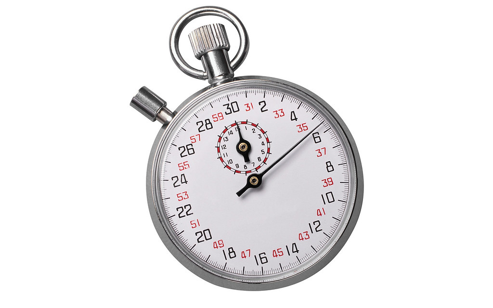

<!-- theme: 研究・実験結果レーン（3-0） -->

# AIに丸ごと任せられる仕事は、12分で終わるものだった。18,796件の作業を採点した指数が公開された

AIに仕事を渡すとき、どこまでを渡せるのか。10月22日に公開された論文が、この問いに数字を出しました。世界の職業データベースにある18,796件の作業を1件ずつ採点し、「一部なら任せられる」が作業時間の35.2%、「丸ごと任せられる」は2.5%、という結果です。中小企業がどこから渡すかを決めるときの手がかりになる数字が並んでいたので、読んで気になったところを書きます。

## 18,796件の作業に、任せられる度合いの点が付いた

調べたのはコロンビアの2大学の研究者2人です（Cristian Espinal Maya、Santiago Jiménez Londoño）。材料は米労働省のO*NETという職業データベースの30.2版で、そこに入っている18,796件の作業文が対象です。作業文というのは「給与計算の誤りを調べて訂正する」くらいの粒度で書かれた、仕事の一手ずつの記述です。

その1件ずつに、AIエージェントへの委任の度合いを4段階で付けました。

- L0: AIが関われる部分がない
- L1: 人がやり、AIが下書きや検索で横から手伝う
- L2: 目標を渡せばAIが大きな部分を最後まで実行できる。ただし人がどこかの工程をやるか、確認して直す必要がある
- L3: 人は指示して受け取るだけ。AIが最後まで終わらせる

これを433の職業グループに対応させ、146か国の就業者数で重みを付けたものが、Agent Delegability Index（委任可能性指数）です。結果は、世界の作業時間のうちL2以上が35.2%、L3だけに絞ると2.5%でした。

点を付けたのは言語モデルです。ここは割り引いて読む必要があります。ただし著者らは、300件を人に中身を知らせずに採点し直させて突き合わせており、一致の度合いはκ=0.85でした。この論文は査読前のプレプリントです（arXiv、2026年10月22日投稿）。

## 丸ごと任せられるのは「12分で終わる作業」に集まっていた

いちばん意外だったのがここです。L3が付いた作業を所要時間との関係で見ると、山ができる場所がありました。人がやると約11.8分で終わる作業です。

もっと短くても、もっと長くてもL3は減ります。短すぎる作業は、AIに渡して結果を受け取る手間のほうが大きい。長い作業は途中に判断や他人とのやりとりが挟まるので、どこかで人が要る。両側が削られて、12分あたりに最後まで任せきれる作業が残りました。

ただしこの「分」も実測ではありません。同じモデルが「この作業なら人は何分かかるか」と見積もった値です。モデルから見た作業の長さ、として読むのが正確です。

それでも、現場で使える形に直せます。「経理を任せる」「問い合わせ対応を任せる」という大きさでは、丸投げできる仕事はほとんど無い。渡せるのは、その中にある12分で片が付く一片です。

## 事務の仕事を止めているのは、AIの賢さではなかった

この論文は、作業に点を付けるのとは別に、「何が任せるのを邪魔しているか」を4種類で記録しています。体を使う必要があること（物理）、法律や資格で人が署名しなければならないこと（責任）、人と人の信頼や説得が要ること（信頼）、そして、システムやデータや場所にAIが入れないこと（到達）です。

事務系の4区分で最も多く付いたのは、すべて「到達」でした。専門職64.2%、管理職74.0%。事務の仕事の3分の2前後は、AIの頭が足りないから止まっているのではなく、見るべき画面にAIが入れないから止まっていました。請求書が共有フォルダの奥にあって開けない、販売管理の画面がブラウザから触れない、といった類です。

これは製品の性能が上がるのを待つ話ではなく、自社で片付けられる話です。どの台帳を、どのフォルダを、どのメールを読ませるか。その経路を作れば、同じAIのままで任せられる範囲が広がります。

責任の壁は職種で割れていました。専門職44.8%、技術職40.0%、管理職35.5%に対し、事務職は10.8%です。誰かが署名する必要のない作業から始めるのが筋だ、と数字が言っています。

委任しやすい職業の上位には、校正・コーディング事務、コールセンターの販売担当、給与計算事務、会計の補助、人事事務、生産管理事務、運送事務が並びました。中小企業にそのままある仕事ばかりです。

## 実際にやらせると、終わったのは2.5%だった

片側だけ並べると危ないので、逆から測った研究も置きます。

2025年10月に出たRemote Labor Index（arXiv:2510.26787）は、Upworkで実際に発注された240件の仕事をそのままAIエージェントにやらせ、依頼主が受け取れる水準に達したかどうかを人が判定しました。合計6,000時間を超える分量で、人に支払われた報酬の合計は143,991ドル（1ドル145円の換算で約2,090万円）です。

最後まで終えられた割合は、いちばん成績が良いもので2.5%。Grok 4とClaude Sonnet 4.5が2.1%、GPT-5が1.7%でした。

ADIが出した「丸ごと任せられるのは2.5%」と数字がそろいましたが、測っているものは違います。片方はモデルが「できるはず」と採点した割合、もう片方は実際にやらせて納品できた割合です。別の方法で別のものを測って、どちらも数%に落ちた。そこだけが共通しています。

今のところ金額が動くのは、L3の丸投げではなくL1とL2の手伝いと分担です。下書きまでAIが作って人が直す、転記はAIがやって最後の1行だけ人が見る。「全部やってくれるAI」を前提に予算と人の配置を決めると、ほぼ外れます。

## 今日からやれること

1. 任せたい仕事を、12分の単位まで切る。「請求書処理」ではなく「届いたPDFから金額と日付を読んで台帳の行を作る」まで降ろします。この粒度まで来ると、任せられるかどうかを判定できるようになります。
2. 止まっている理由を、4つのどれかに仕分ける。物理・責任・信頼・到達のどれか。「到達」なら社内で解けます。AIに読ませたい場所を紙に書き出すところからで十分です。
3. 誰も署名しない作業から始める。事務職で責任の壁が付いたのは10.8%でした。社内で一番抵抗が少ない入口がここです。

AIに渡せる12分が1日に10個見つかれば、2時間になります。その2時間を何に使うかは、AIが決める話ではありません。空いた時間の行き先を先に決めている会社だけが、渡した意味を受け取れます。私たちが一緒に考えたいのは、そちらのほうです。

## 出典

- The Delegation Divide: An Open Index of AI-Agent Delegability across Occupations and Countries（arXiv:2610.30752、2026年10月22日投稿／プレプリント・査読前）

https://arxiv.org/abs/2610.30752

- Remote Labor Index: Measuring AI Automation of Remote Work（arXiv:2510.26787、2025年10月30日投稿／プレプリント）

https://arxiv.org/abs/2510.26787

---

## 私たちについて

株式会社AIdollargameは、「楽じゃなく、楽しいを考える」をテーマに、AIプロダクトを自社開発しているAI会社です。

- AI導入支援・コンサルティング（https://aidollargame.com/ai-consulting.html?utm_source=note&utm_campaign=2026-10-30）
- AIエージェント（https://aidollargame.com/line-ai-agent.html?utm_source=note&utm_campaign=2026-10-30）：問い合わせ・予約対応を24時間自動化
- AIside（https://aidollargame.com/aiside.html?utm_source=note&utm_campaign=2026-10-30）：経営者の"もう一人の自分"になる付き人AI
- AIwill／社長クローンAI（https://aidollargame.com/human-clone-ai.html?utm_source=note&utm_campaign=2026-10-30）：経営者の判断軸をAIに学習させる

「うちの仕事でAIに何ができる？」は、無料のAI活用度診断から。

https://aidollargame.com/shindan.html?utm_source=note&utm_campaign=2026-10-30

公式サイト

https://aidollargame.com/?utm_source=note&utm_campaign=2026-10-30

ご相談：info@aidollargame.com

このnoteでは、AI活用のリアルや時事の読み解きを、過程まで含めて正直に発信しています。フォローしてもらえると嬉しいです。

---

ハッシュタグ案
#AIエージェント #業務効率化 #中小企業 #DX #生成AI

サムネ文言案
1. 丸ごと任せられるのは、12分で終わる仕事だった
2. 事務の仕事を止めているのは、AIの賢さではない
