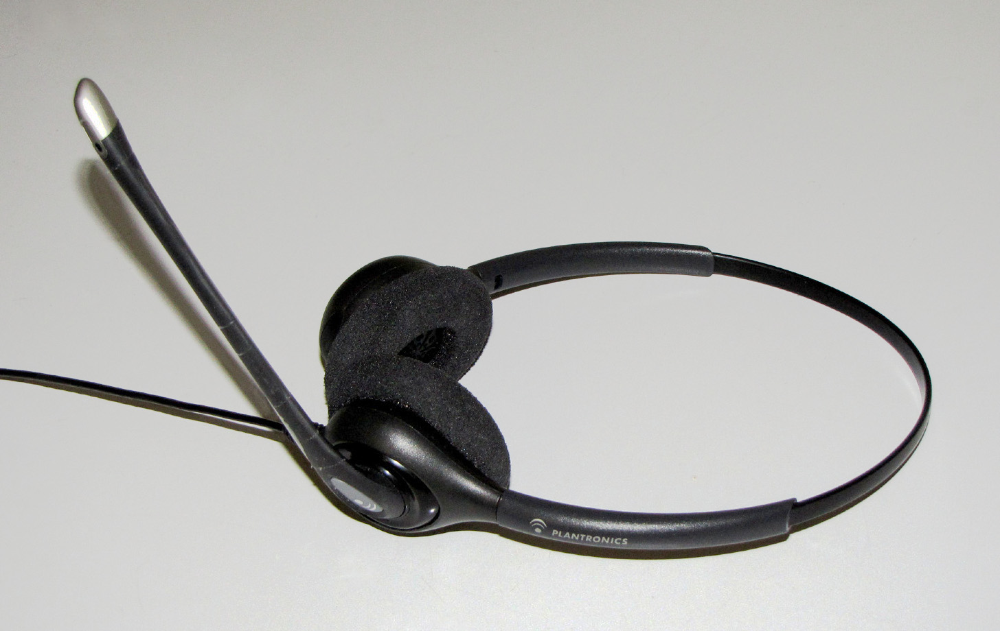

<!-- theme: 研究・実験結果レーン（3-0）／arXiv:2610.25603 中国のネット保険代理店 AI音声エージェント導入前後の通話56万7,090件 -->

# AIに見込みの薄い客を任せたら、人は有望な客を手放すようになった。保険の電話56万件の記録

問い合わせや電話の一次対応をAIに任せようとしている会社の方に向けた記事です。「見込みの薄い客はAIに、有望な客は人に」という分け方は、一番よく聞く設計だと思います。うちもAIエージェントで問い合わせ対応を自動化する仕事をしているので、この分け方がうまくいかない条件があるなら知っておきたい。10月19日に公開された論文が、ちょうどその条件を実データで示していたので、内容を書きます。

## 何が調べられたのか

調べたのは、米ジョージア州立大学、中国人民大学、香港理工大学、シドニー大学などの研究者6人です。材料は、中国のネット健康保険の代理店1社の電話記録です。社名は契約上伏せられています。

この会社は、申し込みの途中でやめた人に電話をかけて、契約までつなぐ部署を持っています。1日の発信はおよそ1万件。途中でやめた人は、やめた場所で2つに分けられます。

- 支払い画面まで進んでやめた人は「有望な客」
- それより前でやめた人は「見込みの薄い客」

2024年8月28日、この会社はAIの音声エージェントの使い方を変えました。それまでは人の手が空かないときだけAIが電話していましたが、この日から見込みの薄い客は原則AIが担当し、有望な客は人が優先して担当する形にしました。見込みの薄い客のうちAIが受け持つ割合は、25%未満から60%超に上がっています。

分析に使ったのは、この切り替えの前後およそ60日の通話記録です。人がかけた電話が40万9,622件、AIがかけた電話が15万7,468件、合わせて56万7,090件。担当者の延べ勤務日数は約1万3,000日分です。

切り替えと同時に、給与、研修、台本、評価、採用は変えていないと論文には書かれています。担当者の給与は固定給が少なく、自分が成約させた契約の歩合が手取りの大半を占めます。

この論文は査読前のプレプリントです（arXiv、2026年10月19日投稿）。

## 人の手元の客は良くなったのに、成約率は下がった

切り替えのあと、人の手元に来る客は確かに良くなりました。出勤して最初の3本の電話で比べると、その電話が有望な客である確率は23.4ポイント上がっています。

ところが、その最初の3本で、人の成約率は4.5ポイント下がりました。切り替え前、最初の3本の成約率は9.1%です。次の3本でも2.5ポイント下がっています。

一方で、1日の終わりのほうの電話では、成約率は3.4ポイント上がっていました。有望な客が増えた朝に成約率が下がり、有望な客が増えなかった夕方には上がっていました。

同じ時間帯に、担当者の動きも変わっていました。

- 成約しなかった客を、共有の順番待ちに戻して他の人に回す割合が、最初の3本で8.1ポイント上がった
- 最初の3本の通話時間が、およそ13%短くなった

論文の説明はこうです。この会社では、客を順番待ちに戻しても罰はなく、評価にも入りません。戻した客が他の人のところで契約しても、自分には歩合が入りません。それでも戻すのは、「次に来る客のほうが良さそうだ」と思えるからです。

朝は、その日にまだ多くの客が来る。しかもAIが見込みの薄い客を引き受けてくれるので、次の客も有望な客である可能性が高い。そうなると、目の前の客を粘って口説くより、次に行くほうが得に見えます。夕方になると残りの客が少なくなるので、この差が消えます。

## 見かけの数字では、導入は成功に見えた

ここは見落としやすいところです。

論文は、この導入が「よく使われる指標では成功に見える」と書いています。人の電話50本あたりの会社全体の成約数は6.3%増えていました。ただしこれは、人がかけた電話が31.8%減ったのに対して、成約の総数の減り方がそれより小さかったからです。人の働きが良くなったからではありません。

人が担当し続けた有望な客だけで見ると、成約率は4.4%から3.7%に下がっています。15.9%の低下です。

研究者らは、AIが客を振り分け直したことによる成約の増加と、人の動きが変わったことによる減少を分けて計算しています。対象は、有望な客を朝から50本目までに担当した分です。振り分けによる増加は0.58%、人の動きの変化による減少は17.6%で、減少のほうがおよそ30倍大きい。差し引きは17.0%の減少です。

1日全体の平均で成約への影響を推定すると、ほぼゼロでした。夕方に成約率が上がった分が、朝の低下を埋めていたためです。

数字が細かいので、ここは2つ注意して書いておきます。0.58%、17.6%、17.0%は、論文の中の計算モデルで出した値です。観測をそのまま割り算したものではありません。また、通話時間が短くなったことと客を戻すことが増えたことの2つで、成約率の低下をどこまで説明できるかを調べると、説明できるのは一部だけでした。担当者の動きが変わったことは確かでも、どの動きがどれだけ下げたかまでは分かっていません。

## 逆の結果もある

AIを入れたら人の成果が上がった、という研究もあります。よく引かれるのは、カスタマーサポート担当5,179人のデータを使ったスタンフォード大学などの研究です。会話の最中にAIが返答の候補を出す道具を使えるようにしたところ、1時間あたりの解決件数が平均14%増え、経験の浅い人では34%増えました（NBERワーキングペーパー、2023年。のちにQuarterly Journal of Economicsに掲載）。

2つの研究の違いは、AIがどこにいるかです。サポートの研究では、AIは担当者の隣にいて、目の前の1件を手伝っていました。今回の保険の研究では、AIは担当者と別の電話をかけていて、目の前の1件には一切関わっていません。それでも、人の手元に何が来るかを変えたことで、人の粘り方が変わりました。

論文は、この現象が起きやすい職場の条件を3つ挙げています。担当者が共有の順番待ちから客を受け取ること。客を手放すか、どれだけ粘るかを本人が決められること。手放してもまだ次の客が来ると見込めること。

裏返すと、担当者が2〜3人で、問い合わせが1日に数件しか来ない会社では、同じことが同じ強さで起きるとは限りません。今回のデータは中国の保険代理店1社で、歩合中心の給与です。日本の中小企業にそのまま当てはまるかは、まだ分かりません。

## AIに一次対応を任せる会社が、今日やれること

それでも、AIで問い合わせを振り分ける設計をする時に、確かめておけることがあります。

1つ目は、有望な客を朝に集中させないことです。論文は、有望な客を出す間隔をずらすことや、見込みの薄い仕事の一部を人の手元に残すことを挙げています。研究者らの計算では、有望な客を出すリズムを切り替え前に戻すだけで、電話1本あたりの成約数は約13.5%増えます（計算モデルの値で、幅は10.5〜16.6%）。

2つ目は、時間帯ごとの数字を見ることです。この会社では、1日の平均で見ると通話時間はほとんど変わっていませんでした。朝の通話が短くなったことは、時間帯に分けて初めて見えました。AIを入れたあとは、朝・昼・夕方に分けて、人が担当した有望な客の成約率を見ると、変化が見えます。

3つ目は、「他の人に回した件数」を記録しておくことです。今回の会社では、回すことに罰がなく、評価にも入っていませんでした。回すこと自体を禁止する話ではありません。回した件数が増えていないかを、導入前と後で比べられるようにしておくと、人の粘り方が変わったかを早めに知ることができます。

AIで見込みの薄い仕事を減らせば、人は大事な仕事に集中できる。AIを入れる理由として、一番よく挙がる考え方です。今回の論文では、有望な客ばかりが並んだ朝に、担当者は1件ごとの通話を短くし、客を他の人に回していました。何をAIに渡すかと同じくらい、残った仕事がいつ、どんな順番で人に届くかを決めておく必要があります。

## まとめ

- 中国のネット保険代理店で、見込みの薄い客をAIの音声エージェントに任せたところ、人の手元の客は良くなったが、朝の成約率は下がった（通話56万7,090件、プレプリント）
- 担当者は朝ほど客を他の人に回し、通話を短くしていた。1日単位の成約への影響はほぼゼロ
- 「人の電話あたりの成約数」は6.3%増えて成功に見えたが、人が担当した有望な客の成約率は4.4%から3.7%に下がっていた
- 次にやること: 有望な客を朝に集中させない設計にする。時間帯別に成約率を見る。他の人に回した件数を記録する

楽になる仕組みを入れたあと、その時間で何をするかまで考えるのが私たちの仕事だと思っています。AIに任せる範囲を決めるときは、残った仕事の届き方まで一緒に設計させてください。

## 出典

- Xinyu Fu, Shulong Luo, Narayan Ramasubbu, Peng Shen, Xincheng Wang, Yucheng Wang「When Better Opportunities Backfire: Service Worker Responses to Parallel AI Deployment in Customer Acquisition」（arXiv:2610.25603、2026年10月19日投稿／プレプリント・査読前）

https://arxiv.org/abs/2610.25603

- Erik Brynjolfsson, Danielle Li, Lindsey R. Raymond「Generative AI at Work」（NBER Working Paper 31161、2023年／のちにQuarterly Journal of Economics 2025年に掲載・査読済み）

https://www.nber.org/papers/w31161

---

## 私たちについて

株式会社AIdollargameは、「楽じゃなく、楽しいを考える」をテーマに、AIプロダクトを自社開発しているAI会社です。

- AI導入支援・コンサルティング（https://aidollargame.com/ai-consulting.html?utm_source=note&utm_campaign=2026-10-31）
- AIエージェント（https://aidollargame.com/line-ai-agent.html?utm_source=note&utm_campaign=2026-10-31）：問い合わせ・予約対応を24時間自動化
- AIside（https://aidollargame.com/aiside.html?utm_source=note&utm_campaign=2026-10-31）：経営者の"もう一人の自分"になる付き人AI
- AIwill／社長クローンAI（https://aidollargame.com/human-clone-ai.html?utm_source=note&utm_campaign=2026-10-31）：経営者の判断軸をAIに学習させる

「うちの仕事でAIに何ができる？」は、無料のAI活用度診断から。

https://aidollargame.com/shindan.html?utm_source=note&utm_campaign=2026-10-31

公式サイト

https://aidollargame.com/?utm_source=note&utm_campaign=2026-10-31

ご相談：info@aidollargame.com

このnoteでは、AI活用のリアルや時事の読み解きを、過程まで含めて正直に発信しています。フォローしてもらえると嬉しいです。

---

ハッシュタグ案
#AIエージェント #コールセンター #営業 #中小企業 #生成AI

サムネ文言案
1. AIが客を選り分けたら、人は粘らなくなった
2. 有望な客だけ渡しても、成約率は上がらなかった
