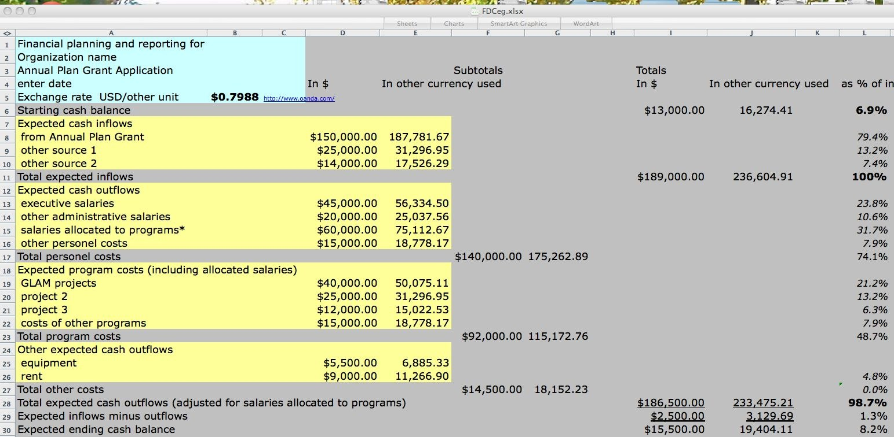

<!-- theme: ニュース型（3-00）／IPA 2026年10月30日公表 プロフェッショナルデジタルスキル（データ・AI）試験（仮称）シラバス案Ver.0.1・科目Bサンプル問題 / 余り2 -->

# AIの国家試験、サンプル問題の1問目は「千円単位を円単位に変えた」話だった。IPAが10月30日に出題案を公表

社員にAIの勉強をさせたい、資格を目標に置きたいと考えている会社の方に向けた記事です。10月30日、IPA（情報処理推進機構）が、2027年度から始まる国家試験のうち、データとAIを扱う区分の出題案とサンプル問題を初めて公表しました。うちも社員向けのAI研修を作る仕事をしているので、国が「AIを仕事に使える人」に何を求めるのかは、自分で原文に当たって確かめておきたかった。28ページの出題案と18ページのサンプル問題を読んで、分かったことを書きます。

## 10月30日に何が出たのか

前提から書きます。国家試験の情報処理技術者試験は、2027年度から仕組みが変わります。今の試験は2026年度の実施で終わる予定です。

新しい制度は8区分です。今の応用情報技術者試験と高度試験をまとめ直して、「プロフェッショナルデジタルスキル試験（仮称）」という区分が新しくできます。中身は次の3つに分かれます。

- マネジメント
- データ・AI
- システム

マネジメントとシステムの出題案は6月30日に出ていました。データ・AIだけが遅れて、10月30日に初めて出ています。公表されたのは2つです。

- シラバス案Ver.0.1（28ページ。何を知っていて、何ができればよいかの一覧）
- 科目Bのサンプル問題（18ページ・6問）

試験はコンピューターで受けるCBT方式で、データ・AIの区分は2027年度の夏頃から秋頃に始まる予定です。科目A-1が90分で60問、科目A-2と科目Bが合わせて120分で、A-2が23問、Bが12問です。

IPAは、どちらの資料も公表時点の検討状況で、変わる可能性があると明記しています。試験の名前も、今は全部「仮称」です。

## AIの用語は最新、ただし技能の1つ目はデータの整備

出題案のAIの部分には、ここ1年ほどで出てきた言葉がそのまま入っています。

- MCP（AIと社内の道具をつなぐ共通の規格）
- A2A（AIエージェント同士をつなぐ規格）
- コンテキストエンジニアリング
- コンテキスト腐敗、Lost in the Middle現象（長い資料を渡すと、AIが途中の内容を取りこぼす現象）

AIエージェントの項目では、自律性を3つの型（アシスト型、半自律型、自律型）に分けた上で、「最終承認」「例外処理」といった人間の関与のしかたと、入力時と出力時のガードレールまで出題範囲に入れています。例えば、AIエージェントが作った見積もりを送る前に誰が承認するのか、想定外の依頼が来たら誰に回すのか。この線の引き方が試験に出ます。

一方で、科目B（実際の場面を題材にした問題）の出題範囲は、次の4つの大項目でできています。

1. データマネジメント
2. データ・AIの活用
3. データ基盤の構築
4. データ処理とアルゴリズム

1番目のデータマネジメントだけ、小項目が9つあり、一番細かく書かれています。2番目のデータ・AIの活用は小項目が5つです。ただしIPAは、1番目を詳しく書いたのは読む人が理解しやすくするためで、出題の割合は大項目の構成に基づく、と注記しています。1番目から多く出る、とは書かれていません。

その1番目の中に、AIに渡すデータとAIが作ったデータについて、利用目的、機密性、個人情報、権利、出どころと生成の履歴などの管理ルールを決める技能が入っています。サンプル問題の末尾の出題趣旨でも、AIが作るデータを誤りや偏りがないか確かめてから仕事に使う力を、強く求められている能力として挙げています。

## サンプル問題の1問目：単位を変えたら、AIが売上を1,000倍と読んだ

6問のうち1問目は、こういう話です。

ある会社で、営業部門が「顧客別の月間売上」のデータを社内に公開しています。単位は千円です。マーケティング部門は、このデータを解約予測AIに入れて使っています。

ある日、経営企画部門から「円単位がほしい」と頼まれ、営業部門は既存の売上の列の中身を円単位に書き換えました。元の千円単位の値は、新しい列を作ってそちらに移しています。このことを経営企画部門には伝えましたが、マーケティング部門には伝えていませんでした。

この会社では、データの説明文をAIが自動で書く道具を入れています。人が一度確定させた説明文をAIが上書きしないように、未承認の列だけを書く設定です。売上の列は承認済みのままだったので、説明文は「千円単位」のまま残りました。

結果として、解約予測AIは顧客の売上が突然1,000倍になったと受け取り、優良顧客と判定して、解約の確率を極端に低く出しました。

設問は、原因と再発防止のルールを選ぶものです。原因の選択肢には、「AIの道具が承認済みの列を見直さない仕様だった」という、道具のせいにするものも並んでいます。このPDFに正解は載っていません。私が読んで残ったのは、AIの誤判定の出発点が、単位を変えたことを使っている部門に伝えなかったという、人と人の連絡だった点です。

3問目も、AIそのものより運用の話でした。製品の仕様書が頻繁に改訂される精密機器メーカーで、保守エンジニア向けの質問応答AIを作る場面です。仕様書でAIを追加学習させる方法と、質問のたびに関連文書を探してAIに渡す方法を比べ、改訂を反映する時間と費用から後者を選びます。最後の空欄は、回答に「根拠になった文書名を表示する」か「信頼度の点数を表示する」かを選ばせる形になっています。

## まだ決まっていないこと

- 名前はすべて仮称で、出題案はVer.0.1です。変更の可能性があるとIPAが書いています。
- 新しく作る試験の実施時期と期間の詳細は、まだ検討中です。
- 今の高度試験に合格している人の科目免除は、検討中の段階です。
- サンプル問題は、出題の形を共有するためのもので、本番の問題と同じ作成とチェックの工程は経ていない、と注記されています。
- サンプル問題の正解は公表されていません。

## 今日やれること

試験を受けるかどうかとは別に、1問目と3問目の場面は、社員が数人の会社でもそのまま起きます。

1. AIに渡す表の、数字の単位と定義を1枚に書く。売上は税込か税抜か、千円か円か、締め日はいつか。表の1行目の列名だけで分かると思っている所ほど、書き出すと人によって答えが違います。
2. 定義や単位を変えるときは、その表を使っている人を先に全員洗い出してから変える。誰が使っているか分からない表は、変えない。
3. 社内の資料をAIに答えさせるなら、回答に根拠の文書名が出る設定にする。古い版の資料が混ざっていても、文書名が出ていれば人が気づけます。

社員の資格の目標にするなら、ビジネス部門向けに新しくできる「データマネジメント試験（仮称）」も候補になります。ITパスポート試験の次の段として位置づけられていて、AIを使うためのデータの整備と管理を扱います。今年度に受けるなら現行の試験で、新しい試験は2027年度からです。

## まとめ

- IPAが10月30日、2027年度に始まる国家試験のデータ・AI区分の出題案（28ページ）とサンプル問題（6問）を初めて公表した。
- AIの用語はMCPやA2Aまで入り、AIエージェントについては人の最終承認やガードレールまで出題範囲になっている。
- サンプル問題の1問目は、単位の変更が伝わらずにAIが売上を1,000倍と読んだ話。AIの誤判定の出発点は、人と人の連絡だった。
- まだ仮称・案の段階で、実施時期の詳細と正解は未公表。

AIに任せる仕事を増やす前に、数字の単位と定義を書き出す。地味な作業ですが、ここが決まると、AIの出した数字を毎回疑って確かめ直す時間が減ります。空いた時間は、その数字で次に何をするかを考えることに使えます。うちが「楽」の先にある「楽しい」と言っているのは、こういう時間のことです。

## 出典

- IPA「新試験制度のシラバス案について」（2026年6月30日公開、2026年10月30日更新／公表資料）

https://www.ipa.go.jp/shiken/syllabus/henkou/2026/20260630.html

- IPA「プロフェッショナルデジタルスキル（データ・AI）試験（仮称）シラバス（案）Ver.0.1」（2026年10月30日掲載／公表資料・変更の可能性あり）

https://www.ipa.go.jp/shiken/syllabus/minaoshi/rqr7mi000000e2t4-att/syllabus_pd-d_ver0_1.pdf

- IPA「新試験制度のサンプル問題について」「プロフェッショナルデジタルスキル（データ・AI）試験（仮称）科目Bのサンプル問題」（2026年10月30日掲載／公表資料）

https://www.ipa.go.jp/shiken/syllabus/henkou/2026/20260622.html

- IPA「情報処理技術者試験及び情報処理安全確保支援士試験の見直しの検討状況について」（2026年3月31日公開、4月28日更新／公表資料）

https://www.ipa.go.jp/shiken/syllabus/henkou/2025/20260331.html

---

## 私たちについて

株式会社AIdollargameは、「楽じゃなく、楽しいを考える」をテーマに、AIプロダクトを自社開発しているAI会社です。

- AI導入支援・コンサルティング（https://aidollargame.com/ai-consulting.html?utm_source=note&utm_campaign=2026-11-02）
- AIエージェント（https://aidollargame.com/line-ai-agent.html?utm_source=note&utm_campaign=2026-11-02）：問い合わせ・予約対応を24時間自動化
- AIside（https://aidollargame.com/aiside.html?utm_source=note&utm_campaign=2026-11-02）：経営者の"もう一人の自分"になる付き人AI
- AIwill／社長クローンAI（https://aidollargame.com/human-clone-ai.html?utm_source=note&utm_campaign=2026-11-02）：経営者の判断軸をAIに学習させる

「うちの仕事でAIに何ができる？」は、無料のAI活用度診断から。

https://aidollargame.com/shindan.html?utm_source=note&utm_campaign=2026-11-02

公式サイト

https://aidollargame.com/?utm_source=note&utm_campaign=2026-11-02

ご相談：info@aidollargame.com

このnoteでは、AI活用のリアルや時事の読み解きを、過程まで含めて正直に発信しています。フォローしてもらえると嬉しいです。

---

ハッシュタグ案
#生成AI #AIエージェント #データ活用 #資格 #中小企業

サムネ文言案
1. AIの国家試験、1問目は「千円単位」の話だった
2. AIが売上を1,000倍と読んだ。原因は連絡漏れ
