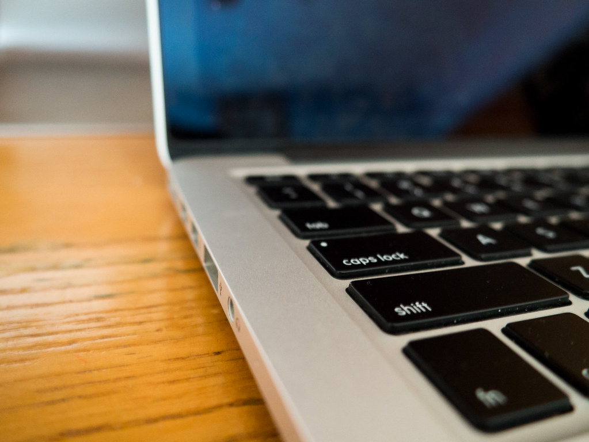

<!-- theme: ニュース型 6sense Buyer Experience Report 2026(11/2公表)・法人の購買でのAI利用 / 余り1 -->
# AIで取引先を探した買い手は26%だった。法人の購買4,607件の調査で、AIの利用は94%から81%に下がった

法人のお客さんに商品やサービスを売っている会社に向けて書きます。
「買い手はもうChatGPTで取引先を探している。AIの答えに名前が出ない会社は選ばれない」という話を、ここ1年でよく聞くようになりました。

11月2日、米国の6sense社が、法人の購買を調べた年次の調査を公表しました。
AIの使われ方について、具体の数字が出ています。
この記事では、その数字と、日本の中小企業がそこから何を写せるかを書きます。

## 何が出たのか：AIを使った買い手は81%、取引先探しに使ったのは26%

調査の対象は、北米・欧州・アジア太平洋・英国とアイルランドの法人の買い手です。
購入まで進んだ3,596件と、途中で止まった1,011件、合わせて4,607件の検討を、担当者に1件ずつ振り返ってもらっています。
（発表文では4,611人と書かれています。数字は報告書本文の方を使います。）
対象は、年額2万5,000ドル以上の購入に関わった人です。

AIについての主な数字は次の通りです。

- 検討のどこかでChatGPTなどの対話型AIを使った買い手は81%。前年の94%から13ポイント下がった
- 新しい取引先を見つけるために使った買い手は26%
- 取引先への印象に「大きく影響した」と答えた買い手は25.2%
- 情報源として影響が大きかったと挙げた割合は、選ぶ段階で21.2%、確かめる段階で17.1%
- 購入と購入の間に業界の情報を追う手段として、AIは15.0%。挙がった11の手段の中で最も低い

AIを使う場面は、検討の初め（43%）より、真ん中（59%）に寄っていました。
報告書は、買い手がAIを「既に持っている情報を並べ替え、要約し、確かめる」ために使っていると書いています。

利用が下がった理由について、報告書は1つの見方を示しています。
会社が、社員の個人のAI利用を止めてから、会社公認のAIを入れるまでの間にいる、という見方です。
ただし報告書自身が「このデータからはそれが原因かどうか決められない」と書いています。
下がり方は、一般社員の層と、欧州・中東・アフリカで大きかったそうです。

## AIより先に、買い手の頭の中で候補が決まっている

この調査の中心は、実はAIではありません。
買い手は、売り手に連絡する前に、ほぼ決めているという数字です。

- 売り手に初めて連絡するのは、平均10.3か月の検討の59.2%が過ぎたころ
- 最終的に選ばれた会社は、検討の初日の候補に92%の割合で入っていた
- 連絡する前から気に入っていた会社が、82%の割合で選ばれた
- 最初の連絡の82%は、買い手から売り手へのもの
- 候補に挙がった会社は平均4.9社。うち3.4社は、買い手の会社と前に取引や接点があった

では、買い手は購入と購入の間、何で情報を追っているのか。
多い順に、相手の会社のウェブサイト35.9%、展示会や業界のイベント33.4%、製品の口コミサイト31.4%、業界誌31.3%でした。
AIは15.0%で、この並びの最後です。

報告書には、AIについてこんな一文もあります。
業界では「AIの答えに出るかどうか」が法人の購買の中心のように語られるが、買い手が新しい情報を得る先として、AIは最も挙げられなかった。

## 自社で写せること

私たちも、自社の名前がAIの答えにどう出るかを毎月測っています。
その立場から見て、この調査で日本の中小企業に写せるのは次の3つだと考えています。

1つ目。AIは、候補を見つける道具より、候補を確かめる道具として使われています。
買い手は、気になった会社の名前をAIに入れて、評判や違いを要約させています。
その時にAIが拾う元の情報は、自社のウェブサイトと、外の記事や口コミです。
自社のサイトに、料金の考え方、導入までの流れ、対応できない仕事が書いてあるか。ここが要約の材料になります。

2つ目。候補に入るのは、検討が始まる前に名前を知られている会社です。
初日の候補に入らなかった会社が選ばれたのは、10件に1件に届きません。
展示会、業界誌、既存のお客さんとの接点。地味な接点が、AIより先に順番を決めています。

3つ目。買う物の中のAIは、ほぼ前提になっています。
購入の80%にAIの機能が含まれていました（前年89%）。
検討の37%でAIが入っていることが強く求められ、21%では条件にされていました。
一方で、売り手がAIをどう使っているか分かったと答えた買い手は72.7%で、前年の82.5%から下がっています。
自社の商品にAIを入れているなら、「AIで何をして、何をしていないか」を、買い手が確かめられる言葉で書いておく必要があります。

## まだ分からないこと

この調査の格は、企業が出した調査レポートです。査読は通っていません。
数字はすべて買い手の自己申告で、報告書も「関係を示すもので、因果ではない」と書いています。

また、6sense社は法人営業向けのソフトを売っている会社です。
「売り手は検討の前に知られていないといけない」という結論は、その会社の商品とつながっています。
数字を使うときは、この点を頭に置いておく必要があります。

日本についても分かりません。
回答者のうちアジア太平洋は21%で、日本の内訳は書かれていません。
対象は年額2万5,000ドル以上の購入です。小さな発注の買い方は、この調査では測られていません。

AIの利用が81%に下がったのも、1年分の差です。
会社公認のAIが行き渡った後に、また上がるのかどうかは、来年の調査を待つしかありません。

## 今日やれること

- 自社の会社名と「評判」「料金」「他社との違い」を組み合わせて、ChatGPTやGeminiに聞いてみる。返ってきた要約が、どのページを元にしているかを確かめる
- 自社サイトに、料金の考え方・導入までの流れ・対応できないことが書いてあるかを見直す。書いていなければ、AIはそこを外の情報で埋めます
- 既存のお客さんの中で、次の検討が始まりそうな会社を3社書き出す。報告書では、候補の4.9社のうち3.4社が前に接点のあった会社でした

## まとめ

- 法人の買い手の81%がAIを使ったが、前年の94%から下がった
- AIで新しい取引先を見つけた買い手は26%。主な使い道は、知っている候補の要約と確認
- 選ばれた会社の92%は、検討の初日の候補に入っていた
- 調査は自己申告で、日本の内訳は無い

AIの答えに名前が出ることは、無駄ではありません。
ただ、この調査を見る限り、AIは買い手が既に知っている会社を確かめる場所として使われています。
先に知ってもらう仕事は、人と人の接点に残っています。
AIで調べものや資料作りの時間が減った分、その接点に時間を回す。
私たちが「楽ではなく、楽しいを考える」と言っているのは、そういう時間の使い方のことです。

### 出典

- 6sense「Buyer Experience Report 2026」（2026年11月2日公表／企業の調査レポート・自己申告のアンケート・査読なし）
https://6sense.com/science-of-b2b/buyer-experience-report-2026/
- 6sense 発表文「6sense Research Finds That Vendors Need to Be Known and Preferred Before the Buying Journey Begins」（Business Wire、2026年11月2日／企業の発表）
https://www.financialcontent.com/article/bizwire-2026-11-2-6sense-research-finds-that-vendors-need-to-be-known-and-preferred-before-the-buying-journey-begins

---

## 私たちについて

株式会社AIdollargameは、「楽じゃなく、楽しいを考える」をテーマに、AIプロダクトを自社開発しているAI会社です。

- AI導入支援・コンサルティング
https://aidollargame.com/ai-consulting.html?utm_source=note&utm_campaign=2026-11-04
- AIエージェント：問い合わせ・予約対応を24時間自動化
https://aidollargame.com/line-ai-agent.html?utm_source=note&utm_campaign=2026-11-04
- AIside：経営者の"もう一人の自分"になる付き人AI
https://aidollargame.com/aiside.html?utm_source=note&utm_campaign=2026-11-04
- AIwill／社長クローンAI：経営者の判断軸をAIに学習させる
https://aidollargame.com/human-clone-ai.html?utm_source=note&utm_campaign=2026-11-04

「うちの仕事でAIに何ができる？」は、無料のAI活用度診断から。
https://aidollargame.com/shindan.html?utm_source=note&utm_campaign=2026-11-04

- 公式サイト
https://aidollargame.com/?utm_source=note&utm_campaign=2026-11-04
- ご相談：info@aidollargame.com

このnoteでは、AI活用のリアルや時事の読み解きを、過程まで含めて正直に発信しています。フォローしてもらえると嬉しいです。

ハッシュタグ案：#法人営業 #BtoB #生成AI #AI検索 #中小企業

サムネ文言案：
1. AIで取引先を探した買い手は26%
2. 選ばれた会社の92%は、初日の候補にいた
