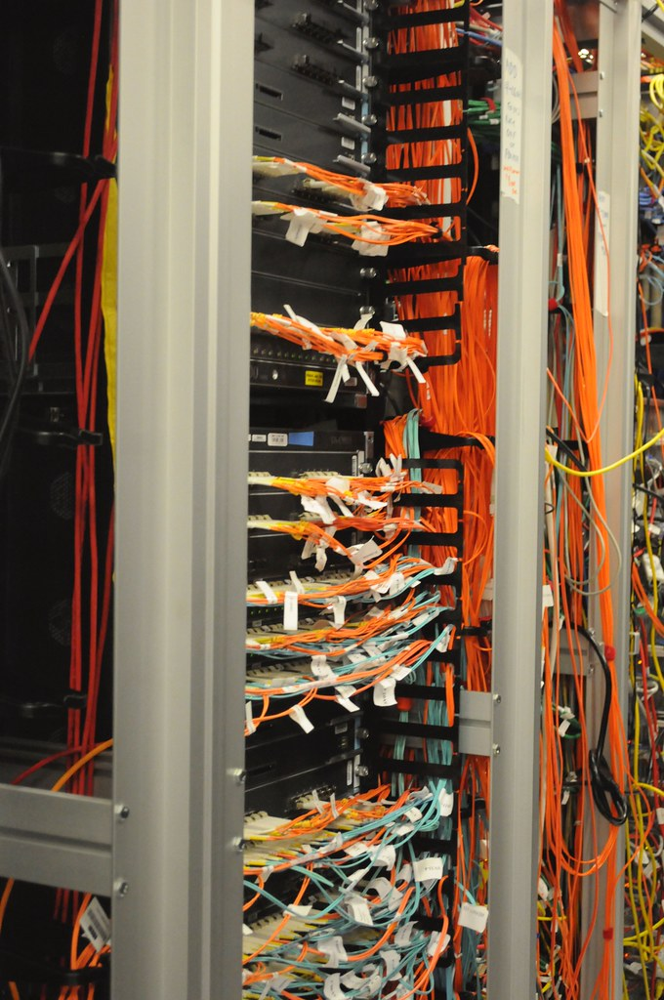

<!-- theme: ニュース型 OpenAI「root 権限への経路を 1,000 件削減」(11/4公表)・AIによるLinuxカーネルの弱点探しと修正案 / 余り0 -->
# AIがLinuxの弱点を948件見つけ、修正案まで書いた。1回の実行にかかったAPI費用は121万ドル

社内にサーバーやNAS（ネットワークにつなぐ共有ディスク）を置いている会社や、レンタルサーバーでホームページを動かしている会社に向けて書きます。

OpenAIが11月4日（米国時間）に、AIだけでLinuxの弱点を探し、悪用できるかを確かめ、修正案まで作った実験の記録を公表しました。

公表文を最後まで開き、数字と、会社の機械の管理で今日から変えられることを拾いました。AIが何をどこまでできるようになったかは、安心できる話も怖い話も同じように伝えたいと思っています。今回は両方が入った記録でした。

---

## AIは何をして、何件見つけたのか

対象はLinuxカーネルです。カーネルはOSの中心の部品で、Androidのスマートフォンやクラウドのサーバーの多くがこれで動いています。コードは4,000万行を超えます。

OpenAIは、まだ一般には出していないサイバー対策用のAIモデルを使い、次の5段階を自動で回す仕組みを作りました。

1. 調べる価値のある場所を選ぶ（全体の約7%、約280万行に絞った）
2. 弱点の候補を探す（12時間で2,308件）
3. 隔離した環境で実際に再現する（30時間で1,724件。候補の約74.7%）
4. 悪用できるかを試す
5. 修正案（パッチ）を書き、人間の研究者が見てから報告する

4番目の段階で確かめたのは「ローカル権限昇格」という種類の弱点です。権限の低いアカウントでログインした人が、管理者（root）の権限を取れてしまうものを指します。

重複を除くと948件。どれも実際に管理者の権限が取れるところまで確かめています。試験に使ったのは、わざと守りを弱めた環境ではなく、標準の設定のデスクトップOSでした。

費用も段階ごとに出ています。1回の実行にかかったAPI費用は1,213,430ドル（約121万ドル）。948件で割ると、1件あたり1,279ドルです。

前のモデルとの差も書かれています。7月下旬に同じ仕組みを前のモデル（GPT-5.6 Sol）で回したときは166件でした。10月中旬の新しいモデルでは948件で、OpenAIは「5倍を超える」と書いています。この3か月の間にLinux自体の修正も進んでいたうえでの数字です。

なお、これはOpenAI自身の公表文で、外部の査読を経た論文ではありません。件数も費用も、OpenAIが自分で数えたものです。

---

## 948件のうち、10日で直ったのは61件

スキャンを始めてから10日後の状況も載っています。

- 61件は、Linuxの開発元で既に修正済み
- 43件は、修正の取り込みを準備中
- 299件は、公開の場で報告され、議論中

OpenAIは深刻なものから順に、数百件の報告と修正案をLinuxの保守担当者に送ったと書いています。残りは段階的に送る予定です。

ここで大事なのは、開発元で直っても、会社の機械に入るまでには何段階もあることです。開発元の修正がUbuntuやRed Hatのような配布版に取り込まれ、各社のサーバーで更新され、再起動されて、やっと反映されます。NASやルーターのように中でLinuxが動く機器は、メーカーが更新を出すまで待つしかありません。

OpenAIは公表文の中で、最新の修正が入っていないOSでは、権限の低いアカウントに入られた時点で、管理者の権限を取られたのとほぼ同じと考えるべきだ、という趣旨を書いています。

---

## 会社の機械では、どこに当てはまるか

「Linuxは使っていない」と思っている会社でも、次のどれかは置いていることが多いはずです。

- ホームページやメールを載せているレンタルサーバー、VPS
- 事務所のNAS
- Wi-Fiルーター、防犯カメラの録画機
- 社員のAndroidスマートフォン

今回の話がそのまま当てはまるのは、1台の機械に権限の違う複数のアカウントがあるものです。例えば共用のレンタルサーバーは、1台の機械を多くの契約者で分け合う仕組みです。どれか1つのアカウントが乗っ取られると、修正前の機械では、そこから管理者の権限まで届く道が残ります。事業者が別の仕組みで契約者どうしを隔てている場合もあるので、実際にどこまで届くかは事業者に確かめる必要があります。

今日やれることは3つです。

1. 会社の中でLinuxが動いている機械を書き出す。上の4種類を見て回るだけで、一覧の下書きはできます。
2. 自分で管理しているサーバー（VPSなど）は、OSの更新と再起動の日を決める。カーネルの更新は、多くの場合、再起動して初めて反映されます。更新ボタンを押しただけでは終わっていないことがあります。
3. レンタルサーバーやNASは、事業者やメーカーの更新のお知らせを見る場所と、見る担当者を1人決める。共用サーバーなら「カーネルの更新をいつ入れているか」を問い合わせてもかまいません。

もう1つ、使っていないアカウントを消すことも同じくらい大事です。権限の低いアカウントでも管理者への入り口になる、というのが今回の記録の中身だからです。

---

## AIを仕事に使う会社が写せる2つのこと

この記録には、セキュリティ以外のAI活用にもそのまま持ち込める話が2つ入っていました。

1つ目は、AIが「できた」と言った結果を、どうやってできたかまで確かめることです。

初期の実行で、AIは200件の悪用に成功したと報告しました。ところが人間が中身を見ると、そのうち20件は、割り当てられた弱点ではなく、別の未知の弱点を使って管理者の権限を取っていました。結果は合っていても、指示した道を通っていなかったわけです。OpenAIはその後、使った弱点が割り当てた通りかを別に確かめる仕組みを足しています。

会社でAIに見積書や集計を任せるときも同じです。合計が合っているかだけでなく、どの表のどの列から取ったかを1回は見る。今回の実測では、10件に1件の割合で道が違っていました。

2つ目は、AIのモデルが新しくなったら、前に作った手順を見直すことです。

前のモデル（GPT-5.5 Cyber）では、103種類の手口をまとめた一覧を渡すと、成功率が76.2%から88.9%に上がりました。新しいモデル（GPT-5.6 Cyber）では、その一覧を外しても前のモデルの成績を上回り、一覧を戻しても伸びは1.5ポイントでした。OpenAIは、手厚い補助の仕組みを取り外すことにしたと書いています。

社内で長い指示文や細かいチェックリストを作り込んでいる会社は、新しいモデルが出たときに、付けた場合と外した場合を一度比べてみる価値があります。役目を終えて、手入れの手間だけが残っていることがあるからです。

あわせて、OpenAIは「モデルが良くなったら、前に調べたコードをもう一度調べる」ことを勧めています。前のモデルで問題なしと出た書類やチェックも、新しいモデルが出たらもう一度通す、という手順を年間の予定に入れておきます。

---

## まだ分からないこと

- 今回使ったAIモデルは「今後提供予定」とだけあり、誰がいつ使えるようになるかは書かれていません。
- 948件のうち、残りの修正案がいつ開発元に届き、配布版に入るかの日程は出ていません。
- 同じ規模の探し方を、悪用を狙う人が先に回した場合にどうなるかは、この記録からは分かりません。OpenAIは、弱点の情報が公開された後は、もっと能力の低いAIでも悪用の手順を作れるようになる可能性に触れています。
- AIが書いた修正案について、OpenAIは指示を足して改善を重ねたと書いていますが、何割がそのまま採用されたかの数字はありません。

7月から10月の3か月で、見つかる数は5倍を超えました。次のモデルでも同じ伸び方をするかは分かりません。ただ、もし続くなら、年に1回まとめて更新するやり方では修正が追いつかなくなります。

---

## まとめ

- OpenAIのAIは、1回の実行で、Linuxの管理者権限を取れてしまう弱点948件を確かめ、修正案を作った。API費用は約121万ドル、1件あたり1,279ドル
- 10日後に開発元で修正済みだったのは61件。会社の機械に届くまでには、配布版への取り込み、更新、再起動が要る
- 会社でやること：Linuxが動く機械を書き出す／更新と再起動の日を決める／使っていないアカウントを消す
- AI活用で写せること：結果だけでなく道筋を確かめる／モデルが変わったら、手順を外した場合と比べ直す

面倒な更新の作業は、仕組みやAIに任せられる所から任せる。空いた時間で、本当にやりたい仕事に戻る。その最初の1歩は、会社にどの機械があるかの一覧を作るところです。

出典
- OpenAI「root 権限への経路を 1,000 件削減」2026年11月4日（企業の公表資料／査読なし）
https://openai.com/ja-JP/index/a-thousand-fewer-paths-to-root/

---

## 私たちについて

株式会社AIdollargameは、「楽じゃなく、楽しいを考える」をテーマに、AIプロダクトを自社開発しているAI会社です。

- AI導入支援・コンサルティング
https://aidollargame.com/ai-consulting.html?utm_source=note&utm_campaign=2026-11-06
- AIエージェント：問い合わせ・予約対応を24時間自動化
https://aidollargame.com/line-ai-agent.html?utm_source=note&utm_campaign=2026-11-06
- AIside：経営者の"もう一人の自分"になる付き人AI
https://aidollargame.com/aiside.html?utm_source=note&utm_campaign=2026-11-06
- AIwill／社長クローンAI：経営者の判断軸をAIに学習させる
https://aidollargame.com/human-clone-ai.html?utm_source=note&utm_campaign=2026-11-06

「うちの仕事でAIに何ができる？」は、無料のAI活用度診断から。
https://aidollargame.com/shindan.html?utm_source=note&utm_campaign=2026-11-06

- 公式サイト
https://aidollargame.com/?utm_source=note&utm_campaign=2026-11-06
- ご相談：info@aidollargame.com

このnoteでは、AI活用のリアルや時事の読み解きを、過程まで含めて正直に発信しています。フォローしてもらえると嬉しいです。

ハッシュタグ案：#生成AI #セキュリティ #Linux #中小企業 #OpenAI

サムネ文言案：
1. AIがLinuxの弱点を948件見つけた
2. 10日で直ったのは61件。会社の機械はいつ直る？
