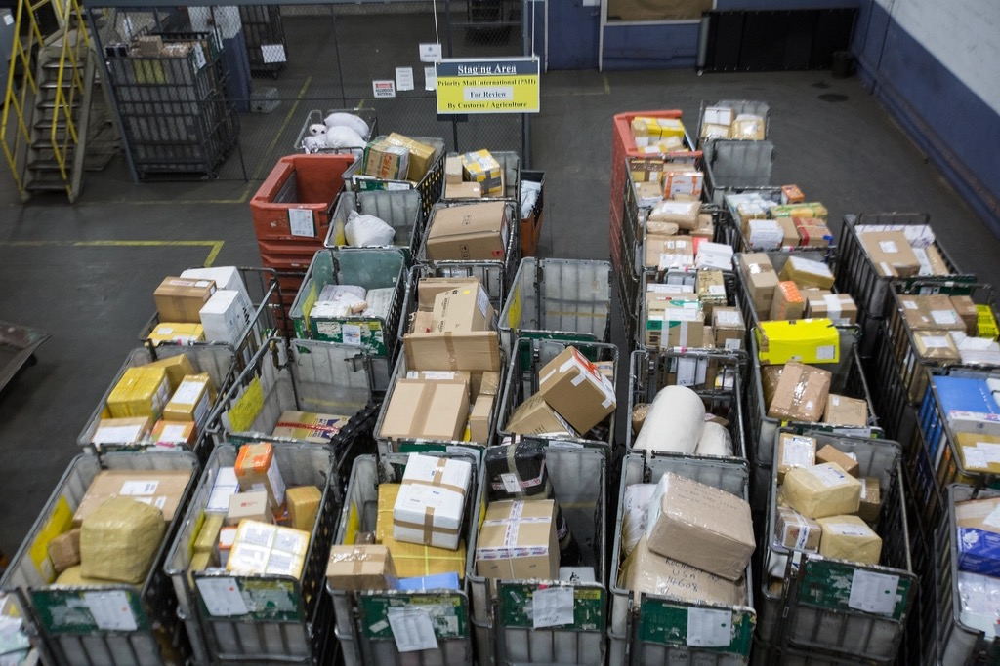

<!-- theme: 研究レーン（AI採用の予測モデルは会社をまたげるか・arXiv:2611.01226） / 余り2 -->
# 他社のデータで作った採用AIは、自社ではくじ引きと同じだった。応募17万件を3社のAIで採点し直した論文

採用にAIや適性検査のサービスを入れようか考えている、中小企業の社長に向けた記事です。
「たくさんの会社のデータで学習したAIなので精度が高い」という売り文句を、そのまま信じていいのか。
その問いに、かなり正面から答えた論文が10月31日に公開されました。私たちもAIを入れる仕事をしているので、売る立場から見て耳の痛い結果も含めて書きます。

---

## 何が調べられたのか：3社のAIで、同じ応募者を採点し直した

ハーバード・ビジネス・スクールのHossein Alidaee氏、Tarun Khanna氏、Rembrand Koning氏の研究です。査読前のプレプリントです。

舞台はメキシコの採用プラットフォームです。倉庫作業、トラック運転手、店舗スタッフなど、離職の多い現場の仕事の採用に使われています。社名は伏せられていて、使ったのは大口の3社の記録です。

- A社：多国籍の日用品メーカー（倉庫から配送まで）
- B社：多国籍のコーヒーチェーン（店舗スタッフ）
- C社：衣料品の国際チェーン

仕組みはこうです。応募者は全員、WhatsAppのチャットボットで同じ42問の質問に答えます。「仕事への責任感」「感情の安定」「ルールを守るか」「倫理観」「協調性」「勤勉さ」「安全への意識」の7分野、各6問です。

各社は、自社で採用した人のこの回答と、入社90日後にまだ働いているかの記録を使って、自社専用の予測AIを作ります。そのAIが、次の応募者が90日残るかを予測して、選考に使います。

使われたデータは次のとおりです。

- AIを作るための記録：採用された8,119人分（A社1,682人、B社3,123人、C社3,314人）
- 比べるための応募：2020年から2025年の172,242件

90日後も残っていた割合は、A社35.8%、B社66.1%、C社41.2%でした。3社とも、早く辞められることに困っている会社です。

## 結果：自社では当たる。他社では五分五分

まず、各社のAIは自社ではよく当たりました。

辞めずに残った人と辞めた人を1人ずつ選んで、残った人を上に並べられる割合は、85.5%から91.4%です。

ところが、A社のAIをB社の採用者に当てると、この割合が47.3%から51.4%に落ちました。6通りの組み合わせのうち5通りは「50%と区別できない」、残る1通り（B社のAIでC社を予測）は50%を下回りました。コインを投げて決めるのと変わりません。

17万件の応募を3社のAIで採点し直して、順位の並び方を比べた結果も同じでした。会社どうしの順位の一致は、マイナス0.067からマイナス0.106です。ほぼ無関係で、わずかに逆向きでした。

比較として、同じ会社の記録を半分に割って2つのAIを作ると、その2つの順位の一致は0.376から0.454でした。同じ会社の中なら、データを変えても似た並びになる。会社が変わると、並びが崩れる。

つまり、A社で「この人は残る」と出た応募者が、B社でも残るとは限りません。

## なぜ会社ごとに違うのか

論文は、AIが何を重く見ているかも分解しています。

どの会社のAIも、重く見ている分野はおおむね同じでした。「協調性」がいちばん大きく、「勤勉さ」は小さい方です。

違ったのは、その向きです。「感情の安定」の点数が中くらいの人たちで点数が上がると、2社では残る見込みが上がり、残る1社では下がっていました。

同じ「感情の安定」でも、会社によって残る人の形が違う。仕事の中身、職場の人、シフトの組み方が違えば、合う人も違う、ということだと思います（ここは論文の数字からの私の読みで、論文はその理由までは確かめていません）。

もう1つ、論文は「この応募者が3社のうちいちばん合う会社に出していたら」も計算しています。7分野の平均点が上位2割の応募者は、実際に出した会社より、いちばん合う会社の方が90日残る見込みが平均26.9ポイント高い。下位2割では16.4ポイントでした。

ただしこの一部は、もともと定着率の高い会社に移るだけで生まれる差です。会社ごとの平均をそろえて計算し直すと、上位2割の差は7ポイント、下位2割は2.2ポイント縮みます。

## まだ分かっていないこと

この研究には、はっきりした限界があります。

- メキシコの大企業3社の、離職の多い現場の仕事の話です。日本の中小企業にそのまま当てはまるかは分かりません
- 見ているのは「90日残るか」だけです。仕事の出来は見ていません
- 「別の会社に出していたら」の数字は、AIの予測どうしの比較で、実際に移って確かめたものではありません
- 査読前で、使ったAIは文章を書く生成AIではなく、表のデータで学ぶ予測のAIです

もう1つ並べておきたい研究があります。2018年に経済学の学術誌に載った、Hoffman氏、Kahn氏、Li氏の研究です（査読済み）。同じく離職の多い現場の仕事を採用する15社が、オンラインの適性検査を入れると、採った人の勤続期間が約15%伸びました。そして、検査の推奨を覆して採用することが多い管理職ほど、結果の悪い人を採っていました。

2本を並べると、話はこうなります。

検査やAIで採用は良くなりうる。人の勘で覆すと悪くなりやすい。ただし、誰が長く残るかの予測は、その会社の記録から作る必要がある。他社の記録から作った予測を借りると、くじ引きと同じになることがある。

## 明日からやれること

- 採用AIや適性検査を検討するとき、「その点数は、どこの会社の誰が辞めた記録から作ったものか」を販売元に聞く。他社の記録だけで作った点数なら、自社で当たるかは別に確かめる
- 今日から、採用した人の記録を1か所に残す。入社日、検査の点数や面接の評価、辞めた日。この研究で1社が使った人数は1,682人から3,314人でした。中小企業でこの人数に届くには何年もかかります。ただ、記録が無ければ確かめることもできません。何人あれば自社専用の予測が作れるかは、この論文には書かれていません
- 「うちで長く残る人」がどんな人か、今いる社員で振り返る。他社が欲しい人と、自社に合う人は違うかもしれない。それが分かると、求人票の書き方が変わります

まとめると、次の3点です。

- 3社のAIは自社では85.5%から91.4%当たり、他社に持ち出すと47.3%から51.4%に落ちた
- どの性格を重く見るかは似ていても、点数が上がったときに残りやすくなるかは会社で逆になることがあった
- 採用のAIは、自社の「残った人・辞めた人」の記録で作るか、少なくともその記録で当たっているかを確かめてから使う

AIを入れて選考の手間が減るのは、入口にすぎないと思っています。どんな人が自社で長く楽しく働けるのかが記録から見えてくると、採用はもっと面白い仕事になる。そこを一緒に考えるのが、私たちの仕事です。

### 出典

- Hossein Alidaee, Tarun Khanna, Rembrand Koning「Learning about Markets from Models: Evidence from an AI Hiring Platform」（arXiv:2611.01226、2026年10月31日公開／プレプリント・査読前。採用者8,119人、応募172,242件）

https://arxiv.org/abs/2611.01226

- Mitchell Hoffman, Lisa B. Kahn, Danielle Li「Discretion in Hiring」（The Quarterly Journal of Economics 133巻2号、2018年／査読済み。15社の適性検査導入の記録）

https://www.nber.org/papers/w21709

---

## 私たちについて

株式会社AIdollargameは、「楽じゃなく、楽しいを考える」をテーマに、AIプロダクトを自社開発しているAI会社です。

- AI導入支援・コンサルティング

https://aidollargame.com/ai-consulting.html?utm_source=note&utm_campaign=2026-11-08

- AIエージェント：問い合わせ・予約対応を24時間自動化

https://aidollargame.com/line-ai-agent.html?utm_source=note&utm_campaign=2026-11-08

- AIside：経営者の"もう一人の自分"になる付き人AI

https://aidollargame.com/aiside.html?utm_source=note&utm_campaign=2026-11-08

- AIwill／社長クローンAI：経営者の判断軸をAIに学習させる

https://aidollargame.com/human-clone-ai.html?utm_source=note&utm_campaign=2026-11-08

「うちの仕事でAIに何ができる？」は、無料のAI活用度診断から。

https://aidollargame.com/shindan.html?utm_source=note&utm_campaign=2026-11-08

- 公式サイト

https://aidollargame.com/?utm_source=note&utm_campaign=2026-11-08

- ご相談：info@aidollargame.com

このnoteでは、AI活用のリアルや時事の読み解きを、過程まで含めて正直に発信しています。フォローしてもらえると嬉しいです。

---

ハッシュタグ案：#採用 #AI活用 #中小企業 #離職対策 #論文紹介

サムネ文言案：
1. 他社のデータで作った採用AI、自社では五分五分
2. 応募17万件でわかった「採用AIは会社をまたげない」
