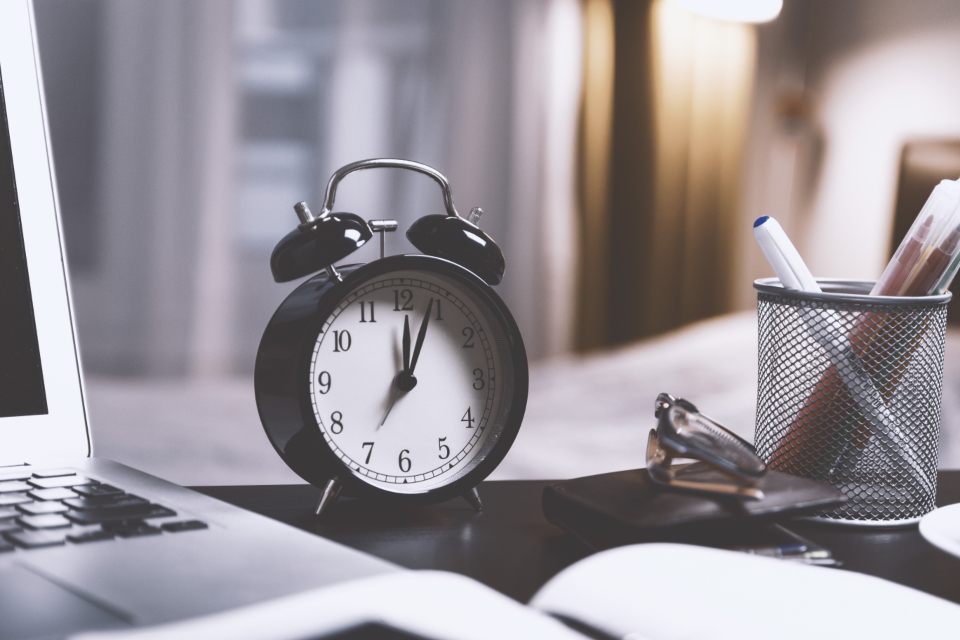

<!-- theme: ニュース型（Anthropic「The AI expectations gap」米国成人10,980人×社員1,334人・2026-10-16 ＋「How employment is changing at Anthropic」同日／AIで速くなったと答えた人と、変わらないと答えた人の差） / 余り0 -->
# 仕事でAIを使っても「時間は変わらない」と答えた人が29%。米国の成人1万980人とAI開発会社の社員1,334人に同じ質問をした調査

社員にAIを使わせ始めたけれど、本当に速くなっているのか分からない。そんな中小企業の社長や管理職に向けた記事です。
AIを作っている会社の社員と、ふつうの米国の働き手に、同じ質問をした調査が10月16日に公開されました。
答えが一番大きく分かれたのは、「AIを使うと、その仕事は何分になるか」でした。社員に何を聞けば、AIで時間が減ったかを確かめられるのか。その聞き方を、調査の中身と一緒に書きます。

---

## 何が出たのか：同じ8つの質問を、2つの集団に聞いた

公開したのは、Claudeを作っている米国のAnthropicの研究部門（The Anthropic Institute）です。
題は「The AI expectations gap」。直訳すると「AIへの期待の差」です。

聞いた相手は2つです。

- 米国の成人1万980人。調査会社のMorning Consultが2026年8月11日から23日にネットで集め、米国の人口構成に合うよう重みを付けている
- Anthropicの社員1,334人。8月9日から12日の社内アンケートで、重み付けは無し

質問は、AIに何ができるか、どれだけ仕事に使われるか、どれだけ時間が減るか、自分の仕事の何割をAIができるようになるか、などです。

まず、今のAIに何ができるかについては、2つの集団の答えはほとんど同じでした。
「科学の研究を設計して論文まで出せる」は、今既にできると答えた人がどちらも約4分の1です。

分かれたのは、この先の速さです。
2030年までにAIがノーベル賞級の発見をすると答えたのは、米国の成人で39%、社員で91%でした。

自分の仕事への見方は、もっと離れています。
2030年までに、今の自分の労働時間の何割をAIができるようになるか。社員の平均は75%、米国の働き手の平均は28%でした。80%以上と答えた米国の働き手は20人に1人です。

---

## 一番分かれた質問：「AIを使うと、その仕事は何分になるか」

この記事で一番見てほしいのは、時間の質問です。

質問はこうです。要約やメールの下書きのように、今のAIが得意な仕事を1つ思い浮かべる。AIを使うと、AI無しの時と比べて何割の時間で終わるか。
ここで大事なのは、AIの出した物を確かめて直す時間も含めて答える、と決められていたことです。

結果は次の通りでした。

- 社員の85%は「半分以下の時間で終わる」と答えた
- 仕事でAIを使っている米国の成人では、一番多い答えが「半分の時間」
- 同じ人たちのうち29%は「同じだけかかる、または余計にかかる」と答えた。社員でそう答えたのは5%
- 「4分の1以下の時間で終わる」は、仕事でAIを使う米国の成人で26%、使わない人で21%、社員で59%

つまり、仕事でAIを使っている米国の人の、およそ3人に1人は「速くなっていない」と感じています。
「4分の1以下」と答えた割合は、仕事でAIを使う人と使わない人で5ポイントしか違いません。使った経験があっても、大きく速くなったと感じる人はそれほど増えていない、という数字です。

実際、仕事でAIをふだんから使う人（回答者の約5分の1）は、社員に近い答えをしていました。
8つの仕事のうち7つ以上を2030年までにAIができると答えた割合は、ふだん使う人で56%、米国の成人全体で41%、一度も使ったことが無い人で28%、社員で96%です。

もう1つ、会社に関係する数字があります。
AIが仕事に広まらない理由を9つから3つまで選んでもらうと、一番多かったのは「お客様が人とのやり取りを望む」でした。次が「データの扱いと安全の心配」、「AIが十分に当てにならない」、「法律や規制、責任の所在」と続きます。
ふだんAIを使う人だけで見ると、データの心配を挙げた人が42%（それ以外の人は37%）、お客様が人を望むを挙げた人が37%（それ以外は42%）でした。使う人ほど、お客様より情報の扱いを気にしています。

---

## 速くなった会社の中で、何が起きていたか

同じ日に、Anthropicは自社の働き方の変化をまとめた報告も出しています（「How employment is changing at Anthropic」）。
社員が「半分以下の時間で終わる」と答える会社の中身です。人事の記録、AIの利用記録、社内アンケート、予定表、17人への聞き取りを使っています。

速くなった数字はこうです。

- 8月の時点で、社員が動かしているAIエージェントの稼働時間は、社員の労働時間の6倍になった
- コーディング用のAIを使い始めた技術者192人と、使っていない74人を比べると、使い始めた後に書くコードの量が大きく増えた。AIが書いたコードが後で消されたり取り消されたりする割合は、本人が書いたコードと差が無かった
- 営業の担当者もAIを使い始めた後、契約できた顧客の数が増えた。ある担当者は、メールの下書きや顧客管理への記録をAIに任せ、前の仕事の約2割が置き換わったと話している。別の担当者は、そのおかげで会える顧客が3割増えたと話している

一方で、速くなった分、人の手が詰まる場所も出ていました。

- 社員とAIのやり取りの時間のうち、約8割はAIが人の返事を待っている時間だった
- 技術職でない社員でも、AIが出した文章を全部読むと週の労働時間の半分を超える量になっていた
- AIへの作業の段取りや、AI同士の確認の仕組みを作る仕事が、AIとのやり取りの10%から22%に増えた
- AIに渡す常設の指示書は、2025年7月の数百件から1年後に8,500件になった
- 社員が会議に使う時間は、1年前より2割増えた

もう1つ、採用の数字もあります。技術部門で若手が占める割合は21%から14%に下がり、技術職の採用に占める若手の割合は27%から9%に下がりました。

---

## 読者の会社で写せること

この2本を並べると、AIで速くなった会社でも、AIの出した物を人が確かめる時間が新しく詰まっていることが分かります。
29%の人が「変わらない」と答えた理由はこの調査では聞かれていません。ただ、質問が確認と直しの時間を含めていた以上、そこで時間を使い切っている人がいると考えるのが自然です。

中小企業で写せることを3つ挙げます。

1つ目は、測り方です。
AIで時間が減ったかを社員に聞くとき、「使っていますか」ではなく、「この仕事は、確認と直しも入れて何分になりましたか」と聞く。調査と同じ聞き方にすると、29%の人と同じ状態の社員が見えてきます。

2つ目は、確かめる手間の短い仕事から渡すことです。
Anthropicの営業担当者がAIに任せたのは、メールの下書きと顧客管理への記録でした。どちらも、出来上がりを見て正しいかがすぐ分かる仕事です。
逆に、正しいかを確かめるのに元の仕事と同じだけかかる仕事は、AIに渡しても時間は減りません。

3つ目は、お客様の前に立つのは人のまま、その後ろの作業をAIに回すことです。
米国の成人が一番の壁に挙げたのは「お客様が人とのやり取りを望む」でした。Anthropicの営業担当者は、記録の作業をAIに任せた分、会える顧客を3割増やしています。人と話す時間を削るのではなく、増やすための使い方です。

あわせて、AIに渡す指示は書いて残しておく。Anthropicの社内では、AIに渡す常設の指示書が1年で8,500件に増えていました。同じ説明を毎回打ち込まずに済むようにする仕組みです。

---

## まだ分からない所

この調査には、気を付けて扱う点がいくつもあります。

- 調べたのはAIを売っている会社自身です。査読を経た論文ではなく、企業が出した報告書です
- 社員の答えは、毎日最先端のAIを使っている人の個人の見通しです。会社の計画や実測ではないと、報告書自身が書いています
- 米国の成人は、ネット調査に自分から登録した人たちです。重みを付けても、ネットを使わない人は入っていません
- 社内の生産性の比較は、AIを使い始める人を会社が無作為に選んだわけではありません。大きな仕事を前にした人が先に使い始めた可能性があると、報告書が自ら断っています
- 同じ時期にAnthropicの売上は大きく伸びていて、強い製品を売っていれば契約は取りやすい。この点も報告書に書かれています
- 日本の働き手に同じ質問をした数字はありません。日本で「変わらない」と答える人が何割になるかは分かりません

---

## 今日やれること

- 社員がAIを使っている仕事を1つ選び、「確認と直しも入れて、AI無しの時の何割の時間で終わったか」を聞く。半分、4分の1、変わらない、の3択で十分です
- 「変わらない」と答えた仕事は、確かめるのに時間がかかる仕事ではないかを見る。そうなら、確かめやすい別の仕事に入れ替える
- お客様と話す時間を減らさずに済む使い方を探す。記録、下書き、日程調整のように、お客様から見えない作業から始める

まとめると、次の3点です。

- 米国の成人1万980人とAnthropic社員1,334人で、今のAIにできることの見方はほぼ同じだったが、時間が減る幅は大きく分かれた
- 仕事でAIを使う米国の成人の29%は、確認と直しを入れると「同じだけかかる、または余計にかかる」と答えた。社員では5%
- 速くなった会社でも、AIの出した物を人が確かめる時間が新しい詰まりになっていた。AIには、正しいかをすぐ確かめられる仕事から渡す

AIで作業が速くなるのは、入口にすぎないと思っています。浮いた時間でお客様と会う回数を増やせたら、仕事はもっと楽しくなる。どの仕事を渡して、空いた時間を何に使うかを一緒に考えるのが、私たちの仕事です。

### 出典

- Szymon Sacher, Tess Cotter, Charles I. Jones, Anton Korinek, Peter McCrory「The AI Expectations Gap: Public and Frontier Lab Views on AI's Impact on Work」（The Anthropic Institute、2026年10月16日公開／企業の報告書・査読なし。米国成人10,980人は2026年8月11〜23日、社員1,334人は8月9〜12日）

https://www.anthropic.com/research/ai-expectations-gap

- Nathan Wilmers, Regina Catipon, Maxim Massenkoff, Peter McCrory「How Employment is Changing at Anthropic」（The Anthropic Institute、2026年10月16日公開／企業の報告書・査読なし。社内の人事・利用記録と社員17人への聞き取り）

https://www.anthropic.com/research/employment-at-anthropic

---

## 私たちについて

株式会社AIdollargameは、「楽じゃなく、楽しいを考える」をテーマに、AIプロダクトを自社開発しているAI会社です。

- AI導入支援・コンサルティング

https://aidollargame.com/ai-consulting.html?utm_source=note&utm_campaign=2026-11-09

- AIエージェント：問い合わせ・予約対応を24時間自動化

https://aidollargame.com/line-ai-agent.html?utm_source=note&utm_campaign=2026-11-09

- AIside：経営者の"もう一人の自分"になる付き人AI

https://aidollargame.com/aiside.html?utm_source=note&utm_campaign=2026-11-09

- AIwill／社長クローンAI：経営者の判断軸をAIに学習させる

https://aidollargame.com/human-clone-ai.html?utm_source=note&utm_campaign=2026-11-09

「うちの仕事でAIに何ができる？」は、無料のAI活用度診断から。

https://aidollargame.com/shindan.html?utm_source=note&utm_campaign=2026-11-09

- 公式サイト

https://aidollargame.com/?utm_source=note&utm_campaign=2026-11-09

- ご相談：info@aidollargame.com

このnoteでは、AI活用のリアルや時事の読み解きを、過程まで含めて正直に発信しています。フォローしてもらえると嬉しいです。

---

ハッシュタグ案：#AI活用 #生産性 #中小企業 #業務改善 #調査データ

サムネ文言案：
1. AIを使っても「時間は変わらない」29%
2. 確認と直しを入れて、その仕事は何分になった？
