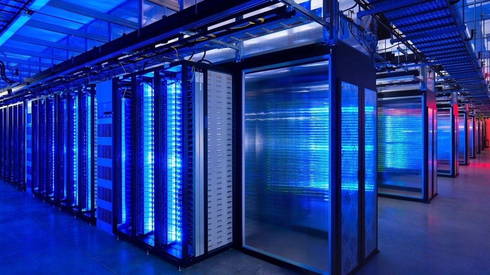

<!-- theme: ニュース型（米国11/3のAIデータセンター住民投票 Ballotpedia集計 41件中40件 ＋ OpenAI「責任あるAIインフラ整備の新たな基準」11/5 ＋ CNBC 11/5・11/6）／AIを動かす建物の建設が、住民の投票で止まり始めた / 余り1 -->
# AIのデータセンター建設に住民が投票し、41件中40件で「制限する」が勝った。2日後、OpenAIは電気代の全額負担を約束した

ChatGPTやClaudeを仕事で使っている会社の社長や管理職に向けた記事です。
11月3日の米国の中間選挙で、AIを動かすデータセンターの建設を地元で認めるかどうかを、住民が投票で決めました。結果はほぼ全部が「制限する」でした。
その2日後、OpenAIは建設先の地域に向けた約束を公表しています。毎日使っているAIの裏で何が起きているのか、投票結果の一覧とOpenAIの発表本文を開いて、数字を書きます。

---

## 何が起きたのか：41件の住民投票のうち、40件で制限する結果になった

米国の選挙情報サイトBallotpediaは、データセンターに関わる住民投票を州ごとに集計しています。
2026年に予定されている住民投票は、13州で少なくとも50件。そのうち41件が、11月3日の中間選挙と同じ日に行われました。

11月3日の41件の結果は次の通りです。

- 40件で、データセンターの建設を制限する結果になった
- 建設を制限する案の可決が27件。建設を進める案の否決が13件
- 例外は、ノースダコタ州ハーウッドの1件だけ。データセンターなどの開発に追加の審査を求める案が否決された

年初からの分も合わせると、11月4日時点で結果が出たのは47件。そのうち46件、98%が制限する結果でした。
州別で一番多いのはオハイオ州で、50件のうち21件を占めています。

可決された27件の中身は、次のようなものです。

- 市や町の中でデータセンターを全面的に禁止する：5件
- 電力が25メガワットを超えるような大きなデータセンターだけを禁止する：12件
- 6か月間、新しい申請を受け付けない：3件（すべてメイン州）
- 一定の規模を超える開発は住民の投票で決める：2件

数字を2つ挙げます。
カリフォルニア州アルハンブラ市では、市内でのデータセンター禁止に84%が賛成しました。
イリノイ州ジョリエット市では、「AIのデータセンターの建設を認めるよう市に勧める」という案に、反対が79%でした。AIという言葉が、案の名前にそのまま入っています。

---

## 2日後にOpenAIが出した約束：電気代は全額自分で払う

OpenAIは11月5日、「責任あるAIインフラ整備の新たな基準」という発表を公開しました。日本語版も出ています。
今後OpenAIが自分で持って運営するデータセンターについて、地域ごとに取り決めを作り、次の3つを必ず入れるという内容です。

1つ目は、電気の費用です。
使う電力と、その電力を届ける送電設備の費用は全額OpenAIが払う。計画が遅れたり、小さくなったり、中止になったりしても、他の電気の利用者に負担が回らないよう、お金の保証を先に出す、としています。

2つ目は、地域の資源と、数字の公表です。

- データセンターごとに水の使い方の計画を作り、水を循環させる冷却や節水型の冷却を優先する
- データセンターごとの水と電気の使用量を公表する
- 建設計画と、第三者による騒音の調査結果を、動き出す前と、その後も毎年公表する
- 自治体の公職者に秘密保持契約を結ばせない（セキュリティや営業秘密などの情報は除く）

3つ目は、地元の仕事です。
見込んでいる雇用の数を公表し、労働組合や職業訓練の機関と組んで、住民がその仕事に就けるよう準備を手伝う。採用の状況は毎年報告する、としています。

具体例も書かれています。
ジョージア州エフィンガム郡では、郡内の児童・生徒1万4,000人の学校給食を無料にするため、480万ドルの助成が決まりました。
同じ郡で計画中のデータセンターでは、電力会社のGeorgia Powerとの契約で、電気が足りない時期に、OpenAIへの供給を最大1,000メガワット減らせるようにしています。

OpenAIはこの約束を、自社のデータセンターだけでなく、国や州のルールにすべきだとも提言しています。

---

## AIを使う会社に関係すること

投票の結果は、お金の動きにも出ました。
米国のテレビ局CNBCによると、選挙の翌日、データセンターを持って計算機を貸している会社の株が下がり、CoreWeaveは約10%下がりました。
テキサス州の次の知事は、データセンターの新しい許可を州全体で止める案を出しています。既に建設中のものは対象外とされています。

一方で、OpenAIの最高財務責任者は11月6日にCNBCに対し、「AIの需要は本物だ」と話し、投資を続けると答えています。

日本の中小企業にとって、すぐに何かが変わる話ではありません。
野村證券は、2027年に動き出すデータセンターの多くは既に建設中なので、すぐの影響は小さく、影響が大きくなるのは2028年以降と見ています（CNBCの記事による）。

それでも、私たちが毎月払っているAIの料金の裏には、電気と土地と水があり、そこに地元の住民の投票が入るようになった、というのが今回の事実です。
AIの計算をする場所をどこにどれだけ作れるかが、技術だけでは決まらなくなっています。

---

## まだ分からない所

- AIの料金や使える量に、これがどう出てくるかは分かりません。OpenAIの発表にも、料金の話は書かれていません
- 住民投票の中には、市への「勧告」にとどまり、法的な縛りの無いものも含まれています。Ballotpediaは、拘束力のある禁止と、勧告だけのものを分けて数えています
- OpenAIの約束は、OpenAIが自分で持つデータセンターが対象です。他社から借りている計算機には、そのままは当てはまりません
- 日本で同じような住民投票が起きているかは、今回の資料からは分かりません

---

## 今日やれること

- 使っているAIサービスの契約やプランで、料金の改定や利用量の上限がどう書かれているかを1度確かめておく
- 業務で使うAIを1社だけに頼っていないかを見る。止まったときや値上げのときに切り替えられる候補を、1つ決めておく
- 社内でAIを広げるとき、社員から「電気や環境は大丈夫か」と聞かれたら、OpenAIが公表を約束した数字（電気、水、騒音、雇用）を例に話せる

まとめると、次の3点です。

- 11月3日、米国の41件のデータセンターの住民投票のうち、40件で建設を制限する結果になった。年初からでは47件中46件
- その2日後、OpenAIは電気と送電設備の費用の全額負担、水と電気の使用量の公表、公職者との秘密保持契約の不使用を約束した
- 日本の会社にすぐの影響は小さいが、AIの料金や使える量の裏に、地元の住民の判断が入り始めている

AIで仕事が楽になるのは、入口にすぎないと思っています。そのAIを動かす建物が誰の町に建ち、その町の人が何を決めたのかまで知っておくと、AIの使い方を一緒に考えるときの話が具体になる。そこを一緒に考えるのが、私たちの仕事です。

### 出典

- Ballotpedia「Data center-related ballot measures, 2026」（米国の選挙情報サイトの集計。2026年11月4日時点の結果）

https://ballotpedia.org/Data_center-related_ballot_measures,_2026

- OpenAI「責任ある AI インフラ整備の新たな基準」（2026年11月5日公開／企業の公式発表）

https://openai.com/ja-JP/index/setting-new-standard-responsible-ai-infrastructure/

- CNBC「U.S. midterms could widen AI data center divide」（2026年11月5日／報道）

https://www.cnbc.com/2026/11/05/ai-data-centers-midterms-capacity.html

- CNBC「OpenAI will keep investing in AI data centers despite election results, CFO tells CNBC」（2026年11月6日／報道）

https://www.cnbc.com/2026/11/06/open-ai-data-centers-election.html

---

## 私たちについて

株式会社AIdollargameは、「楽じゃなく、楽しいを考える」をテーマに、AIプロダクトを自社開発しているAI会社です。

- AI導入支援・コンサルティング

https://aidollargame.com/ai-consulting.html?utm_source=note&utm_campaign=2026-11-10

- AIエージェント：問い合わせ・予約対応を24時間自動化

https://aidollargame.com/line-ai-agent.html?utm_source=note&utm_campaign=2026-11-10

- AIside：経営者の"もう一人の自分"になる付き人AI

https://aidollargame.com/aiside.html?utm_source=note&utm_campaign=2026-11-10

- AIwill／社長クローンAI：経営者の判断軸をAIに学習させる

https://aidollargame.com/human-clone-ai.html?utm_source=note&utm_campaign=2026-11-10

「うちの仕事でAIに何ができる？」は、無料のAI活用度診断から。

https://aidollargame.com/shindan.html?utm_source=note&utm_campaign=2026-11-10

- 公式サイト

https://aidollargame.com/?utm_source=note&utm_campaign=2026-11-10

- ご相談：info@aidollargame.com

このnoteでは、AI活用のリアルや時事の読み解きを、過程まで含めて正直に発信しています。フォローしてもらえると嬉しいです。

---

ハッシュタグ案：#AI #データセンター #OpenAI #中小企業 #AIニュース

サムネ文言案：
1. AIのデータセンター、住民投票41件中40件で「制限」
2. OpenAIが約束した「電気代は全額自分で払う」
