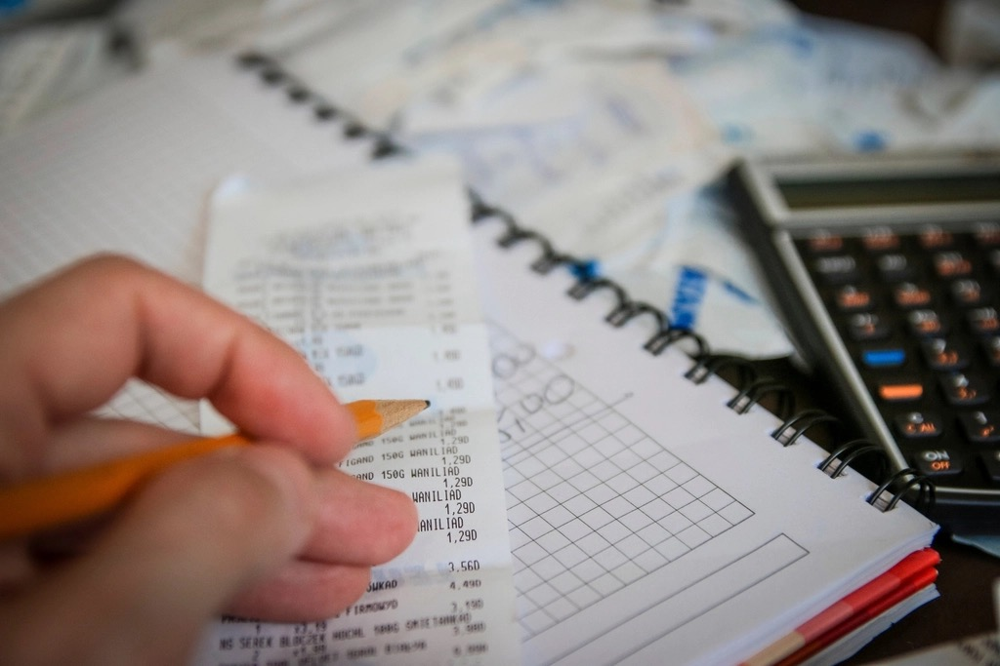

<!-- theme: ニュース型（VoxEU「The concentration of AI spending」2026-11-07・米アトランタ連銀SBU 845社＋英イングランド銀行DMP 1,273社のAI支出／社員1人あたりの平均と中央値の差） / 余り1 -->
# AIへの支出の半分を、2%の会社が払っていた。米英の企業2,118社に聞いた2026年のAI予算

来年のAIの予算をいくらにするか、決めかねている中小企業の社長や管理職に向けた記事です。
米国と英国の中央銀行が回している企業調査で、「AIにいくら使ったか、今年はいくら使う予定か」を聞いた結果が、11月7日に公開されました。
よその会社はAIにいくら払っているのか。その数字をどう見て、自社の予算にどう写せばいいかを、調査の中身と一緒に書きます。

---

## 何が出たのか：AIの支出を、社員1人あたりで聞いた

公開されたのは、経済学者向けの解説サイトVoxEUのコラム「The concentration of AI spending（AI支出の集中）」です。
書いたのは、米アトランタ連邦準備銀行、英イングランド銀行、スタンフォード大学などの研究者11人です。
査読を通った論文ではなく、研究者が自分たちの調査結果を速報として解説した公表資料、という格になります。

使ったのは2つの企業調査です。

- 米国：アトランタ連銀の「Survey of Business Uncertainty」。2026年3月に聞き、845社が回答
- 英国：イングランド銀行の「Decision Maker Panel」。2026年8〜9月に聞き、1,273社が回答

答えたのは、どちらも企業の経営幹部です。

質問は、AIの導入と関連技術に2025年にいくら使ったか、2026年にいくら使う予定か。
ここで「AIの支出」に入れるよう決められていたのは、ソフト、月額の利用料、機械、社員の研修、社内のIT担当の支援の5つです。道具の代金だけではありません。
金額は会社の社員数で割って、社員1人あたりで比べています。

結果は次の通りでした。

- 米国で2025年にAIへ何かしら払った会社は80%を超えた。払っていない会社は2025年に16%、2026年は11%の見込み
- 米国の社員1人あたりの平均は、2025年の約1,363ドルから、2026年は約2,043ドルの見込み。およそ5割増
- 英国の社員1人あたりの平均は、2025年の422ドルから、2026年は725ドルの見込み。およそ7割増
- 英国でAIに全く払っていない会社は、2025年の3分の1から、2026年は17%に減る見込み

この平均は、社員数の多い会社ほど重く数える方法で出しています。
調査の答えを国全体に広げると、2026年のAI支出は米国で約2,800億ドル、英国で約250億ドルになる、というのが研究者たちの見積もりです。

---

## 一番見てほしい数字：平均は2,043ドル、真ん中の会社は294ドル

米国の2026年の数字を、もう少し細かく見ます。

- 社員1人あたりの平均：2,043ドル
- 真ん中の会社（中央値）：294ドル
- 支出の多い上位10%の会社：平均7,480ドル

平均と真ん中の会社で、およそ7倍の差があります。
平均を押し上げているのは、ひと握りの会社です。

そのひと握りが、どれだけ小さいかも出ています。
2026年に見込まれるAI支出の半分を払っているのは、米国では会社全体の1.8%、英国では1.3%でした。
100社あれば、2社にも満たない会社が、残り98社分と同じ額をAIに払う計算です。

研究者たちは、この偏りが調査の誤差ではないかも確かめています。
企業の決算データで、売上、社員数、設備などへの投資の偏りと並べると、AIの支出は売上や社員数より偏っていて、投資全体とはほぼ同じ偏り方でした。
AIの支出は、機械や建物への投資と同じように、大きく払う会社が限られる種類のお金だ、という見方です。

業種でも差があります。
米国では、金融、情報、専門サービスの会社が社員1人あたり3,000ドルを超える見込みで、製造業は1,000ドルを下回ります。
英国でも、金融、情報、専門サービスが約1,300ドルで一番高く、他の業種は1,000ドル未満でした。

英国のデータでは、会社の特徴との関係も見ています。
1人あたりの生産性が高い会社、給料の高い会社、若い会社、取締役の年齢が若い会社ほど、社員1人あたりのAIの支出が多い見込みでした。
ただし、これは並べて比べた結果です。AIに払ったから生産性が上がったのか、もともと生産性の高い会社がAIに払っているのかは、このコラムからは分かりません。

---

## 自社の予算に写せること：比べる相手は「平均」ではなく「真ん中」

ここからは、日本の中小企業が来年の予算を考えるときに写せることです。

1つ目。「他社は社員1人あたりいくらAIに使っている」という数字を見たら、平均か中央値かを確かめる。
今回の米国の数字なら、平均の2,043ドルと、真ん中の294ドルでは話が全く変わります。
平均だけを見て予算を組むと、ひと握りの大手に合わせた額になります。

2つ目。AIの支出を、道具の代金だけで数えない。
この調査では、研修と社内のIT担当の手間も「AIの支出」に入れて聞いています。
ツールの月額は小さくても、社員に使い方を教える時間や、設定を担う人の時間がかかっていれば、それも費用です。
自社で去年AIにいくら使ったかを数えるときも、この5つの区分で数えると、他社の数字と並べられます。

3つ目。業種で比べる。
同じ米国でも、金融・情報・専門サービスと製造業では、1人あたりの額が3倍以上離れています。
自社と違う業種の数字を基準にしない方が、予算の話がぶれません。

4つ目。2026年の数字は「使う予定」だと覚えておく。
米国の会社が3月に答えた見込みで、実際に払ったかどうかはまだ分かりません。去年の実績（2025年）と分けて見ると、比べ間違いが減ります。

---

## まだ分からないこと

このコラムで決まっていないことも、書いておきます。

- 日本の会社は調査に入っていない。米国と英国だけの数字
- 2026年の額は「使う予定」で、実際に払った額ではない。米国は3月、英国は8〜9月に聞いており、聞いた時期も違う
- AIに払った額と、その会社の成果の関係は出ていない。支出が多い会社が得をしているかは、この調査からは言えない
- 研究者たちも、今の偏りが、使う会社が増えるにつれて小さくなるかどうかは、これから追うべきだと書いている

なお、同じ研究チームは別の論文（NBERのワーキングペーパー）で、7か国の経営幹部9,000人超に聞き、78%の会社が何かしらのAIを使っていると報告しています。
使っている会社は8割。でも、払っている額の半分は2%の会社。
この2つを並べると、AIを使っている会社の数が増えても、払っている額は一部の会社に集まったままだと分かります。

---

## 今日やれること

- 自社が2025年にAIへ使った額を、ソフト・月額の利用料・機械・研修・IT担当の支援の5つに分けて書き出す
- その合計を社員数で割り、1人あたりの額を出す。米国の真ん中は294ドル、英国の平均は422ドル（2025年）
- 来年の予算を決める前に、比べる相手の数字が平均か中央値か、どの業種の数字かを確かめる

AIに払う額を大きくすること自体は、目的ではありません。
AIに任せて浮いた時間で、社員が何をするようになったか。予算を決めるときは、その時間の使い道まで一緒に書いておくと、AIで楽になった先の、楽しい仕事の話ができます。

出典
- Yotzov, Barrero, Bloom ほか「The concentration of AI spending」VoxEU（CEPR）、2026年11月7日（研究者による調査結果の解説／査読前の公表資料）

https://cepr.org/voxeu/columns/concentration-ai-spending

- Yotzov ほか「Firm Data on AI」NBER Working Paper 34836、2026年10月改訂（ワーキングペーパー／査読前）

https://www.nber.org/papers/w34836

---

## 私たちについて

株式会社AIdollargameは、「楽じゃなく、楽しいを考える」をテーマに、AIプロダクトを自社開発しているAI会社です。

- AI導入支援・コンサルティング

https://aidollargame.com/ai-consulting.html?utm_source=note&utm_campaign=2026-11-10

- AIエージェント：問い合わせ・予約対応を24時間自動化

https://aidollargame.com/line-ai-agent.html?utm_source=note&utm_campaign=2026-11-10

- AIside：経営者の"もう一人の自分"になる付き人AI

https://aidollargame.com/aiside.html?utm_source=note&utm_campaign=2026-11-10

- AIwill／社長クローンAI：経営者の判断軸をAIに学習させる

https://aidollargame.com/human-clone-ai.html?utm_source=note&utm_campaign=2026-11-10

「うちの仕事でAIに何ができる？」は、無料のAI活用度診断から。

https://aidollargame.com/shindan.html?utm_source=note&utm_campaign=2026-11-10

- 公式サイト

https://aidollargame.com/?utm_source=note&utm_campaign=2026-11-10

- ご相談：info@aidollargame.com

このnoteでは、AI活用のリアルや時事の読み解きを、過程まで含めて正直に発信しています。フォローしてもらえると嬉しいです。

---

ハッシュタグ案：#AI活用 #AI予算 #中小企業 #経営 #調査データ

サムネ文言案：
1. AIへの支出の半分は、2%の会社が払っていた
2. 平均2,043ドル、真ん中の会社は294ドル
