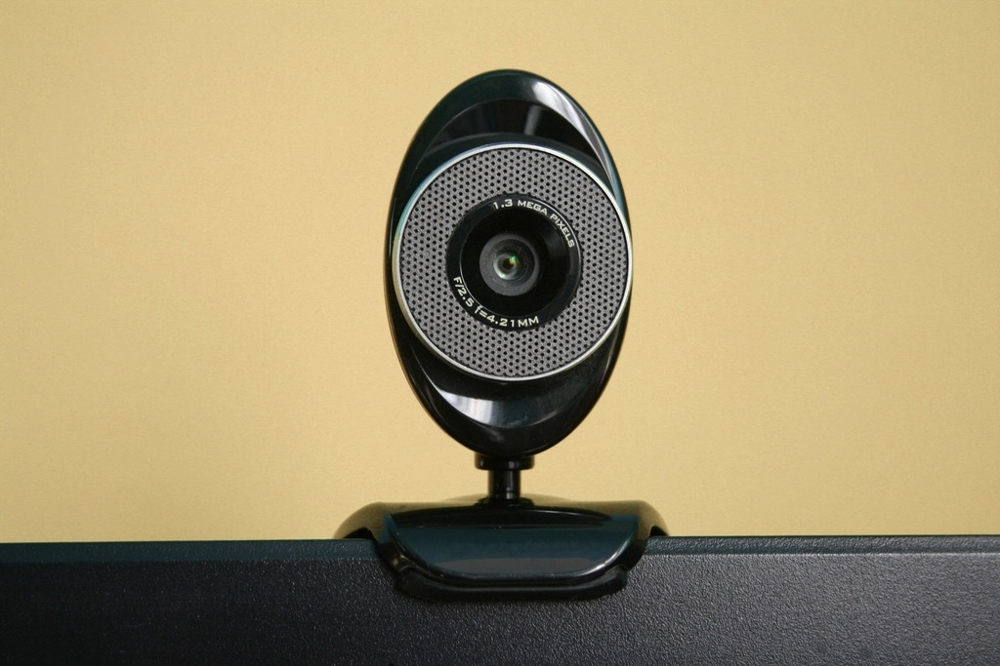

<!-- theme: ニュース型（NTTドコモ モバイル社会研究所「生成AIの偽情報に『だまされない自信』1年で低下し約3割に」2026年11月12日公表。2025年2月7,527人・2026年2月7,223人の全国Web調査。レポート本文を原文で確認。対比にiProov社の2,000人テスト（2025年公表）と香港警察が発表したビデオ会議の詐欺事件） / 余り2 -->
# 生成AIの偽物にだまされない自信がある人は、1年で35%から28%に減った。AIに詳しい人ほど大きく下がった

取引先や社長の顔と声で「至急この口座に振り込んで」と頼まれたら、社員は見抜けるのか。そこが気になっている経営者や経理の方に向けて書きます。

NTTドコモのモバイル社会研究所が11月12日、生成AIで作られた偽の文章・画像・動画にだまされない自信があるかを、全国の15〜69歳に聞いた結果を公表しました。2025年2月と2026年2月の2回、それぞれ7,000人以上に聞いています。

私が手を止めたのは、生成AIを「詳しく知っている」人の数字でした。1年で15.7ポイント下がっています。レポートの本文を開いて、数字のかかり先と、この調査で言えないことを確かめました。

---

## 何が出たのか。テキストの偽物は35.4%から27.6%に

調査の形はこうです。

- 方法：Web調査。性別・5歳刻みの年齢・都道府県が日本の人口の構成になるよう人数を割り当てている
- 人数：2025年2月が7,527人、2026年2月が7,223人
- 今回の質問に答えたのは、その中で生成AIを「詳しく知っている」か「ある程度知っている」と答えた人

聞いたのは「生成AIで作られた偽情報にだまされない自信はありますか」。「自信がある」と「やや自信がある」を足した割合が、1年でこう変わりました。

- テキストの偽物：35.4% → 27.6%
- 画像の偽物：37.7% → 31.5%
- 動画の偽物：36.8% → 30.8%

3種類とも約3割まで下がっています。

下がり方が大きかったのは、AIに詳しい人でした。生成AIを「詳しく知っている」人に限ると、テキストは68.1%から52.4%（15.7ポイント減）、画像は70.7%から56.7%、動画は69.6%から56.3%です。「ある程度知っている」人の下げ幅は6〜7ポイントなので、詳しい人の方が2倍以上下げています。

年代別では、どの性別・年代でも2026年が2025年を下回りました。一番下げたのは15〜29歳の男性で、テキストの偽物が58.2%から41.8%へ16.4ポイント下がっています。一番低いのは50〜69歳の女性で、テキストが14.7%でした。

---

## 自信が下がったのは、悪い知らせなのか

この数字を見て、最初は「日本人がAIの偽物に弱くなった」と読みかけました。ただ、聞いているのは自信であって、見抜く力そのものではありません。

見抜く力を実際に測った調査があります。英国の本人確認の会社iProovが、英国と米国の2,000人に本物と偽物の画像・動画を見せて、どちらかを答えてもらいました（2025年公表の自社調査で、論文ではありません）。

- 全部を正しく見分けられた人：0.1%（2,000人中およそ2人）
- 偽の動画は偽の画像より、正しく見抜かれる割合が36%低かった
- それでも、答えが合っていたかに関係なく、自分の判定に自信を持つ人は60%を超えていた

参加者は「偽物が混ざっている」と知らされた上で見ています。普段の仕事中は、もっと見抜けないはずです。

2つを並べると、ドコモの調査で自信が下がったことは、実際の見抜く力に近づいた、とも読めます。詳しい人の自信が大きく下がった理由は、調査では確かめられていません。私は、作られる物の出来がこの1年で上がったのを、詳しい人ほど見ているからだと考えています。

実際の被害の例も1つ挙げます。2024年2月に香港警察が発表した事件では、ある会社の社員が、本社の幹部を名乗る人が何人も出てくるビデオ会議に呼ばれました。全員の顔と声が本物に見えたため、指示どおり5つの口座へ15回送金し、合計は2億香港ドルでした。警察は、犯人が事前に動画を集め、AIで声を付けたとみていると説明しています。社員が本社に確かめたのは、送金の後でした。

---

## この調査で、まだ言えないこと

レポート自体も、いくつか断りを入れています。

- 自信は本人の申告です。偽物を見せて判定させたわけではないので、見抜く力が下がったのか上がったのかは分かりません
- 生成AIを知っている人は1年で増えています。最近知った人が加わったことが、割合を押し下げた可能性があるとレポートも書いています
- 「AIを信じすぎて確かめずに失敗したことがある」と答えた人は、画像の偽物に自信がある割合が47.3%で、答えなかった人の34.7%より12.6ポイント高い結果でした。失敗したから自信が付いたのか、よく使う人だから両方当てはまるのか、この調査からは決まりません
- 対象は個人の生活の場面です。会社の経理や総務の担当者に限った数字ではありません

それでも、全国7,000人規模で同じ質問を1年空けて2回聞いた結果として、どの年代でも自信が下がった、という向きは確かです。

---

## 今日やれること。見抜く力に頼らない決め方にする

自信がある人でも0.1%しか全部を見分けられなかった以上、社員の目で偽物を見抜く前提の守り方は外した方がいいと私は考えています。代わりに、偽物でも通らない手順を決めておきます。

1. 送金と振込先の変更は、届いた経路と別の経路で確かめる。メールやビデオ会議で頼まれたら、こちらが前から知っている電話番号へかけ直す。相手から届いた連絡先は使わない
2. 社長や役員からの「至急」「内密に」は、それだけで一度止める理由にする、と社内で先に言っておく。香港の事件の最初の連絡も、内密の取引の話でした
3. 一定額を超える振込は2人で確かめる。1人が会議で信じてしまっても、もう1人が会議の外で確かめられる形にする

3つともAIの道具を買わずに、今日の朝礼で決められます。

AIで偽物を作るのが簡単になった分、確かめる手順を1つ足すのは面倒に見えます。それでも、その1手で守った時間とお金は、本来やりたい仕事の方に回せます。

---

## まとめ

- 全国の15〜69歳7,223人（2026年2月）で、生成AIの偽物にだまされない自信がある人は、テキスト27.6%・画像31.5%・動画30.8%。1年前より6〜8ポイント下がった
- 生成AIを詳しく知っている人ほど大きく下げ、テキストは68.1%から52.4%に。すべての性別・年代で下がった
- 聞いたのは自信で、見抜く力ではない。実際に試したiProovの2,000人テストでは、全部を見分けられたのは0.1%だった
- 会社の守りは、社員が見抜くことを前提にせず、別の経路でかけ直す・「至急」で止める・2人で確かめる、の手順で作る

出典

- NTTドコモ モバイル社会研究所「生成AIの偽情報に『だまされない自信』1年で低下し約3割に」（2026年11月12日／調査機関の公表資料。2025年2月7,527人・2026年2月7,223人のWeb調査）

https://www.moba-ken.jp/project/lifestyle/20261112.html

- iProov「Study Reveals Deepfake Blindspot: Only 0.1% of People Can Accurately Detect AI-Generated Deepfakes」（2025年／本人確認の会社による自社調査。英米2,000人。査読なし）

https://www.iproov.com/press/study-reveals-deepfake-blindspot-detect-ai-generated-content

- The Guardian「Company worker in Hong Kong pays out £20m in deepfake video call scam」（2024年2月5日／報道。香港警察の発表を引用）

https://www.theguardian.com/world/2024/feb/05/hong-kong-company-deepfake-video-conference-call-scam

---

## 私たちについて

株式会社AIdollargameは、「楽じゃなく、楽しいを考える」をテーマに、AIプロダクトを自社開発しているAI会社です。

- AI導入支援・コンサルティング

https://aidollargame.com/ai-consulting.html?utm_source=note&utm_campaign=2026-11-17

- AIエージェント：問い合わせ・予約対応を24時間自動化

https://aidollargame.com/line-ai-agent.html?utm_source=note&utm_campaign=2026-11-17

- AIside：経営者の"もう一人の自分"になる付き人AI

https://aidollargame.com/aiside.html?utm_source=note&utm_campaign=2026-11-17

- AIwill／社長クローンAI：経営者の判断軸をAIに学習させる

https://aidollargame.com/human-clone-ai.html?utm_source=note&utm_campaign=2026-11-17

「うちの仕事でAIに何ができる？」は、無料のAI活用度診断から。

https://aidollargame.com/shindan.html?utm_source=note&utm_campaign=2026-11-17

- 公式サイト

https://aidollargame.com/?utm_source=note&utm_campaign=2026-11-17

- ご相談：info@aidollargame.com

このnoteでは、AI活用のリアルや時事の読み解きを、過程まで含めて正直に発信しています。フォローしてもらえると嬉しいです。

---

ハッシュタグ案：#生成AI #ディープフェイク #なりすまし詐欺 #経理 #中小企業

サムネ文言案：
1. AIの偽物にだまされない自信、1年で35%→28%
2. 全部見抜けたのは2,000人中0.1%
