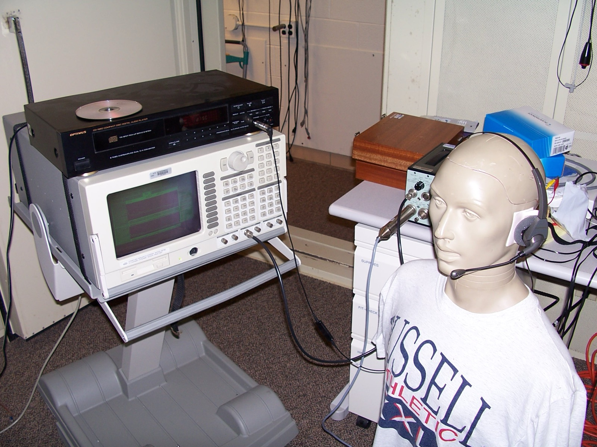

<!-- theme: ニュース型（博報堂DYホールディングス Human-Centered AI Institute「AIと暮らす未来の生活調査2026」2026年11月16日公表。全国15〜74歳、事前調査18,888人・本調査3,513人、マクロミルのネット調査。リリースPDF 11ページの図表まで確認） / 余り1 -->
# 問い合わせ対応を「AI中心でいい」と答えた人は41%、「AIだけでいい」は8%だった。3,513人に聞いた、AIに任せていい仕事の線

問い合わせ窓口や受付にAIを入れようか迷っている経営者の方に向けて書きます。お客さんはAIの応対をどこまで受け入れるのか、という問いに、日本の生活者3,513人の回答が出ました。

博報堂DYホールディングスの研究所が11月16日、「AIと暮らす未来の生活調査2026」を公表しました。今年で4回目の調査です。

報道では「生成AIの利用率が63.7%で、昨年の約2倍」という数字が先に出ています。私が手を止めたのは、リリースのPDFの9ページ目にある表でした。28の仕事について、「AIはどこまでやってよいか」を4段階で聞いた結果です。図表の数字まで開いて確かめました。

---

## 何が出たのか。28の仕事を「AIだけ」から「人だけ」まで4段階で聞いた

まず調査の形です。

- 対象：全国の15〜74歳
- 方法：マクロミルのインターネット調査、2026年9月
- 人数：事前調査18,888人、本調査3,513人
- 前の年との比較は、両年に共通する15〜69歳で集計

生成AIを使っている人は63.7%で、昨年の33.6%から増えました。10代は88.8%、20代は76.7%、30代は64.5%です。

使い方を見ると、AIを使う人の98.0%が「プライベートまたは学業で」使っています。「仕事だけ」の人は2.0%でした。つまり、あなたの会社のお客さんの多くは、既に家でAIと話しています。

問題の表は、本調査の全員（3,513人）に、28の仕事それぞれで次の4つから選んでもらったものです。

1. AIだけでいい
2. AIが中心で、人が少し関わればいい
3. 人が中心で、AIが少し手伝えばいい
4. 人だけでいい

1と2を足した「AI中心」が過半数だったのは、3つだけでした。

- 事務作業（データ入力など）：61.0%
- 翻訳：60.8%
- 情報収集と分析：54.9%

会社の仕事に近い項目を、表から私が足し算して並べます。

- 文書作成（企画書、報告書など）：AI中心46.9%／人中心53.2%
- カスタマーサポート（問い合わせ、クレーム対応など）：AI中心41.0%／人中心59.1%
- 価格決定（商品の値付けなど）：AI中心35.1%／人中心64.8%
- 接客（店頭での案内など）：AI中心30.0%／人中心70.0%
- 人事評価（部下の評価など）：AI中心27.7%／人中心72.3%
- 経営判断（事業の方針、投資など）：AI中心23.2%／人中心76.8%
- 採用（応募者の選考など）：AI中心21.4%／人中心78.6%

---

## 一番多かったのは「AIだけ」でも「人だけ」でもなかった

私がこの表で一番時間を使ったのは、両端の数字です。

カスタマーサポートで「AIだけでいい」と答えた人は8.3%でした。一方、「人だけでいい」も15.4%しかいません。最も多かったのは「人が中心で、AIが少し手伝えばいい」の43.7%で、次が「AIが中心で、人が少し関わればいい」の32.7%です。

この形は28項目すべてで同じでした。真ん中の2つを足すと、どの項目でも6割を超えています。一番「人だけ」が多い育児でも34.6%で、「AIだけ」が一番多い事務作業でも19.1%です。

お客さんの答えを言い換えると、「全部AIにされるのは嫌だが、AIが入ること自体は構わない」になります。問い合わせ窓口の設計で言えば、問われているのは「AIを入れるか、入れないか」ではありません。「どこで人に代わるか」です。

同じ調査には、AIの答えの扱い方を聞いた質問もあります（生成AIを使う2,400人が対象）。

- AIが出す答えには、間違いがあると思っている：85.1%
- AIが出した内容はそのまま使わず、自分で修正・吟味して使う：81.3%
- 間違えると困る重要なことは、最初からAIに聞かない：60.9%

「生成AIの情報を信頼している」と答えた人は48.0%で、昨年の55.1%から下がりました。使う人は増え、信頼は下がった。お客さんは、AIの返事を「下書き」程度に受け取っていると考えた方が実態に近そうです。

もう1つ、窓口の設計に関係する数字がありました。悩みを人とAIに話したあとの状態を比べた質問です。

- 「あとで気まずくならない」：AI 54.6%、人 26.9%
- 「わかってもらえたと感じる」：AI 23.6%、人 57.1%
- 「悩みや困りごとが解決する」：AI 32.9%、人 47.0%

気軽に聞けるのはAI、分かってもらえて片付くのは人。この差は、問い合わせの入口をAIにして、こじれた話を人が引き取る作りと重なります。

---

## 社内で使うときに気になった数字。10代・20代の「自分で決める力」

次は、会社で働く社員の話です。生成AIを使う人を年代ごとに400人ずつ集め、使い始めてからの変化を聞いています。

「自分で決断する力が弱まった」と答えたのは、10代43.7%、20代42.7%でした。60代以上は20.4%です。「自分で決めたあとも、AIに確かめるようになった」は10代58.3%、20代57.0%で、60代以上の32.2%を大きく上回っています。

10代では「どこからの情報か確かめずに、そのまま使う」が43.4%でした。生成AIを使う人全体では29.7%です。

これから入ってくる新卒や若手は、AIを使い慣れた状態で来ます。その一方で、確かめずに使う人も、決める前にAIに聞く人も多い。研修で教えるべきは「AIの使い方」より「AIの答えをどこで止めて確かめるか」のほうかもしれない、と私は読みました。

---

## この調査で言えないこと

数字を自社に当てはめる前に、3つ書いておきます。

- 本調査3,513人は、AIを日常的に使う人・ときどき使う人・使わない人の3つに分け、性別・年代・地域で均等に割り付けています。人口の構成に合わせて補正したかは、リリースには書かれていません。28項目の割合は「日本人全体の割合」ではなく、「この割り付けで集めた人の割合」として読む必要があります。
- 「AIはどこまでやってよいか」は、世の中の仕事についての考えです。自分がお客さんとしてAIの窓口に当たったときの満足度を測ったものではありません。
- 公表元は企業の研究所で、学術誌の査読は経ていません。数字はリリースとPDFの図表から取りました。

---

## 今日やれること

問い合わせ窓口にAIを入れるかどうかを考えている会社なら、次の3つから始められます。

1. 過去1か月の問い合わせを、「答えが1つに決まる質問」（営業時間、料金、予約の空き）と「事情を聞かないと答えられない相談」（クレーム、返金、個別の事情）に分ける。AIが受け持つのは前者からにする。
2. AIの応対の中に、「担当者に代わる」ボタンや一言を必ず置く。調査で一番多かった答えは「人が中心で、AIが少し手伝う」です。人に代われることを最初に見せておく。
3. 社内でAIを使う若手には、「お客さんに出す前に、どの数字と固有名詞を確かめるか」を決めて渡す。「確かめずにそのまま使う」10代43.4%という数字は、本人の問題ではなく、確かめる場所が決まっていないことの表れでもあります。

---

## まとめ

- 3,513人に28の仕事を聞くと、「AI中心でいい」が過半数だったのは事務作業・翻訳・情報収集と分析の3つだけ
- カスタマーサポートは、AI中心41.0%・人中心59.1%。ただし「AIだけ」8.3%、「人だけ」15.4%で、どの項目でも真ん中の答えが6割を超えた
- AIを使う人の85.1%が「AIの答えには間違いがある」と考え、信頼は55.1%から48.0%に下がった
- 10代・20代の4割強が「自分で決断する力が弱まった」と答えた

AIで問い合わせの応対が楽になるのは入口です。そこで空いた手で、こじれた相談をじっくり聞く時間を作る。お客さんが「人に話してよかった」と思う場面を増やすことが、AIを入れる本当の目的だと私たちは考えています。

---

出典

- 博報堂DYホールディングス Human-Centered AI Institute「AIと暮らす未来の生活調査2026」（2026年11月16日公表／企業の調査、査読なし。全国15〜74歳、事前調査18,888人・本調査3,513人、2026年9月にインターネット調査）

https://www.hakuhodody-holdings.co.jp/news/corporate/2026/11/6955.html

- 同 リリースPDF（11ページ。9ページ目の「AIはどこまでやってよいか（4段階の内訳）」の図表から足し算した）

https://www.hakuhodody-holdings.co.jp/news/corporate/assets/uploads/202611161100-3.pdf

写真: Wikimedia Commons「Testing output from call center operator headset」（パブリックドメイン）

---

## 私たちについて

株式会社AIdollargameは、「楽じゃなく、楽しいを考える」をテーマに、AIプロダクトを自社開発しているAI会社です。

- AI導入支援・コンサルティング

https://aidollargame.com/ai-consulting.html?utm_source=note&utm_campaign=2026-11-18

- AIエージェント：問い合わせ・予約対応を24時間自動化

https://aidollargame.com/line-ai-agent.html?utm_source=note&utm_campaign=2026-11-18

- AIside：経営者の"もう一人の自分"になる付き人AI

https://aidollargame.com/aiside.html?utm_source=note&utm_campaign=2026-11-18

- AIwill／社長クローンAI：経営者の判断軸をAIに学習させる

https://aidollargame.com/human-clone-ai.html?utm_source=note&utm_campaign=2026-11-18

「うちの仕事でAIに何ができる？」は、無料のAI活用度診断から。

https://aidollargame.com/shindan.html?utm_source=note&utm_campaign=2026-11-18

- 公式サイト

https://aidollargame.com/?utm_source=note&utm_campaign=2026-11-18

- ご相談：info@aidollargame.com

このnoteでは、AI活用のリアルや時事の読み解きを、過程まで含めて正直に発信しています。フォローしてもらえると嬉しいです。

---

ハッシュタグ案：#生成AI #カスタマーサポート #問い合わせ対応 #AI導入 #中小企業

サムネ文言案：
1. 「AIだけでいい」は8%。問い合わせ窓口の線
2. AIに任せていい仕事、過半数は28中3つだけ
