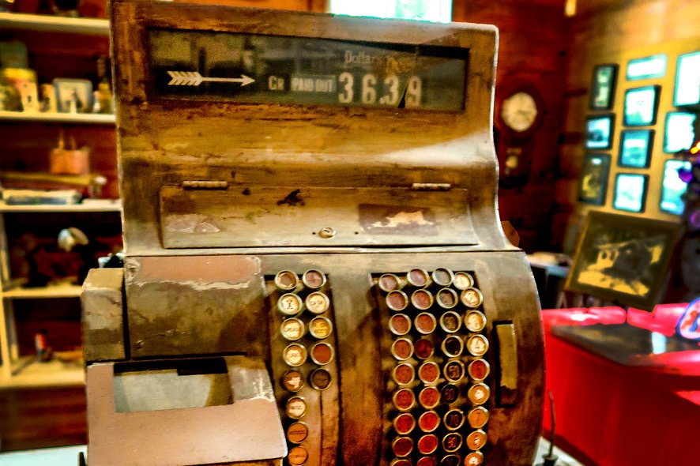

<!-- theme: ニュース型（バンク・オブ・アメリカ「2026 Business Owner Report」2026年11月17日公表。米国の中小企業の経営者1,099人、Ipsosのネット調査。発表文の全文と、同行の研究所の決済データ分析PDF 8ページを確認。報告書本体のPDFは取得できず） / 余り1 -->
# 中小企業の経営者がAIに期待するのは「売上が増える」68%、「経費が減る」36%。米国の経営者1,099人の調査

AIを入れたものの、「何のために使うのか」を社内でうまく説明できていない中小企業の経営者の方に向けて書きます。同じ規模の会社の経営者は、AIに何を期待しているのか。米国の経営者1,099人の回答が出ました。

米国の大手銀行バンク・オブ・アメリカが11月17日、中小企業の経営者への年次調査「2026 Business Owner Report」を公表しました。発表文の見出しは「経費が上がる中でも、経営者は成長とAIに賭けている」です。

AIに期待することの1位は、経費を減らすことではありませんでした。発表文を全文開き、あわせて同じ銀行の研究所が出している決済データの分析（PDF 8ページ）も読みました。

---

## 何が出たのか。AIを使う経営者は84%、使い道の1位は宣伝

まず、誰に聞いた調査かです。

- 調査会社Ipsosが、2026年8月7日から20日にインターネットで実施
- 小規模の経営者849人（年商10万ドル以上500万ドル未満、従業員2〜99人）
- 中規模の経営者250人（年商500万ドル以上5,000万ドル未満、従業員2〜499人）
- 合わせて1,099人。規模・年商・地域の構成が全米の実態に合うように補正してある

大企業は入っていません。従業員2人の会社から数百人の会社までの、経営者本人の回答です。

その1,099人のうち、AIを何らかの形で使っていると答えた経営者は84%でした。

使っている経営者に用途を聞いた結果は、次の順です。

- 宣伝・広告 52%
- データの分析と経営の把握 41%
- 業務の流れの自動化 33%
- 顧客対応 31%

1位は事務の自動化ではなく、宣伝でした。84%に52%を掛けると、およそ44%です（この掛け算は私がしたもので、発表文には無い数字です）。経営者全体のうち4割強が、お客さんを呼ぶ仕事にAIを使っている計算になります。

AIを使っている経営者の94%は、この1年でAIが会社に少なくとも1つは良い結果をもたらしたと答えています。

---

## AIへの期待は「売上」が「経費」の約1.9倍だった

AIを使っている、または使う予定の経営者に、これから1年でAIに期待することを聞いた結果です。

- 売上と収入が増える 68%
- お客さんの体験が良くなる 66%
- 手間が減って経費が下がる 36%

売上を挙げた人は、経費を挙げた人の約1.9倍いました（68÷36）。

この調査では、経営者の91%が「この1年で経費が上がった」と答えています。去年の77%から14ポイント増えました。79%は値上げをしていて、値上げ幅は平均で13%近くです。

経費に一番苦しんでいる年に、AIに期待することの1位は経費ではなく売上でした。ここが、この調査で私が一番意外に思った所です。

人の採用についても聞いています。AIを使っている、または使う予定の経営者の答えです。

- 社員の仕事が新しい役割や作り直した役割に移る 60%
- AIの道具を扱うために、追加で人を採る必要が出る 52%
- AIで人数が減る可能性が高い 33%

全体では、これから1年で人を増やす予定の経営者が39%、今の人数を保つが49%、減らすは4%でした。採りたい職種は、顧客対応28%、IT担当26%、宣伝担当25%の順です。AIの用途の上位と、採りたい職種の上位がほぼ重なっています。

もう1つ、社員の力について。経営者の86%が、社員に伸ばしてほしい分野が少なくとも1つあると答えました。その中で一番多かったのが「AIと新しい技術」で36%です。AIを使う会社が84%ある一方で、社員のAIの力が足りないと見ている経営者が3人に1人以上います。足りない分野があると答えた経営者のうち、研修や学びにお金を出しているのは60%でした。

---

## 決済の記録でも、AI関連の支払いは1年で約2割増えていた

アンケートは「そう答えた」という記録です。実際にお金が動いているかは、別の資料で確かめました。

同じ銀行の研究所（Bank of America Institute）が9月24日に出した分析です。銀行に事業用の口座かカードを持つ会社の、実際の支払い記録を集計しています。

- AI関連の支払額（1社あたり）の前年同月比は、2026年8月時点で小規模の会社が18.4%増、中規模の会社が20.1%増
- 中規模の会社の中では、金融・保険、医療・福祉、教育の伸びが大きい
- 小規模の会社では、小売の伸びが最も大きいと3月の分析で報告されていた

研究所は、中規模の会社でAI関連の支払いが伸びている業種について、事務・分析・書類作り・連絡の仕事が多い業種だと書いています。

同じ期間に、求人の会社への支払いも増えていました。研究所は、AIが人の仕事を置き換えるより補っている可能性を示す、と控えめに書いています。断定はしていません。

---

## この調査で言えないこと

読んでいて、線を引いておくべきだと思った点です。

- 証拠の格は「企業の調査」です。査読はありません。調査をしたのは、中小企業に融資をしている銀行です。
- 報告書の本体は開けませんでした。銀行のサイトの仕組みで取得できず、この記事の数字は公式の発表文に書いてある範囲です。小規模と中規模で答えがどう違うかは、発表文には出ていません。
- 「AIを使っている84%」は、何らかの形で使っている、という聞き方です。毎日使っているのか、月に1回なのかは分かりません。
- 「売上が増える」は期待です。実際に売上が増えたかを測った数字ではありません。
- 決済データの「AI関連」には、AIの会社に加えて、AIの機能を持つIT企業への支払いが入っています。店の名前と業種コードから分類したもので、AIだけの支出ではありません。集計した会社の数も資料に書かれていません。
- 米国の調査です。日本の中小企業にそのまま当てはまるとは言えません。

---

## 今日やれること

数字を自分の会社に置き換えるなら、次の3つです。

1. 自社でAIを使っている仕事を紙に書き出し、「経費を減らす仕事」と「売上を増やす仕事」に分ける。経費の欄にしか書けなければ、宣伝文の下書き、お客さんへの返信の下書き、売上データの集計のうち1つを今週試す。調査で用途の上位に入っていた仕事です。
2. AIを入れる目的を社員に話すとき、「誰の仕事がどう変わるか」まで言う。調査では、役割が移ると答えた経営者が60%いました。何も言わなければ、人数の話なのか役割の話なのかが社員に伝わりません。
3. 社員がAIの使い方を学ぶ時間を、月に1時間でも業務の中に取る。AIの力が足りないと答えた経営者は36%いました。足りない分野があると答えた経営者のうち、研修にお金を出しているのは60%です。

---

## まとめ

- 米国の中小企業の経営者1,099人のうち、AIを使っているのは84%。用途の1位は宣伝・広告で52%
- AIに期待することは、売上が増える68%、お客さんの体験が良くなる66%、経費が減る36%
- 人については、役割が移る60%、追加で人を採る52%、人数が減る33%
- 実際の決済記録でも、AI関連の支払額は1社あたり前年より約2割増えていた（2026年8月）
- ただし「売上が増える」は期待であり、結果を測った数字ではない

1,099人の経営者がAIの先に見ていたのは、減らす話よりも、お客さんを増やす話でした。AIに任せて空いた時間で、お客さんに何を届けるか。それを考える時間は、経営者にとっても社員にとっても楽しい仕事のはずです。私たちは、そこを一緒に考える会社でありたいと思っています。

---

出典

- Bank of America「Bank of America Study: Business Owners Bet on Growth and AI Despite Rising Costs」（2026年11月17日公表／企業の調査、査読なし。Ipsosが2026年8月7日〜20日にインターネットで実施、小規模の経営者849人と中規模の経営者250人）

https://www.prnewswire.com/news-releases/bank-of-america-study-business-owners-bet-on-growth-and-ai-despite-rising-costs-302941549.html

- Bank of America Institute「Business Checkpoint: Bigger and better」（2026年9月24日公表／銀行の決済データの分析、査読なし。PDF 8ページ。4ページ目の図表9・10と6ページ目の調べ方の説明を確認）

https://institute.bankofamerica.com/content/dam/economic-insights/business-checkpoint-september-2026.pdf

写真: JFGryphon「Cash Register -- $36.39, Please」（CC0／Openverse）

---

## 私たちについて

株式会社AIdollargameは、「楽じゃなく、楽しいを考える」をテーマに、AIプロダクトを自社開発しているAI会社です。

- AI導入支援・コンサルティング

https://aidollargame.com/ai-consulting.html?utm_source=note&utm_campaign=2026-11-19

- AIエージェント：問い合わせ・予約対応を24時間自動化

https://aidollargame.com/line-ai-agent.html?utm_source=note&utm_campaign=2026-11-19

- AIside：経営者の"もう一人の自分"になる付き人AI

https://aidollargame.com/aiside.html?utm_source=note&utm_campaign=2026-11-19

- AIwill／社長クローンAI：経営者の判断軸をAIに学習させる

https://aidollargame.com/human-clone-ai.html?utm_source=note&utm_campaign=2026-11-19

「うちの仕事でAIに何ができる？」は、無料のAI活用度診断から。

https://aidollargame.com/shindan.html?utm_source=note&utm_campaign=2026-11-19

- 公式サイト

https://aidollargame.com/?utm_source=note&utm_campaign=2026-11-19

- ご相談：info@aidollargame.com

このnoteでは、AI活用のリアルや時事の読み解きを、過程まで含めて正直に発信しています。フォローしてもらえると嬉しいです。

---

ハッシュタグ案：#生成AI #中小企業 #AI導入 #経営者 #売上アップ

サムネ文言案：
1. AIに期待するのは「売上」68%、「経費」36%
2. 中小企業の経営者1,099人、AIの使い道1位は宣伝
