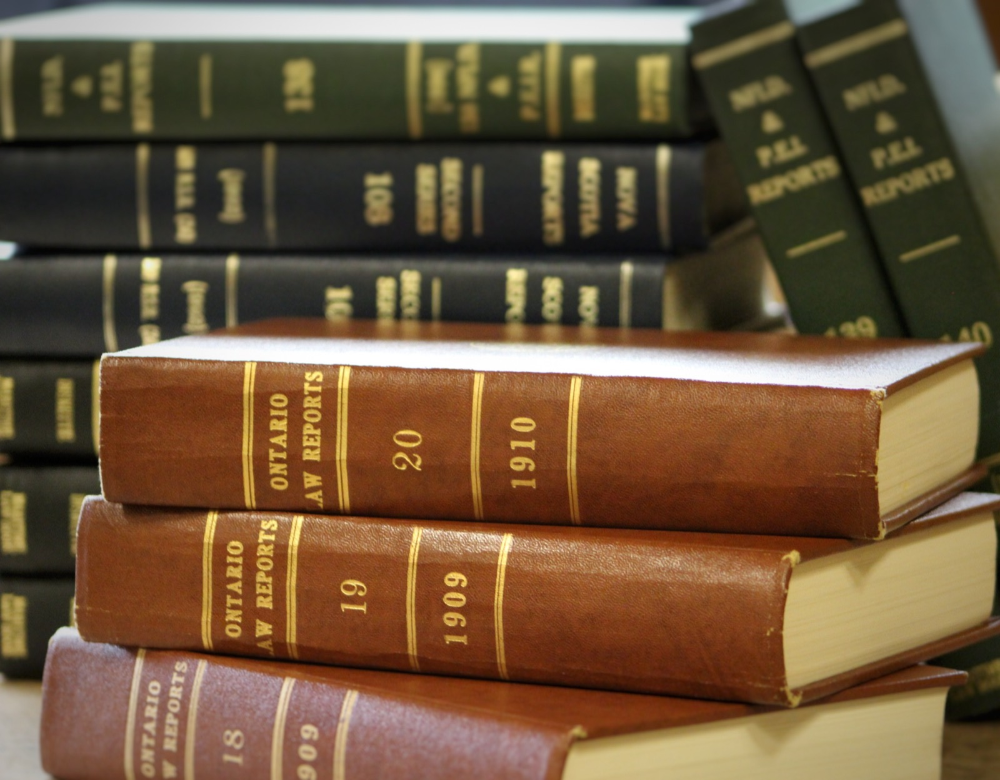

<!-- theme: ニュース型（Stanford大学 RegLab／HAI「Detection Objection」2026年11月19日公表。米国4郡の州裁判所の訴状127,518件。論文PDF本文と、HAIの解説記事を確認） / 余り2 -->
# AIで書いたかを判定する道具は、設定を1つ変えるだけで「AI製」が9.7%から97.5%に動いた。米国の訴状12万7,518件を調べた論文

社員の報告書や外注先の原稿、応募者の作文を「AIで書いたものかどうか」確かめたいと考えている経営者の方に向けて書きます。判定の道具を入れる前に、知っておいた方がいい数字が出ました。

米スタンフォード大学の研究チームが11月19日、米国の州裁判所に出された訴状のうち、AIの手が入ったものがどれだけあるかを推計した論文を公表しました。調べた訴状は127,518件です。

私が一番驚いたのは、AIの割合そのものより、判定の道具の設定を1つ変えただけで答えが10倍に動いたことでした。論文のPDFを開いて、本文の数字を確かめながら書きます。

---

## 何が出たのか。2026年の訴状の約3分の1に、AIの手が入っていた

調べたのは、カリフォルニア州のサンフランシスコとサンタクララ、オクラホマ州のオクラホマとタルサ、4つの郡の裁判所です。2020年から2026年に出された、裁判を始めるときの訴状を集めました。

- タルサ 31,143件
- オクラホマ 46,740件
- サンフランシスコ 25,134件
- サンタクララ 24,501件

AIの手が入ったと推計された訴状の割合は、2022年まではどの郡でもほぼ0%でした（最大0.5%）。2024年から2025年にかけて急に増え、2026年は次のとおりです。

- サンタクララ 37.8%
- サンフランシスコ 35.6%
- タルサ 16.9%
- オクラホマ 16.1%

差が大きかったのは、弁護士を立てずに自分で訴えた人です。サンタクララでは、自分で訴えた人の訴状のうちAIの手が入った割合が、2024年の18.8%から2026年は71.6%になりました。弁護士が書いた訴状は、同じ期間に4.7%から33.5%です。ただし自分で訴えた人の訴状は、2026年で266件と数が少ない点は差し引いて見る必要があります。

訴えの種類でも分かれました。借金の取り立ての訴えは、決まった書式を埋めるものが多く、AIはほとんど見つかっていません。一方、サンタクララでは商取引の訴えで81.5%、雇用の訴えで59.2%と推計されています。1件ずつ事情を書く必要がある訴えほど、AIが使われていました。

訴状の中でも、AIが入っていたのは「事実の説明」と「なぜ訴えるのかの理由」の部分です。添付の書類や署名欄では、低く出ています。

---

## なぜ判定の道具は当てにならないのか。同じ訴状で9.7%から97.5%まで動いた

この論文の本題は、AIの割合よりも、測り方の方です。

AIで書いたかを判定する道具は、文章に「AIらしさ」の点数を付けます。何点以上を「AI製」とするかは、使う人が決めます。サンタクララの訴状で、その線を変えた結果がこれです。

- 0.10点以上をAI製とすると、9.7%
- 0.05点以上にすると、33.7%
- 0.01点以上にすると、97.5%

同じ訴状の束で、線を動かすだけで1割から全部近くまで変わりました。1つの道具の設定を216通り試すと、4つの郡の訴状でAI製と判定される割合は1%未満から99%超まで広がったと書かれています。有料の判定サービスでも、点数のまとめ方を9通り変えると22.3%から52.4%まで動きました。

理由として、論文は法律の文章の性質を挙げています。

- 訴状の言葉の約26%は、どの訴状にも出てくる決まり文句。報道発表や論文の要約では、決まり文句はせいぜい6%
- 使う言葉の幅が狭く、人が書いてもAIが書いても似た文章になる
- AIの使われ方が分からない。「書き直して」と頼んだ文章で学んだ道具は、書き直しの文章の90%を見つけたが、質問への答えとしてAIが書いた文章は16〜72%しか見つけられなかった

決まった言い回しの多い仕事の文章なら、法律に限らず同じことが起きる、と論文は書いています。契約書、見積書の説明、介護の記録、不動産の物件説明など、中小企業の書類にも決まり文句は多くあります。

そこで研究チームは、「確実にAIを使った書類」を集めました。裁判官がAIの作った架空の判例の引用を指摘した事件をたどり、元の書類980件を取り寄せています。この980件を「AI製の正解」として使い、どの道具のどの設定が正解を多く当てるかを比べました。さらに、道具の点数を全体の割合の推計に直す方法を作っています。その結果、設定による差は0.6〜5.6ポイントまで縮んでいます。

それでも著者たちは、この方法は「全体の割合」を推計するもので、1通ずつ「これはAI製だ」と決める用途には慎重であるべきだ、と書いています。一番成績の良かった道具でも、見逃しと誤判定は無視できない数で残りました。

---

## まだ分かっていないこと

読みながら、線を引いておくべきだと思った点です。

- 証拠の格は「査読前の論文」です。著者の研究室のサイトで公開された原稿で、学術誌の審査はまだ経ていません。
- 「AI製の正解」として使ったのは、架空の判例を引用してしまった書類です。AIの使い方が雑だった例に寄っているため、著者は今回の割合を「控えめな推計」と書いています。丁寧に使われたAIは見えていない可能性があります。
- AIの手が入った訴状の質が良いのか悪いのかは、調べていません。弁護士を雇えない人の助けになっているのか、裁判所の負担を増やしているのかは、次の研究に回されています。
- カリフォルニアとオクラホマで2倍ほど差が出た理由も、まだ特定できていません。訴えの種類の違いが一部を説明する、という段階です。
- 米国の4つの郡の調査です。日本の書類に同じ割合が当てはまるとは言えません。

もう1つ、目に留まった所があります。論文の末尾には「AIの利用について」という欄があり、著者たち自身が、集計の道具作りと原稿の見直しにAIを使ったと書いていました。

---

## 今日やれること

判定の道具を当てにするより、先にできることがあります。

1. 社内でAI判定の道具を使っているなら、その結果だけで社員や応募者、外注先を問い詰める使い方をやめる。同じ文章でも、線の引き方1つで9.7%にも97.5%にもなります。
2. 社内の報告書や外注の納品物に、「AIを使った場合は、どこに使ったかを1行書く」欄を作る。論文の著者が末尾に書いていた形と同じです。判定するより、書いてもらう方が確かです。
3. AIで作った書類は、事実と理由を書いた部分に確認の時間を割く。論文でAIが多く見つかったのもこの部分でした。引用した法令、数字、URL、過去の事例は、元の資料を開いて確かめる。米国では、AIが作った架空の判例が書類に入っていた事件が1,500件を超えて記録されています。

---

## まとめ

- 米国の4つの郡の訴状127,518件のうち、2026年はサンタクララで37.8%、サンフランシスコで35.6%にAIの手が入っていたと推計された。2022年まではほぼ0%
- 弁護士を立てずに自分で訴えた人では、サンタクララで71.6%（2026年、266件）
- 判定の道具は、線の引き方1つで同じ訴状の9.7%から97.5%まで「AI製」と判定した
- 著者は、判定の道具は全体の割合を推計するためのもので、1通ずつ決めつける用途には慎重であるべきだと書いている
- 判定に頼るより、AIを使った所を書いてもらい、事実と理由の部分を人が確かめる方が確実

AIを使ったかどうかを当てる仕事は、思ったよりずっと難しいものでした。誰が使ったかを探すことに時間を使うより、使ったことを気軽に書ける職場にして、空いた時間でその書類の中身を一緒に良くしていく。私たちは、AIの使い方をそういう前向きな話にしていきたいと思っています。

---

出典

- Javokhir Arifov, Alexander Spangher, Jonathan Hennessy, Diya Karan, Emaan Hariri, Daniel E. Ho「Detection Objection: Documenting, Calibrating, and Detecting the Rise of AI-Assisted Text in U.S. State Courts」（スタンフォード大学、2026年11月公表／査読前の論文。本文の要旨、第2〜6章、表2・表3を確認）

https://dho.stanford.edu/wp-content/uploads/GenAI_Courts.pdf

- Stanford HAI「AI Might Be Flooding State Court Houses, but Proving It Is Another Matter」（2026年11月19日公表／著者による解説記事。架空の判例が記録された1,500件超の数字はこの記事から）

https://hai.stanford.edu/news/ai-might-be-flooding-state-court-houses-but-proving-it-is-another-matter

写真: Canadian law books（CC0／Openverse・Wikimedia Commons）

---

## 私たちについて

株式会社AIdollargameは、「楽じゃなく、楽しいを考える」をテーマに、AIプロダクトを自社開発しているAI会社です。

- AI導入支援・コンサルティング

https://aidollargame.com/ai-consulting.html?utm_source=note&utm_campaign=2026-11-20

- AIエージェント：問い合わせ・予約対応を24時間自動化

https://aidollargame.com/line-ai-agent.html?utm_source=note&utm_campaign=2026-11-20

- AIside：経営者の"もう一人の自分"になる付き人AI

https://aidollargame.com/aiside.html?utm_source=note&utm_campaign=2026-11-20

- AIwill／社長クローンAI：経営者の判断軸をAIに学習させる

https://aidollargame.com/human-clone-ai.html?utm_source=note&utm_campaign=2026-11-20

「うちの仕事でAIに何ができる？」は、無料のAI活用度診断から。

https://aidollargame.com/shindan.html?utm_source=note&utm_campaign=2026-11-20

- 公式サイト

https://aidollargame.com/?utm_source=note&utm_campaign=2026-11-20

- ご相談：info@aidollargame.com

このnoteでは、AI活用のリアルや時事の読み解きを、過程まで含めて正直に発信しています。フォローしてもらえると嬉しいです。

---

ハッシュタグ案：#生成AI #AI判定 #中小企業 #AI導入 #社内ルール

サムネ文言案：
1. AI判定の道具、設定1つで9.7%→97.5%
2. 米国の訴状の3分の1にAI。見分ける方が難しかった
