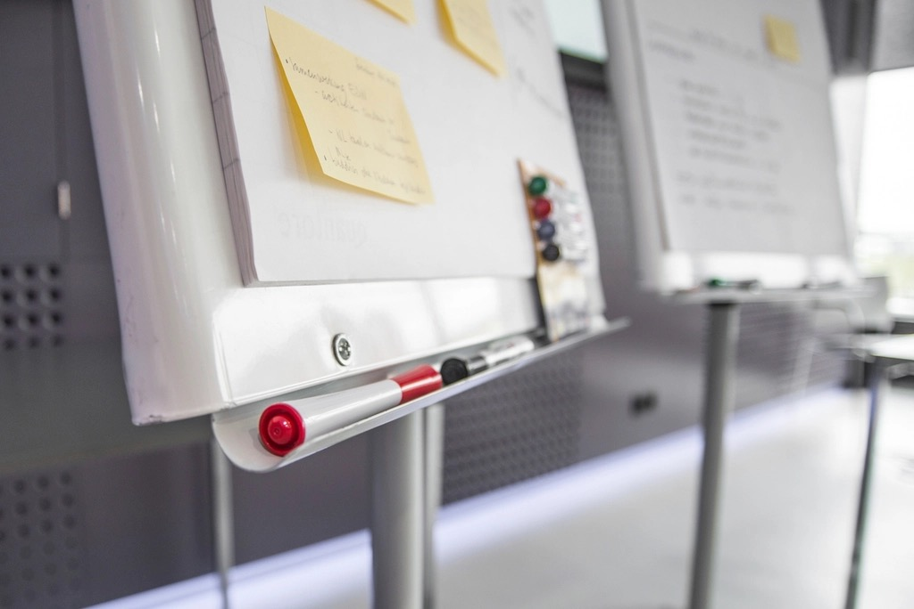

<!-- theme: ニュース型（The Adecco Group「Global Workforce of the Future 2026」People-powered performance。2026年11月19日公表。36か国4万500人。プレスリリースと本編PDF81ページのうち全体編・日本のページ・付録を確認） / 余り2 -->
# 日本でAIエージェントを使う社員は、1年で27%から61%に増えた。AIの研修を受けた人は77%から67%に減っている。36か国4万500人の調査

AIを会社に入れたものの、使い方は社員それぞれに任せている。そんな会社の経営者や、現場をまとめる人に向けて書きます。

人材サービス大手のAdecco Group（本社スイス）が、11月19日に報告書を出しました。36か国で働く4万500人に、AIと仕事の変化を聞いた調査です。81ページの本編PDFを開き、AIの数字と日本のページを中心に確かめました。

先に結論を書きます。AIが仕事の手順に組み込まれているか。手順を変えるとき、その仕事をしている本人が加わったか。この2つで、答えが大きく分かれていました。

## 誰に何を聞いた、AIの調査か

- 公表：2026年11月19日。毎年出している「Global Workforce of the Future」の7回目
- 対象：36か国・21業種で働く4万500人（日本は2,008人。最多は米国の5,578人）
- 時期：2026年6〜7月。各国の言葉で答えるオンライン調査で、平均25分
- 証拠の格：企業の公表資料。査読は経ていない、本人の自己申告の調査

回答者の顔ぶれも書いておきます。報告書の4ページによると、約3分の2が部下を持つ立場の人です。約5分の2は派遣など、人材会社を通して働く人でした。8割がオフィスで働く人です。

人材会社がまとめた調査なので、この偏りは数字を見るときに頭に置いておきます。

AIの使われ方は、この1年で大きく変わりました。AIエージェントを仕事で使う人は、世界全体で64%から74%に増えています。報告書の定義では、AIエージェントは「自分で判断して動く仮想アシスタント」です。

日本のページでは、27%から61%でした。1年で2倍を超えています。ただし「たまに使う」人も含めた数字です。

もう1つ、66%の人が「AIで、自分の仕事に必要な技能が変わった」と答えています。

## AIが手順に組み込まれた人と、そうでない人の差

報告書では、「AIの道具が今の仕事の流れにきちんと組み込まれている」と答えた人が62%いました。この人たちと、そうでない人たちを比べています。

- 組み込まれている人は、AIで1日に浮く時間が平均20%多い
- 浮いた時間を「より価値の高い仕事」に回していると答えた人は、そうでない人の62%に対して79%
- 「AIをうまく使いこなさなければ」と追い立てられる感覚を持つ人は、7分の1

ここで注意が1つあります。「20%多い」は、AIで浮いた時間の長さを2つの集団で比べた数字です。仕事全体が20%速くなった、という意味ではありません。

日本のページでは、この差は9%でした。世界全体の20%より小さい数字です。国による開きは大きく、オーストラリアは3%、50%の国もありました。

私がこの数字で考え込んだのは、AIの契約をして社員に配っただけの会社です。その会社の社員の多くは、「組み込まれていない」と答える38%のほうに入るはずです。道具を配った時点では、手順はまだ何も変わっていないからです。

## AIで仕事が変わるとき、本人が加わったかどうか

この調査で開きが一番大きかったのは、AIに合わせて仕事を作り直すときの、会社の進め方でした。

- AIに合わせた仕事の見直しに、会社が本人を加えた場合。「環境の変化に合わせて動ける」と答えた人は96%。加えなかった場合は29%
- 「AIで役割がどう変わるか」を上の人が説明した場合。「AIで仕事が丸ごと変わっても構わない」と答えた人は92%。説明が無かった場合は15%
- 会社が技能の育成にお金と時間を出している場合。「自分の技能は求められている」と答えた人は90%。出していない場合は10%

一方で、職場の今の状態を聞いた数字は低めでした。

- 「上の人は、変化が社員に与える影響を分かっている」：19%（日本のページでは約4人に1人）
- 「新しい技術への不安を、真剣に聞いてもらえる」：21%
- 「上司に支えられて、変化に対応できている」：39%

AIの研修を受けた人は、77%から67%に、10ポイント減りました。AIを使う人のうち、研修を受けた人の93%が「AIで生産性が上がった」と答えています。受けていない人では47%でした。

AIを使う人は増えているのに、使い方を教わる人は減っている。この報告書で、私が一番引っかかったのはこの組み合わせです。

## この数字でまだ分からないこと

報告書をそのまま自社に当てはめる前に、確かめておきたい点が3つあります。

1つ目は、比べている2つの集団の大きさが揃っていないことです。研修の比較は、受けた人1万7,182人に対して、受けていない人は379人です。

「安心して意見を言える」など6つの項目のうち5つ以上に当てはまった人は、950人でした。全体の2%ほどです。人数の少ない集団の数字は、上下に振れやすくなります。

2つ目は、原因と結果の向きです。「仕事の見直しに加えてもらった人ほど、変化に前向き」という結果は、もともと前向きな人が声をかけられやすかっただけ、とも取れます。1回きりの聞き取り調査なので、どちらが先かはここからは分かりません。

3つ目は、日本のページの数字の範囲です。各国のページの末尾には、「国ごとの人数が足りない項目は、地域全体の数字を載せた」という注記があります。日本のページのどの数字がアジア太平洋全体の数字なのかは、本編からは区別できませんでした。

## 今週、自分の会社でAIについてやれること

- AIを使っている業務を1つ選ぶ。その手順書に「どの段階で、何にAIを使うか」を書き込む。社員それぞれの工夫のままにしない
- その手順を変えるときは、実際にその業務をしている人を、最初の打ち合わせから1人加える
- 「AIで、誰のどの仕事がどう変わるか」を、上司が自分の口で一度説明する。掲示板やメールだけで済ませない
- 研修は1回で終わらせない。手順に組み込んだ後に、実際の業務でAIを使う時間をもう一度取る

AIで浮いた時間を何に使うかは、道具を配った人ではなく、その仕事をしている人が一番よく知っています。手順を一緒に書き換える場に、その人がいるかどうか。この報告書の96%と29%の差は、そこを聞いた数字でした。

---

出典

- The Adecco Group「People-powered performance: How to unlock happiness in the hybrid workforce（Global Workforce of the Future 2026）」（2026年11月19日公表／企業の調査報告書・査読なし。3〜5ページ、15〜18ページ、22〜25ページ、日本のページ（53ページ）、付録を確認）

https://discover.adeccogroup.com/The_Adecco_Group_GWOF_Report_2026

- The Adecco Group「The Adecco Group global study: AI delivers more value when people are involved in work redesign」（2026年11月19日／企業のプレスリリース）

https://www.adeccogroup.com/en/our-group/media/press-releases/global-workforce-of-the-future-study-2026

---

## 私たちについて

株式会社AIdollargameは、社内にセキュリティ担当がいない会社に代わって、その担当者の仕事を引き受けている会社です。犯人と同じ手順で、サイト・メール・VPN機器に外から実際に入れるかを試し、見つけた穴を当社が塞ぎます。AIの研修と、自社で開発したAIの導入も支援しています。

- ホワイトハック（セキュリティ担当の代行）：外から入れるかを試し、見つけた穴を当社が直す。セキュリティを任せる社員を1人雇うより安く、月3万円から（税別）

https://aidollargame.com/security/?utm_source=note&utm_campaign=2026-11-23

- AI研修・社員リスキリング（助成金対象）：貴社の実際の仕事を教材に、翌日から仕事で使える状態にする研修

https://aidollargame.com/ai-training.html?utm_source=note&utm_campaign=2026-11-23

- AIチャットエージェント：問い合わせ対応・予約受付から社内マニュアルの参照まで、24時間自動で対応

https://aidollargame.com/line-ai-agent.html?utm_source=note&utm_campaign=2026-11-23

- AIwill（社長クローンAI）：経営者の判断の仕方をAIに学習させ、社員がいつでも参照できるようにする

https://aidollargame.com/human-clone-ai.html?utm_source=note&utm_campaign=2026-11-23

- AIside（付き人AI）：Gmail・カレンダー・Slackをまたいで、予定調整やメールの下書きを先回りで代行

https://aidollargame.com/aiside.html?utm_source=note&utm_campaign=2026-11-23

- AIコンサルティング・導入支援：何から手をつけるかの整理から、実装と運用まで

https://aidollargame.com/ai-consulting.html?utm_source=note&utm_campaign=2026-11-23

自社のサイトが外からどう見えるかは、ドメインを入れるだけで無料で調べられます。

https://whitehack.jp/?utm_source=note&utm_campaign=2026-11-23

- 公式サイト

https://aidollargame.com/?utm_source=note&utm_campaign=2026-11-23

- ご相談：info@aidollargame.com

このnoteでは、AI活用のリアルや時事の読み解きを、過程まで含めて正直に発信しています。フォローしてもらえると嬉しいです。

---

ハッシュタグ案：#生成AI #AIエージェント #中小企業 #AI導入 #社員研修

サムネ文言案：
1. AIエージェントの利用、日本は1年で27%→61%
2. 仕事の見直しに加わった人96%、加わらなかった人29%
