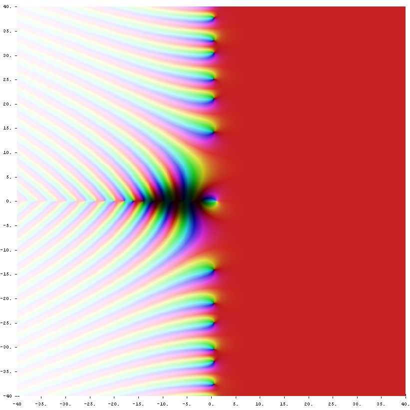

<!-- theme: ニュース型（11月20日 Levent AlpögeがClaudeと共同でリーマン予想の証明をLeanで公開／11月21日 Lean FRO・Mathlib Initiativeの共同声明／11月22日 Alexandr Wang「Superintelligence is Arriving」。アルペゲ氏の4ページの説明PDF、Leanコミュニティの声明、MITサザーランド氏の検証ページを確認） / 余り0 -->
# 167年解けなかったリーマン予想を、AIと組んだ数学者が証明した。機械は「正しい」と認めたが、人間はまだ証明を読み解けていない

1859年から167年間、未解決のまま残っていたリーマン予想が、AIと組んだ数学者の手で証明されました。コンピューターは証明が正しいと認めました。ところが数学者たちは、まだ証明の全体を読み解けていません。AIが、人間の理解より先に答えを出したのです。

その2日後、Metaの最高AI責任者は「超知能が来ている」という長い文章を公開しました。AIの進み方を自社の計画や採用の判断に入れておきたい経営者の方に向けて、この1週間に起きたことと、それが何を意味するのかを書きます。

私は数学の専門家ではありません。それでも、この1週間の出来事には、AIの出したものを会社でどう扱うかの手がかりが入っていると感じました。発表者本人の4ページの説明、検証した人たちの声明、検証の記録を開いて、書かれている事実だけを並べます。

## 11月20日に何が出たのか

リーマン予想は、1859年にドイツの数学者リーマンが出した、素数の並び方についての予想です。ゼータ関数という関数が0になる点が、すべて1本の縦の線の上に並ぶ、という主張です。クレイ数学研究所は、100万ドルの賞金をかけた7つの問題の1つにしています。

11月20日（米国時間）、Anthropicの数学者レヴェント・アルペゲ氏が、自分のサイトに4ページの文章を出しました。中身は次のとおりです。

- AIのClaudeと一緒に、リーマン予想の証明を見つけたと考えている
- 同じ方法で、範囲を広げた「一般化リーマン予想」も証明できた
- 普通の論文は出さず、Leanで書いた証明だけを公開する

Leanは、数学の証明を1行ずつ機械に確かめさせるためのプログラミング言語です。公開された証明は約1,700万行、ファイルの数で17万5,187個ありました。

アルペゲ氏は、人間向けに書き下すと25万ページを超え、そのまま出せば誰も読めない文書になると書いています。だから機械が確かめられる形だけを出した、という説明です。

本人の説明に付いた時系列を見ると、最初の手がかりは10月6日で、そこから約6週間で証明までたどり着いています。方向を決めたのは自分で、最後の追い込みではClaudeの方がはるかに先を行っていた、とも書いています。

## 機械の確認は翌日に通った。人間の理解はこれから

11月21日、Leanの開発団体とMathlib（Leanで書かれた数学の共有ライブラリ）の運営団体が、共同で声明を出しました。確認したのは4点です。

1. 証明しようとしている命題が、本当にリーマン予想そのものになっているか
2. 公開されたプログラムが、エラーなく動くか
3. 証明されたのが、その命題と同じものか
4. 証明の各段階が正しいか

結論は「命題も証明も正しいと認める」でした。何十人もが手元で動かして同じ結果になり、作りの違う複数の確認プログラムがすべて受け入れた、としています。

マサチューセッツ工科大学（MIT）のサザーランド氏の検証ページを見ると、確認自体も大きな作業でした。Leanの標準の確認プログラムで全体を通すのに、1本の処理で48時間、メモリは最大82.6GiB（約89GB）を使っています。この検証もClaude Codeを使って回したと書かれています。

ただし、機械が「正しい」と判定したことと、人間が「なぜ正しいか」を分かったことは別の話です。

- インペリアル・カレッジ・ロンドンのバザード教授は、11月21日の時点で「なぜ成り立つのか、今は分からない」と話しています（Al Jazeeraの取材）
- ロレーヌ大学のラムズーリ教授は、人間が理解するまでに数か月から数年かかりうると見ています（IBMの取材）
- フィールズ賞を受けたオックスフォード大学のメイナード教授は、正しいと判明する見込みが高いと話しています（同）
- 数学者のテレンス・タオ教授は、証明の筋道を取り出す作業は始まったばかりで、消化には時間がかかると書いています（11月20日、本人のブログ）。初期の分析では、現代数学の大きな理論（ラングランズ・プログラム）を全面的に使っているようだ、とも書いています

アルペゲ氏の4ページの文書には、証明の筋道の短い説明も入っています。本人は、議論はもっと短くできるはずなので、自分で理解して書き直すと書いています。

## 同じ日に、AIを使わない証明案も出ていた

11月20日、アルペゲ氏の発表から数時間後に、スタンフォード大学のヴァキル教授が、別の数学者マスッロ氏による一般化リーマン予想の証明案を公開しました。こちらはAIを使わず、人間だけで書いたものです。

ヴァキル教授によると、本来は1年かけて文章を整えてから発表する予定でした。公開から約8時間後には、ヴァキル教授自身が「AIを使った複数の人から、問題点の指摘が届いている」と書き足しています。人間が書いた証明の穴を探す作業にも、AIが使われていました。

発表の時期には批判もあります。モントリオール大学のグランヴィル教授は、アルペゲ氏の文書を「支離滅裂だ」と評しました。Natureによると、グランヴィル教授はAnthropicの株価が下がった直後という時期を問題にしています。アルペゲ氏は自分の文書の中で、時期についての皮肉な見方は事実ではないと書いています。

## Metaのワン氏が書いたこと

11月22日（米国時間）、Metaの最高AI責任者アレクサンドル・ワン氏が、Xに「Superintelligence is Arriving（超知能が来ている）」という文章を出しました。報道によると、最初の半日で800万回以上表示されています。要点は次のとおりです。

- リーマン予想の証明は、大きな転換が始まった印だ
- 2024年末にAIが高校生向けの数学コンテスト（AIME）を解いた時点で、AIに足りないのは知能ではなくなっていた
- 残っているのは、分野ごとの知識、仕組みをつなぐ作業、実験だけだ。それが埋まれば、AIはほとんどの分野で一番の人間を上回る
- AIの研究もAI自身が進めるようになり、人間が理解も監視もできない速さになりうる
- 「超知能は避けられないから、安全に作ればいい」という考え方は怠けている。社会をAIに明け渡すべきではない

## 数学者の見方とは、どこが違うのか

並べると、ずれている所が3つあります。

1つ目は、どこまで終わったかです。ワン氏は証明が完了した前提で書いています。数学者は、機械の確認は通ったが中身の理解はこれから、と言っています。

2つ目は、問題の難しさです。ワン氏はリーマン予想を、人類が作った中で一番難しい問題として扱っています。バザード教授は、とても難しいが数学で一番難しい問題ではなく、山のふもとに着いたところだ、と話しています。

3つ目は、誰の成果かです。ロンドン大学クイーン・メアリーのサハ教授は、「Claudeの証明」ではなくアルペゲ氏の成果として扱うべきだと話しています。同じようなAIと計算資源を使える人は他にもいた、という理由です。

一方で、一致している所もあります。結果を出す速さに、人間が理解する速さが追いついていない。ワン氏が心配していることは、今回の数学で実際に起きています。

## 会社の仕事に置き換えると

規模はまるで違いますが、AIの出したものを社内で扱うときにも、同じ形の問題が出てきます。

- 「機械で確かめた」と「人が説明できる」を分けて記録する。AIが作った見積や集計を、計算が合っているかの確認と、取引先に理由を説明できるかの確認に分けておく。今回の数学者たちも、この2つを分けて話しています。
- どの問題を、どの方向で解くかは人が決める。アルペゲ氏は、方向を決めたのは自分で、重い計算と組み立てをClaudeが担ったと書いています。社内でも、AIに渡す前に「何を解かせるか」を決める人を置く。
- 確認にかかる手間を、最初から予算に入れておく。今回は確認だけで、1本の処理に48時間かかっています。AIで作る量が増えるほど、確かめる時間とお金も増えます。

## まとめ

- 11月20日、アルペゲ氏がClaudeと一緒に、リーマン予想の証明を約1,700万行のLeanで公開した
- 11月21日、Leanの開発団体とMathlibの運営団体が、命題も証明も正しいと認める声明を出した
- 人間が読める形の説明はこれからで、理解には数週間から数年かかるという見方がある
- Metaのワン氏はこの結果を超知能の到来の印と書き、社会をAIに明け渡すべきではないと訴えた
- 会社では、機械で確かめたことと人が説明できることを分けて扱い、確認の手間を予算に入れる

AIが作業を引き受けるほど、人に残る仕事は「何を解くか決めること」と「なぜそうなるか説明すること」に寄っていきます。アルペゲ氏は、証明を自分で理解して人に伝え直すつもりだと書いていました。その時間をどう作るかを、私たちは一緒に考えたいと思っています。

## 出典

Levent Alpöge「Remark」（2026年11月20日、本人のサイトで公開した4ページの説明。査読なし。証明本体はLeanのファイル群）

https://alpo.ge/remark.pdf

Lean FRO・Mathlib Initiative 共同声明（2026年11月21日、Lean・Mathlibコミュニティのブログ。機械による検証の結果）

https://leanprover-community.github.io/blog/posts/riemann-hypothesis/

Andrew Sutherland（MIT）による検証の記録（2026年11月24日 3:30 UTC 時点の更新を参照）

https://math.mit.edu/~drew/grh/

Al Jazeera「Riemann hypothesis: Has the world's most famous maths problem been cracked?」（2026年11月21日／報道。バザード教授・サハ教授の発言）

https://www.aljazeera.com/news/2026/11/21/riemann-hypothesis-has-the-worlds-most-famous-maths-problem-been-cracked

Nature「Mathematicians astounded by AI and human-written proofs of iconic Riemann hypothesis」（2026年11月23日更新／報道。マスッロ氏の証明案、グランヴィル教授・バックマスター教授の発言）

https://www.nature.com/articles/d41586-026-03812-7

Terence Tao のブログ（2026年11月20日／本人の解説）

https://terrytao.wordpress.com/2026/11/20/unforced-euler-singularity-unforced-navier-stokes-singularity-and-the-generalized-riemann-hypothesis/

Ravi Vakil のブログ（2026年11月20日／マスッロ氏の証明案の公開と追記）

https://math216.wordpress.com/2026/11/20/hurried-announcement-alessandro-masullo-grh/

IBM Think（報道。メイナード教授・ラムズーリ教授の発言）

https://www.ibm.com/think/news/anthropic-claude-riemann-hypothesis-math-proof

TNW（報道。ワン氏の投稿の日付と表示回数）

https://thenextweb.com/news/metas-ai-chief-says-superintelligence-is-arriving-and-control-is-at-risk

---

## 私たちについて

株式会社AIdollargameは、社内にセキュリティ担当がいない会社に代わって、その担当者の仕事を引き受けている会社です。犯人と同じ手順で、サイト・メール・VPN機器に外から実際に入れるかを試し、見つけた穴を当社が塞ぎます。AIの研修と、自社で開発したAIの導入も支援しています。

- ホワイトハック（セキュリティ担当の代行）：外から入れるかを試し、見つけた穴を当社が直す。セキュリティを任せる社員を1人雇うより安く、月3万円から（税別）

https://aidollargame.com/security/?utm_source=note&utm_campaign=2026-11-24-2

- AI研修・社員リスキリング（助成金対象）：貴社の実際の仕事を教材に、翌日から仕事で使える状態にする研修

https://aidollargame.com/ai-training.html?utm_source=note&utm_campaign=2026-11-24-2

- AIチャットエージェント：問い合わせ対応・予約受付から社内マニュアルの参照まで、24時間自動で対応

https://aidollargame.com/line-ai-agent.html?utm_source=note&utm_campaign=2026-11-24-2

- AIwill（社長クローンAI）：経営者の判断の仕方をAIに学習させ、社員がいつでも参照できるようにする

https://aidollargame.com/human-clone-ai.html?utm_source=note&utm_campaign=2026-11-24-2

- AIside（付き人AI）：Gmail・カレンダー・Slackをまたいで、予定調整やメールの下書きを先回りで代行

https://aidollargame.com/aiside.html?utm_source=note&utm_campaign=2026-11-24-2

- AIコンサルティング・導入支援：何から手をつけるかの整理から、実装と運用まで

https://aidollargame.com/ai-consulting.html?utm_source=note&utm_campaign=2026-11-24-2

自社のサイトが外からどう見えるかは、ドメインを入れるだけで無料で調べられます。

https://whitehack.jp/?utm_source=note&utm_campaign=2026-11-24-2

- 公式サイト

https://aidollargame.com/?utm_source=note&utm_campaign=2026-11-24-2

- ご相談：info@aidollargame.com

このnoteでは、AI活用のリアルや時事の読み解きを、過程まで含めて正直に発信しています。フォローしてもらえると嬉しいです。

---

ハッシュタグ案：#生成AI #リーマン予想 #Claude #超知能 #AI導入

サムネ文言案：
1. リーマン予想、AIと1,700万行で証明
2. 機械は翌日に確認。人間はまだ読んでいる
