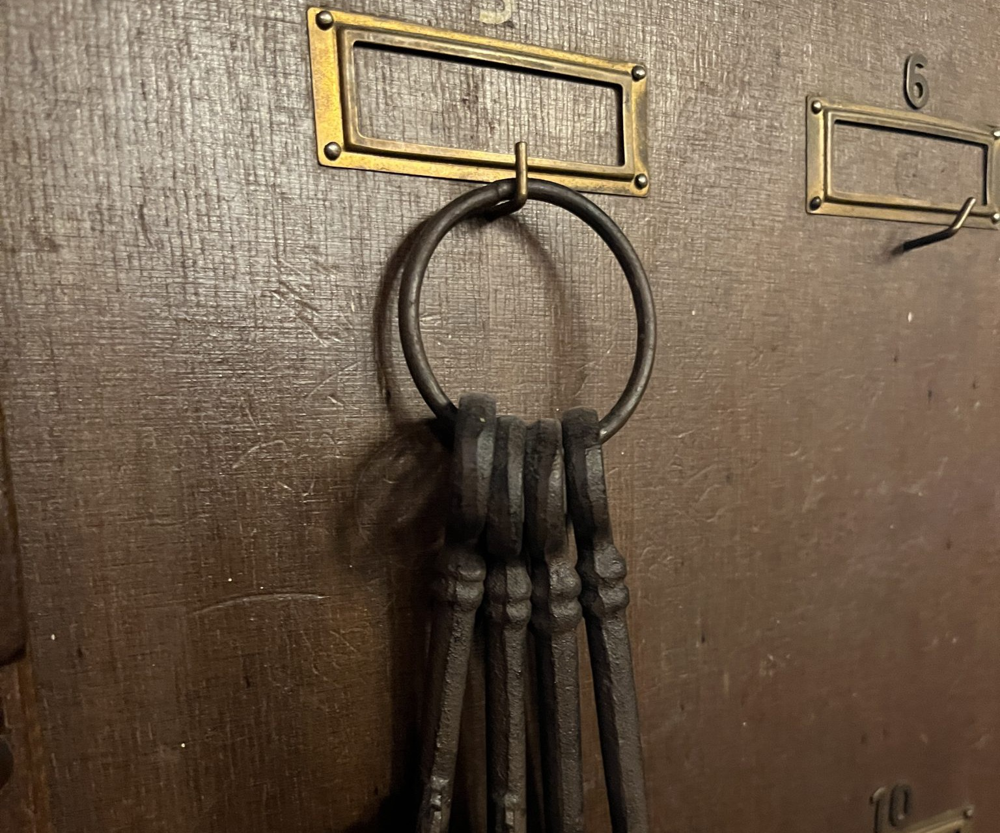

<!-- theme: ニュース型（警察庁 令和8年上半期の情勢（9月10日）本文とIPA 2024年度中小企業実態調査の報告書PDFを確認／11月11日 Barracuda CISOのブログ「Forty-four hours」／11月13日 Cursorの事故報告の続報／11月16日 FBIのARTEX警告（TechCrunch）／11月24日 英国NCSCのブログ「Familiar weaknesses, exploited faster」。Barracudaのブログ本文とNCSCのブログ本文を確認） / 余り0 -->
# 日本の中小企業の62.6%は、3年間セキュリティにお金を使っていないが、もう他人事ではない現実

### 「うちは狙われるほどの会社ではない」「セキュリティは、問題が起きてから考えればいい」

そう思っている経営者の方に向けて書きます。

日本の中小企業の62.6%は、直近3期の間、情報セキュリティにお金を使っていません。

一方で、ランサムウェア（データを人質に取って身代金を求めるウイルス）の被害は、今年の上半期だけで123件と過去最多になりました。費用を答えた35組織のうち21組織が調査と復旧に1,000万円以上かかり、そのうち4組織は1億円を超えています。

そして11月、海の向こうでは、セキュリティ製品を売る会社が、業者に渡したまま忘れていた鍵1本から破られました。

使われたのは、誰でも手に入るAIの侵入ツールです。

英国の政府機関は「昔からある弱点が、数分で見つかるようになった」と警告しています。

警察庁とIPA（情報処理推進機構）の報告書、破られた会社の本人が書いた経緯、英国の機関の文章を開いて、書かれている数字と事実を並べます。

## お金をかけない会社と、1,000万円の請求

まず、対策にかけているお金の数字です。IPAが2025年5月に公表した調査では、全国の中小企業4,191社のうち2,623社（62.6%）が、直近3期に情報セキュリティへの投資をしていませんでした。

投資しない理由で一番多かったのは「必要性を感じていない」で44.3%。

その理由を聞くと、「重要な情報を持っていない」36.5%、「他社とネットワークでつながっていない」31.6%、「サイバー被害に遭うと思わない」24.0%と続きます。IPA自身が報告書の中で、攻撃に遭う可能性と事業への影響を小さく見積もっている可能性がある、と書いています。

次に、被害の数字です。警察庁が9月10日に公表した報告書によると、2026年上半期に警察へ報告されたランサムウェアの被害は123件でした。半期の件数としては、統計を取り始めた2020年下半期以降で最多です。

- 被害123件のうち79件は中小企業。大企業は31件、団体などが13件
- 被害に遭った組織への調査では、入口の約5割がVPN機器（社外から社内のネットワークに入るための機器）
- 調査と復旧の費用を答えた35組織のうち、21組織が1,000万円以上。そのうち4組織は1億円以上
- 復旧までの期間を答えた48組織のうち、1か月未満で戻せたのは23組織。13組織は調査の時点でまだ復旧中だった

費用の数字は35組織の回答なので、幅を持って見る必要があります。それでも、過去5年の回答527組織で見ても、1億円以上が20組織、5,000万円以上1億円未満が60組織ありました。

大きな会社では、桁がさらに変わります。通販のアスクルは、ランサムウェアへの対応費用として、52億1,600万円の特別損失を計上しました（2026年5月期 第2四半期決算、日経クロステック）。

IPAの調査では、サイバー被害に遭った中小企業の約7割が「取引先にも影響が出た」と答えています。被害は自社だけで終わりません。

ここから、11月に起きた海外の事故を見ます。お金をかけていない会社の弱い所を、AIがどう見つけるかが分かる事故です。

## セキュリティ会社のBarracudaに何が起きたのか

Barracuda（バラクーダ）は、メールやネットワークを守る製品を売っている米国の会社です。11月11日、同社の最高情報セキュリティ責任者（CISO）のアルヴェ・キョーレン氏が、自社のブログに「44時間」という題で侵入の経緯を書きました。時刻は世界標準時です。

- 10月：仕事を頼んでいたAIの会社の開発環境に、犯人が入る。そこにBarracudaのクラウドの鍵が置いてあった
- 11月1日 4時33分：犯人がその鍵で最初の操作をする。数分のうちに、鍵で入れる範囲を調べ、保管されていた別のパスワードや鍵を読み出した
- その後の24時間：手に入れた鍵を1本ずつ使い、クラウドのアカウントから、データ分析の仕組み、プログラムの保管場所、サーバーをまとめて動かす仕組みへと進んだ
- 11月2日の未明：4時間足らずで、プログラムを組み立てる仕組みに細工をし、そこで使われているパスワードを記録に書き出させた
- 11月2日 23時31分：犯人の最後の操作
- 11月4日：社員の1人が、自分のアカウントの不審な動きに気づいて報告する。同じ日、鍵を置いていたAIの会社からも「こちらで事故があった」と連絡が来た

最初の操作から最後の操作まで約44時間、触られたクラウドのアカウントは約10個でした。サーバーの中に居座るための仕掛けも置かれ、新しい管理者のアカウントを作ろうとした操作は止められています。

犯人は、サーバーの中で暗号資産のウォレットの情報も探していました。Barracudaは、そこにウォレットの情報は無かったとしています。

一方で、Barracudaの製品が顧客のシステムからデータを集めるための認証情報を保管している場所にも、犯人は届いていました。見られた証拠は無いが、記録が細かくなかったので見られていないとも言い切れない、と書いています。Barracudaは対象の顧客に連絡し、その認証情報を作り直すよう頼みました。

## 侵入経路は、仕事が終わっても取り消していなかった鍵1本だった

キョーレン氏は、侵入経路をこう説明しています。以前の仕事のために、AIの仕事をしている外部の会社にクラウドの鍵を渡した。その仕事が終わっても鍵を取り消さなかった。それは自分たちの責任だ

犯人は扉を壊して入ったのではありません。正しい鍵を持って、正面から入っています。BleepingComputerの報道によると、鍵はその業者のGitHub（プログラムを置いておくサービス）の設定ファイルに書かれていました。

同じ時期に、同じ形の事故がもう1件あります。

AIでプログラムを書く道具を作っている米国のCursor（カーソル）です。11月13日に出した続報によると、Cursorが外部のAIの会社Fireworks AIに渡していた鍵が、Fireworks AIで起きた事故で盗まれました。

犯人はその鍵で、Cursorが共有していたデータを写し、さらに偽の拡張機能を配る場所に入り込みました。偽の拡張機能はおよそ11時間置かれ、最大5,000人が受け取った可能性があると報じられています。

どちらも、自分の会社のパスワードが破られたわけではありません。外の会社に渡した鍵が、渡した先で盗まれています。

## 使われたのは、誰でも手に入るAIの侵入ツール

Barracudaは、犯人の動き方がARTEX（アーテックス）というツールと一致したと書いています。

ARTEXは、2026年7月に無料で公開されたAIの侵入テスト用のツールです。もともとは、許可を得て自社や顧客の守りを試すために作られました。司令役のAIが次の手を決め、作業役のAIが道具を動かして、見つけたことを1枚の地図に書き足していきます。

FBIは11月16日の注意喚起で、ARTEXを使った攻撃が、狙いを付けてから侵入までを3時間かからずに終えた例があると伝えています（TechCrunchの報道）。開発者はその後ARTEXの公開をやめましたが、前の版は出回ったままだ、ともしています。

Barracudaは「ARTEXと一致したことで分かるのは犯人のやり方で、誰なのかではない」と断っています。多くの犯罪グループが同じツールを使っているからです。

## 「昔からある弱点が、数分で見つかる」

11月24日、英国の国家サイバーセキュリティセンター（NCSC）が、ブログに「なじみのある弱点が、より速く突かれている」という題の文章を出しました。

NCSCによると、9月以降、AIを使った攻撃がはっきり増えています。いくつもの業種で、サービスが止まったり、システムに入られたりしました。

使われた弱点は、新しいものではないと書いています。挙げられているのは次のようなものです。

- プログラムの保管場所に書き込まれたままのパスワードや鍵
- 初期設定のままのパスワード、またはパスワードが無い入口
- 必要以上に強い権限を持ったアカウント
- 忘れられた古いサイトや、古い機器
- 直す方法が出ているのに、直していない弱点

違うのは速さです。AIの道具は、弱点を見つけてから使うまでを数分で進めます。忘れられた鍵や、守られていない入口も数分で見つかる、とNCSCは書いています。

## 「うちは小さいから」が通らなくなっている

ここからは私たちの受け止めです。

Barracudaは、守ることが仕事の会社です。その会社でも、終わった仕事の鍵1本の取り消しが漏れていました。社内に専任の担当がいない会社なら、同じ漏れはもっと起きやすいはずです。

以前なら、犯人が1社ずつ手で調べる手間が、小さな会社を守っていた面がありました。NCSCが書いているように、今はAIの道具が外から見える入口を次々に調べます。狙う相手を人が選ぶ前に、弱い所が見つかってしまいます。

NCSCが挙げた弱点は、警察庁の報告書と重なります。日本のランサムウェアの入口の約5割はVPN機器で、警察庁は、直していない弱点や漏れたパスワードが使われていると書いています。IPAの同じ調査では、回答した中小企業の8割以上がメールを使い、3分の1がWebサイトを持っています。「重要な情報を持っていない」と答えた会社にも、外から見える入口はあります。AIの道具は、会社の大きさを見ずに、外から見えるVPN機器やサイトやメールの入口を順に調べていきます。

被害も、データだけではありません。Barracudaのブログによると、10月に同じような手順で入られた米国のクラウドサービスRailwayでは、盗まれたAIサービスの鍵で、約74万ドル分の計算資源が勝手に使われました。

## 今週やれること

NCSCが挙げた対策と、Barracudaが書いた反省から、社内に専任の担当がいない会社でもすぐ手を付けられるものを選びました。

- 外の業者やAIのサービスに渡した鍵・パスワード・アクセス権を全部書き出す。仕事が終わった業者の分は、その日のうちに取り消す。Barracudaは、期限の短い鍵を必要な範囲だけで渡していれば、最初の一歩で止まったと書いています。
- 会社の名前で外から見えるものを洗い出す。昔のキャンペーンサイト、使っていない管理画面、古い機器などです。NCSCの対策の1つ目は「何が外から見えているかを知る」でした。
- 初期設定のままのパスワードと、パスワードの無い入口をなくす。
- GitHubなどのプログラムの置き場所に、パスワードや鍵を書き込んでいないか調べる。
- 誰が、いつ、何をしたかの記録を残し、誰かが見る仕組みにする。Barracudaでは、犯人の最後の操作から気づくまで約2日空き、記録が細かくなかったために、見られた範囲を言い切れませんでした。

## まとめ

- 日本の中小企業の62.6%は、直近3期に情報セキュリティへの投資をしていない。理由の1位は「必要性を感じていない」
- 2026年上半期のランサムウェア被害は123件で過去最多。79件は中小企業。費用を答えた35組織のうち21組織が1,000万円以上、4組織は1億円以上かかった
- 11月、セキュリティ製品を売るBarracudaが、前の仕事で業者に渡したまま取り消していなかった鍵1本から入られた。犯人は無料のAIの侵入ツールARTEXと同じ動きで、44時間に約10のアカウントを回った
- 英国のNCSCは、狙われているのは昔からある弱点で、それが数分で見つかるようになったと書いた
- まずやるのは、外に渡した鍵の洗い出しと取り消し、外から見えるものの洗い出し、記録を残すこと

セキュリティにかけるお金は、何も起きていない間は出ていくだけに見えます。ただ、被害に遭えば、元に戻すだけで1,000万円を超えることが珍しくありません。入られた所は、Barracudaでは業者に渡したまま忘れていた鍵、日本の被害では約5割がVPN機器でした。自社の鍵が今どこに何本あるのか、一度一緒に数えてみませんか。

## 出典

警察庁「令和8年上半期におけるサイバー空間をめぐる脅威の情勢等について」（2026年9月10日公表。ランサムウェアの件数・入口・復旧の費用と期間）

https://www.npa.go.jp/publications/statistics/cybersecurity/data/R8kami/R08_kami_cyber_jousei.pdf

IPA「2024年度 中小企業における情報セキュリティ対策に関する実態調査」報告書（2025年5月27日公開。中小企業4,191社への調査）

https://www.ipa.go.jp/security/reports/sme/sme-survey2024.html

日経クロステック「アスクルが特別損失52億円を計上、ランサムウエア攻撃の対応費用として」（2026年1月28日／報道）

https://xtech.nikkei.com/atcl/nxt/news/24/03064/

Arve Kjoelen（Barracuda CISO）「Forty-four hours: Anatomy of a machine-speed intrusion」（2026年11月11日、Barracudaのブログ。会社本人による経緯の説明）

https://blog.barracuda.com/2026/11/11/anatomy-of-a-machine-speed-intrusion

BleepingComputer「Barracuda links cloud breach to ARTEX AI-powered cyberattack」（2026年11月16日／報道。鍵の置き場所）

https://www.bleepingcomputer.com/news/security/barracuda-links-cloud-breach-to-artex-ai-powered-cyberattack/

BleepingComputer「Cursor confirms security breach led to malicious Claude Code extension」（2026年11月14日／報道。Cursorの事故と影響の範囲）

https://www.bleepingcomputer.com/news/security/cursor-confirms-security-breach-led-to-malicious-claude-code-extension/

TechCrunch「FBI says Artex AI open source hacking tool used to breach networks in 'under three hours'」（2026年11月16日／報道。FBIの注意喚起）

https://techcrunch.com/2026/11/16/fbi-says-artex-ai-open-source-hacking-tool-used-to-breach-networks-in-under-three-hours/

NCSC「Familiar weaknesses, exploited faster: defending against agentic cyber attacks」（2026年11月24日、英国国家サイバーセキュリティセンターのブログ。公的機関の一次資料）

https://www.ncsc.gov.uk/blogs/familiar-weaknesses-exploited-faster-defending-against-agentic-cyber-attacks

写真: Topher / CC0 / WordPress Photo Directory

---

## 私たちについて

株式会社AIdollargameは、社内にセキュリティ担当がいない会社に代わって、その担当者の仕事を引き受けている会社です。悪質なハッカーと同じ手順で、サイト・メール・VPN機器に外から実際に入れるかを試し、見つけた穴を当社が塞ぎます。AIの研修と、自社で開発したAIの導入も支援しています。

- ホワイトハック（セキュリティ担当の代行）：外から入れるかを試し、見つけた穴を当社が直す。セキュリティを任せる社員を1人雇うより安く、月3万円から（税別）

https://aidollargame.com/security/?utm_source=note&utm_campaign=2026-11-25

- AI研修・社員リスキリング（助成金対象）：貴社の実際の仕事を教材に、翌日から仕事で使える状態にする研修

https://aidollargame.com/ai-training.html?utm_source=note&utm_campaign=2026-11-25

- AIチャットエージェント：問い合わせ対応・予約受付から社内マニュアルの参照まで、24時間自動で対応

https://aidollargame.com/line-ai-agent.html?utm_source=note&utm_campaign=2026-11-25

- AIwill（社長クローンAI）：経営者の判断の仕方をAIに学習させ、社員がいつでも参照できるようにする

https://aidollargame.com/human-clone-ai.html?utm_source=note&utm_campaign=2026-11-25

- AIside（付き人AI）：Gmail・カレンダー・Slackをまたいで、予定調整やメールの下書きを先回りで代行

https://aidollargame.com/aiside.html?utm_source=note&utm_campaign=2026-11-25

- AIコンサルティング・導入支援：何から手をつけるかの整理から、実装と運用まで

https://aidollargame.com/ai-consulting.html?utm_source=note&utm_campaign=2026-11-25

自社のサイトが外からどう見えるかは、ドメインを入れるだけで無料で調べられます。

https://whitehack.jp/?utm_source=note&utm_campaign=2026-11-25

- 公式サイト

https://aidollargame.com/?utm_source=note&utm_campaign=2026-11-25

- ご相談：info@aidollargame.com

このnoteでは、AI活用のリアルや時事の読み解きを、過程まで含めて正直に発信しています。フォローしてもらえると嬉しいです。

---

ハッシュタグ（noteで付けたもの）：#生成AI #中小企業 #セキュリティ #情報セキュリティ #サイバー攻撃 #ホワイトハック

サムネ文言案：
1. セキュリティに3年間0円の中小企業が62.6%。復旧に1億円超の被害も
2. AIの侵入ツールは、忘れた鍵1本を数分で見つける
