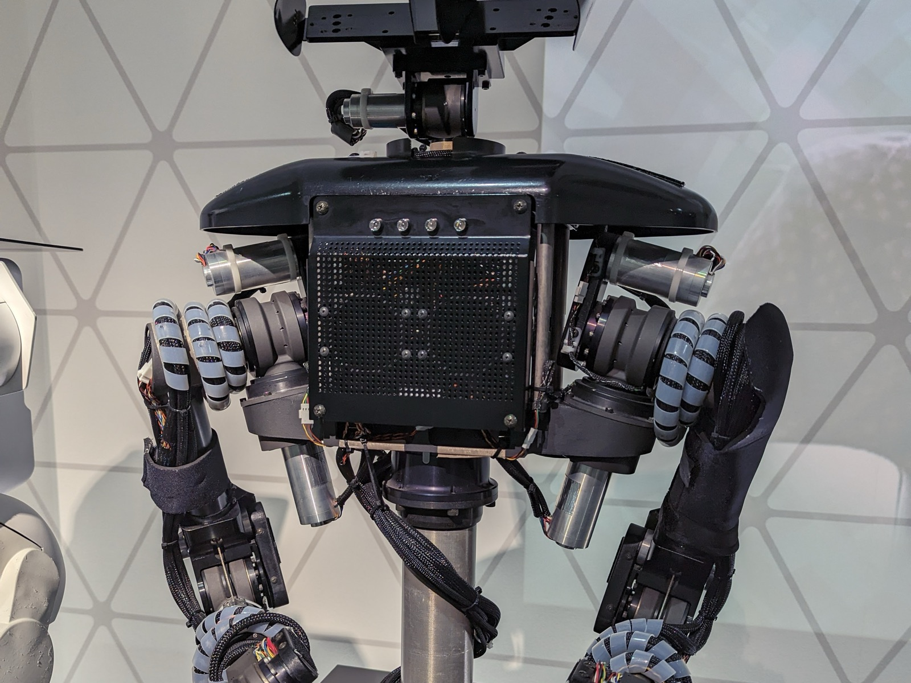

<!-- theme: ニュース型（IFR World Robotics 2026の発表（9月24日）、経済産業省 赤澤大臣の会見（6月30日）と同日の報道発表の本文を確認。Omdiaの人型ロボット出荷（TechNode）、UBTechの上半期（Asiabits）、ハーモニック・ドライブ・システムズ（日経クロステック要旨）、緑的諧波（36Kr Japan）、WSJ 11月24日のAIバブル記事（Oninvestの要約）） / 余り0 -->
# 人型ロボットの87%は中国製になった。日本は工場のロボットの導入台数でも米国に抜かれて3位。

2025年に世界で出荷された人型ロボットは、調査会社Omdiaの集計で1万3,317台でした。そのうち87%を、中国の会社が作っています。工場で使う産業用ロボットでも、日本の導入台数は前の年より19%減り、米国に抜かれて世界3位に下がりました。

一方で、米国ではAIへの投資ブームが崩れたらどうなるか、という記事が出始めています。それでも日本の経済産業省は、日本には「勝ち筋」があると言っています。数字と、国が書いた文章を開いて、どこに勝ち筋があるとされているのかを並べます。

## 人型ロボットは、ほとんど中国で作られている

Omdiaによると、2025年の人型ロボットの世界の出荷は1万3,317台で、前の年の約5.8倍でした。上位は中国の会社が占め、上海のAgiBot（智元）1社で5,168台、世界の39%を出しています。米国のテスラ、Figure AI、Agility Roboticsは、それぞれ約150台でした。

調査会社によって数字には幅があります。IDCは2025年の出荷を約1万8,000台と見ています。どちらの集計でも、中国の会社が大半を占めている点は同じです。

台数だけでなく、売上も決算に出始めています。

- 杭州のUnitree（宇樹科技）は、上場のための書類で、2025年の人型ロボットの出荷が5,500台を超えたと書いています
- 深圳のUBTech（優必選）は、2026年1〜6月に大型の人型ロボットを921台売り、その売上は約5億9,000万元でした（Asiabitsの分析）

## 工場のロボットでも、日本は3位に下がった

国際ロボット連盟（IFR）が9月24日に出した報告によると、2025年に世界の工場に新しく入った産業用ロボットは60万3,000台でした。

- 中国：35万4,000台。世界の59%で、前の年より20%増えた
- 米国：約3万8,500台。12%増えて2位に上がった
- 日本：3万6,219台。19%減って、2位から3位に下がった
- 韓国：約3万台で4位

中国の工場に入ったロボットのうち、中国の会社が作ったものは55%でした。中国の工場でも、まだ半分近くは海外製が使われていることになります。

IFRは日本について、ロボットの需要は少し増えるが、近いうちに大きく戻ることは考えにくい、と書いています。

## 米国では「AIバブルが崩れたら」という記事が出ている

11月24日、米ウォール・ストリート・ジャーナル（WSJ）が、AIへの投資ブームが崩れたら米国の経済はどうなるか、という記事を出しました。原文は有料のため、ここでは翌日に出た要約記事（Oninvest）から引きます。

- 英バークレイズのエコノミストの推計では、過去1年の米国の経済成長の25%はAI関連の支出によるもの
- 元FRB理事のジェレミー・スタイン氏は、崩れたときの打撃はドットコムバブルの崩壊より大きくなるほうに賭ける、と話している
- ハーバード大学のジェイソン・ファーマン氏は、株価が30%下がりデータセンターの建設が止まっても、それだけでは景気後退にはならないと見ている

WSJが心配しているのは、まだお金を生んでいないデータセンターへの借金と、株価です。人型ロボットや部品は、何台売れていくらになったかが、決算や出荷の集計に出ます。同じAIの話でも、数字の見え方が違います。

## 日本が持っているもの1：ロボットの関節の部品

人型ロボットの関節には、モーターの回転をゆっくり強い力に変える「減速機」という部品が入っています。その中でも、薄くて軽い「波動歯車減速機」は、日本のハーモニック・ドライブ・システムズが世界首位のシェアを持っています。

日経クロステック（9月1日）によると、同社の研究開発の責任者である矢田静華取締役は、AIで動かすロボット向けの部品の売上を、2030年度に2025年度の7倍にする見通しを示しました。人型ロボットの需要に合わせて、2026年夏から米国での生産を増やしています。

ただし、中国の会社が追い上げています。36Kr Japan（5月17日）によると、中国の緑的諧波（リーダードライブ）は波動歯車減速機で世界2位、中国では首位です。受注は2027年分まで埋まっていると話し、生産能力を年100万台規模に広げる計画です。2025年の純利益は前の年の2倍を超えました。

部品で勝てるのは、壊れにくさと精度で値段の差を説明できる間だけです。中国の部品が同じ品質に届けば、価格で押されます。

## 日本が持っているもの2：人が足りない現場のデータ

経済産業省は6月30日、「AIロボティクス戦略」の改訂版を公表しました。赤澤経済産業大臣は、同じ日の会見で次のように説明しています。

- 2040年のロボットの導入台数の目標を、約1,000万台とする
- 飲食・食品製造と医療を加え、合計18分野でロボットを現場に入れていく
- 高齢者のヘルスケア、災害対応、製造現場、福島第一原発の廃炉現場などで蓄積されたデータの活用が「我が国の勝ち筋」だ

同じ日の経産省の発表は、日本の幅広い産業の「現場データ」を使ってフィジカルAI（現実の世界で体を動かすAI）を作ることを、勝ち筋の1つとしています。そのために、現場のデータを国内で守りながら使える国産のAIの基盤を作るとして、Noetra社と産業技術総合研究所のグループを選びました。物流の業界紙LogiShiftによると、経産省はこの基盤に関わる予算として、2027年度に8,964億円を求めています。2026年度当初の3,873億円の2倍以上です。

国の考え方をまとめると、完成品の台数で中国と競うのではなく、人が足りない現場に先にロボットを入れ、そこで集まるデータでAIを鍛える、ということになります。高齢者の介護や廃炉のように、日本が世界より先に向き合っている現場があることが、その前提です。

## 現場を持つ会社が、今できること

国の戦略は、ロボットを作る会社だけの話ではありません。データを持っているのは、ロボットを使う現場の会社です。

- 人が足りない作業を書き出す。運ぶ、並べる、見回る、記録するなど、毎日同じ形でくり返している作業から選ぶ
- その作業の記録が残っているかを確かめる。作業の手順書、日報、監視カメラの映像、機械のログなど
- 国の導入支援を調べる。経産省は、ロボットを使う会社への導入支援を強めると言っています

ロボットを入れるかどうかを決める前でも、作業の記録は今日から残せます。

## まとめ

- 2025年の人型ロボットの世界の出荷は1万3,317台（Omdia）。そのうち87%は中国の会社が作った
- 産業用ロボットの導入台数でも、日本は19%減って世界3位に下がった（IFR）
- 米国では、AIへの投資ブームが崩れたときの打撃を心配する記事が出ている
- 日本が持っているのは、関節の部品（波動歯車減速機で世界首位）と、人が足りない現場のデータ
- 経産省は、2040年に約1,000万台のロボットを入れ、現場のデータを使うことを勝ち筋としている

人型ロボットの台数の競争は、今のところ中国が大きく先を行っています。それでも、ロボットの関節を作る会社と、ロボットに任せたい作業を毎日回している現場は、日本にあります。その現場のデータを、どこが先に使える形にするかで、この先の順位が決まっていくのだと思います。

## 出典

国際ロボット連盟（IFR）「Five million robots now operate in factories globally」（2026年9月24日、World Robotics 2026の発表）

https://ifr.org/ifr-press-releases/news/five-million-robots-now-operate-in-factories-globally

経済産業省「赤澤経済産業大臣の閣議後記者会見の概要」（2026年6月30日。AIロボティクス戦略の改訂）

https://www.meti.go.jp/speeches/kaiken/2026/20260630001.html

経済産業省「AIロボット・フィジカルAIを見据えたマルチモーダル基盤モデル開発事業」の発表（2026年6月30日）

https://www.meti.go.jp/press/2026/06/20260630005/20260630005.html

TechNode「China's AgiBot leads global humanoid robot shipments in 2025, Omdia says」（2026年1月9日／報道。Omdiaの集計）

https://technode.com/2026/01/09/chinas-agibot-leads-global-humanoid-robot-shipments-in-2025-omdia-says/

界面新闻（英語版）「IDC sees global humanoid robot shipments at about 18,000 units in 2025」（報道。IDCの推計とUnitreeの出荷）

https://en.jiemian.com/article/13925066.html

Asiabits「UBTech Starts Delivering 13,361 Humanoids at a Published Price」（2026年9月9日／分析。UBTechの上半期）

https://www.asiabits.com/insights/ubtech-delivers-13361-humanoids-published-price

日経クロステック「ハーモニック、AIロボ部品の売上高5年で7倍へ」（2026年9月1日／報道）

https://xtech.nikkei.com/atcl/nxt/column/18/03727/082100002/

36Kr Japan「ヒューマノイドが主役に：中国ハーモニック減速機大手、純利益2倍超の快走」（2026年5月17日／報道）

https://36kr.jp/493448/

LogiShift「経産省が27年度8964億円要求」（2026年9月2日／報道）

https://logishift.net/2026/09/02/post-8699/

Oninvest「Worse Than the Dot-Com Crash: How the Burst AI Bubble Threatens the U.S. Economy」（2026年11月25日／WSJの記事の要約）

https://en.oninvest.com/article/worse-than-the-dot-com-crash-how-the-burst-ai-bubble-threatens-the-u-s-economy

写真: Syced / CC0 / Wikimedia Commons

---

## 私たちについて

株式会社AIdollargameは、社内にセキュリティ担当がいない会社に代わって、その担当者の仕事を引き受けている会社です。悪質なハッカーと同じ手順で、サイト・メール・VPN機器に外から実際に入れるかを試し、見つけた穴を当社が塞ぎます。AIの研修と、自社で開発したAIの導入も支援しています。

- ホワイトハック（セキュリティ担当の代行）：外から入れるかを試し、見つけた穴を当社が直す。セキュリティを任せる社員を1人雇うより安く、月3万円から（税別）

https://aidollargame.com/security/?utm_source=note&utm_campaign=2026-11-27

- AI研修・社員リスキリング（助成金対象）：貴社の実際の仕事を教材に、翌日から仕事で使える状態にする研修

https://aidollargame.com/ai-training.html?utm_source=note&utm_campaign=2026-11-27

- AIチャットエージェント：問い合わせ対応・予約受付から社内マニュアルの参照まで、24時間自動で対応

https://aidollargame.com/line-ai-agent.html?utm_source=note&utm_campaign=2026-11-27

- AIwill（社長クローンAI）：経営者の判断の仕方をAIに学習させ、社員がいつでも参照できるようにする

https://aidollargame.com/human-clone-ai.html?utm_source=note&utm_campaign=2026-11-27

- AIside（付き人AI）：Gmail・カレンダー・Slackをまたいで、予定調整やメールの下書きを先回りで代行

https://aidollargame.com/aiside.html?utm_source=note&utm_campaign=2026-11-27

- AIコンサルティング・導入支援：何から手をつけるかの整理から、実装と運用まで

https://aidollargame.com/ai-consulting.html?utm_source=note&utm_campaign=2026-11-27

自社のサイトが外からどう見えるかは、ドメインを入れるだけで無料で調べられます。

https://whitehack.jp/?utm_source=note&utm_campaign=2026-11-27

- 公式サイト

https://aidollargame.com/?utm_source=note&utm_campaign=2026-11-27

- ご相談：info@aidollargame.com

このnoteでは、AI活用のリアルや時事の読み解きを、過程まで含めて正直に発信しています。フォローしてもらえると嬉しいです。

---

ハッシュタグ（noteで付けたもの）：#生成AI #中国 #ロボット #製造業 #フィジカルAI #深圳 #人型ロボット

サムネ文言案：
1. 人型ロボットの87%は中国製。日本の勝ち筋は
2. 関節の部品と、人が足りない現場のデータ
